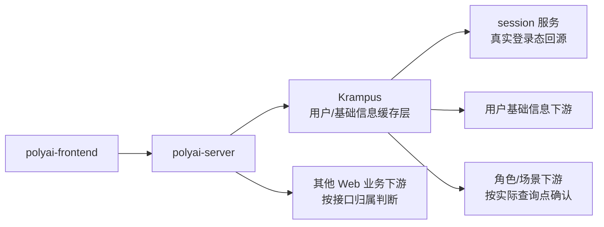
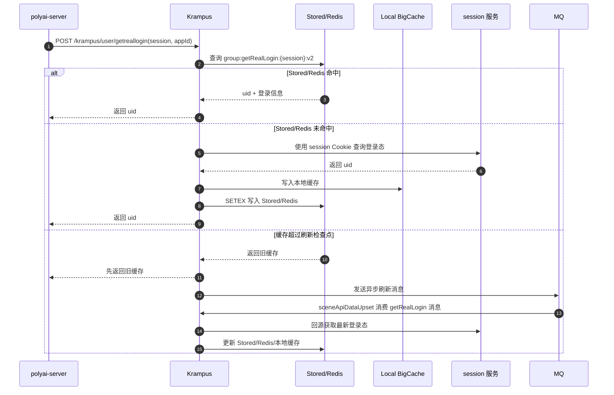

# 底层服务缓存机制

> 本文用于梳理 PolyWeb 底层基础信息缓存，当前以 Krampus 的用户登录态、用户信息、角色/场景信息缓存为主。后续可继续补充各业务服务自己的缓存关系。

## 1. 核心结论

对 Web 来说，`polyai-server` 是统一的 Web BFF/API 入口。用户登录态和用户基础信息相关请求，通常由 `polyai-server` 负责鉴权和编排，并通过 Krampus 获取或缓存；角色/场景信息则需要根据具体业务查询点判断是否经过 Krampus。

Krampus 本身是面向基础信息的缓存层/聚合层，主要用于降低底层 `session`、用户服务、角色服务被直接打爆的风险。它不是需要在每条 Web 业务链路中都单独展开的下游服务。

当前已确认的真实登录态链路是：

```text
polyai-frontend
    ↓ Web API
polyai-server
    ↓ /krampus/user/getreallogin
Krampus
    ↓ 命中缓存：直接返回
    ↓ 未命中：回源 session 服务
session 服务
    ↓ 返回 uid
Krampus 写入本地缓存 + Stored/Redis
```

判断一个请求是否需要经过 Krampus，不能只看“是不是 PolyWeb 请求”，而要看数据归属：

| 数据类型 | 通常应关注的服务 | 是否默认经过 Krampus |
|---|---|---|
| 数据类型 | Web 侧主要入口 | 是否经过 Krampus |
|---|---|---|
| 真实登录态 `session -> uid` | `polyai-server -> Krampus` | 当前灰度链路是 |
| Web 游客 `cuid -> fake user` | `polyai-server -> Krampus` | 是 |
| 用户基础信息 | `polyai-server -> Krampus` 或具体业务服务 | 以实际接口实现为准 |
| 角色/场景基础信息 | `polyai-server` 代理的具体业务接口 | 以实际查询点为准 |
| 会话、消息、历史记录 | `polyai-server` 代理到对应对话服务 | 不因是用户请求就默认经过 Krampus |
| 会员、订单、权益、社区互动 | `polyai-server` 代理到对应业务服务 | 不因是用户请求就默认经过 Krampus |

## 2. PolyWeb 相关服务关系

### 2.1 Web BFF 与基础信息缓存边界



### 2.2 请求是否经过 Krampus 的判断方法

针对 Web 请求，按以下顺序判断：

1. 先定位 `polyai-server` 的 Web 路由、Controller 或代理配置。
2. 用户信息相关请求，确认是否由 `polyai-server` 调用 `api_krampus.NewClient(ctx)`。
3. 角色/场景信息相关请求，继续定位实际查询点：可能走 Krampus，也可能直接走角色/场景业务服务。
4. 如果接口进入 Krampus，再确认对应接口是否配置了 Avalanche `NewGroup`；只有进入具体 Group 的接口，才具备本文描述的缓存行为。
5. 不要仅凭请求中存在 uid/session，就推断该请求经过 Krampus。

当前本文聚焦 Web 侧的判断：`polyai-server` 是 Web 用户请求的 BFF/API 入口；用户信息链路重点看 `polyai-server -> Krampus`。其他业务下游不在本节展开，除非后续发现它们存在需要单独记录的 Krampus 缓存关系。

## 3. Avalanche 防雪崩机制如何注入

Krampus 在启动时通过 `InitGroups` 创建缓存 Group。以真实登录态为例：

```go
func InitGroups(engine *gin.Engine, config *conf.TApi, srv Service) *Groups {
    avalanche.Init(engine)

    return &Groups{
        GetRealLoginGroup: avalanche.NewGroup[
            *dtouser.GetRealLoginReq,
            session.GetRealLoginRes,
            string,
        ](
            helpers.BffMyStoredClient,
            defines.GroupNameUserRealLogin,
            helpers.UserAvalanche,
            getter,
            keys,
            avalanche.WithGroupVersion("v2"),
            avalanche.WithGroupCacheGetSet(300, 50),
            avalanche.WithGroupCacheTime(24*time.Hour),
            avalanche.WithGroupCacheRandTime(2*time.Hour),
            avalanche.WithGroupUpset(
                defines.RmqServiceSceneApiCheck,
                30*time.Minute,
            ),
        ),
    }
}
```

`NewGroup` 的几个核心注入点：

| 注入项 | 作用 |
|---|---|
| `helpers.BffMyStoredClient` | Stored/Redis 缓存客户端，负责远端缓存读写 |
| `defines.GroupNameUserRealLogin` | 缓存分组名，也作为 MQ 更新分组标识 |
| `helpers.UserAvalanche` | 当前进程的本地 BigCache |
| `getter` | 缓存未命中后的回源函数 |
| `keys` | 计算缓存 Key 和业务 ID |
| `WithGroupVersion("v2")` | 缓存版本隔离，防止旧版本 Key 污染新逻辑 |
| `WithGroupCacheGetSet(300, 50)` | 一次最多读取 300 个 Key、写入 50 个 Key |
| `WithGroupCacheTime` | Stored/Redis 缓存基础 TTL |
| `WithGroupCacheRandTime` | TTL 随机抖动，避免同一时刻集中失效 |
| `WithGroupUpset` | 旧缓存异步刷新所使用的 MQ 服务和刷新周期 |

注意：MQ 并不写在泛型参数中，而是通过 `WithGroupUpset` 这个 `GroupOption` 注入。

## 4. GetRealLogin 的完整机制

### 4.1 polyai-server 读取登录态

`polyai-server` 的 `middleware.GetRealLogin` 先根据灰度开关选择链路：

- 命中登录灰度：读取 `session` Cookie，调用 `api_krampus.NewClient(ctx).GetRealLogin`；
- 未命中登录灰度：调用旧的 passport 链路。

因此 Krampus 真实登录缓存并不是所有请求都会使用，当前受 `LoginGray` 灰度逻辑控制。

### 4.2 Krampus 接口查询缓存

Krampus 路由：

```text
POST /krampus/user/getreallogin
```

Controller 调用：

```go
cacheResults, err := r.cacheGroups.GetRealLoginGroup.Get(ctx, &param)
```

### 4.3 两个回调函数

#### 回源函数

```go
func(ctx *gin.Context, req *dtouser.GetRealLoginReq, ids []string) (
    res map[string]session.GetRealLoginRes,
    err error,
) {
    ret, err := srv.GetRealLogin(ctx, *req)
    return map[string]session.GetRealLoginRes{
        req.Session: ret,
    }, err
}
```

职责：

- 仅在缓存未命中时执行；
- 调用 session 服务查询真实登录态；
- 返回 `session -> uid`；
- Avalanche 使用返回值回填本地缓存和 Stored/Redis。

当前实现虽然保留了 `ids []string` 批量参数，但实际只使用 `req.Session` 回源，当前 `GetRealLogin` 一次只查询一个 session。

#### Key 函数

```go
func(ctx *gin.Context, req *dtouser.GetRealLoginReq) (
    cacheKeys []string,
    sessionKeys []string,
    err error,
) {
    return []string{
        cache.BuildUserLoginAvalancheKey(req.Session),
    }, []string{
        req.Session,
    }, nil
}
```

职责：

- `cacheKeys`：用于拼接最终缓存 Key；
- `sessionKeys`：作为回源结果的业务 ID；
- 当前两者值都等于 `req.Session`。

最终缓存 Key 形态为：

```text
group:getRealLogin:{session}:v2
```

### 4.4 读写时序



### 4.5 MQ 异步刷新链路

`GetRealLogin` 的 MQ 消息只携带待刷新的 session 和原始请求参数，不携带 uid 或完整登录态数据。消费者收到消息后，仍然需要重新请求真实数据源，再将结果写回缓存(自产自销)。

```text
缓存命中但 CacheTime 超过 30 分钟
    ↓
Avalanche 发送刷新消息
    service: sceneApiCheck
    topic: hire_krampus_api_data_check
    tag: getRealLogin
    body: { IDs: [session], Req: { session, appId } }
    ↓
Krampus 消费者 service: sceneApiDataUpset
    ↓
router/mq.go: sceneApiDataUpset()
    ↓
case getRealLogin
    ↓
userGroups.GetRealLoginGroup.Update(ctx, upset.Req, upset.IDs)
    ↓
重新执行 Group 初始化时注入的 getter
    ↓
srv.GetRealLogin(ctx, *req)
    ↓
session 服务 POST /session/api/getlogin
    ↓
写回本地 BigCache + Stored/Redis
```

关键配置关系：

| 项目 | 配置/代码 | 作用 |
|---|---|---|
| MQ 发送服务 | `sceneApiCheck` | Avalanche 发送异步刷新消息时使用的 service 名称 |
| MQ topic | `hire_krampus_api_data_check` | 角色接口和该用户登录态刷新消息使用的 topic |
| 消息 tag | `getRealLogin` | 对应 `defines.GroupNameUserRealLogin`，用于区分缓存 Group |
| MQ 消费服务 | `sceneApiDataUpset` | `resource.yaml` 中的 consumer service |
| 消费函数 | `router/mq.go` 的 `sceneApiDataUpset` | 按 tag 找到具体 Group 并调用 `Update` |
| 真实数据源 | `session` 服务 `/session/api/getlogin` | 根据 session Cookie 和 appId 获取最新登录态 |

`Update` 的执行过程不是直接把 MQ 内容写入缓存，而是：

1. 解析 MQ 消息中的 `Req` 和 `IDs`。
2. 调用 `GetRealLoginGroup.Update`。
3. Avalanche 重新执行该 Group 初始化时注入的 getter。
4. getter 调用 `srv.GetRealLogin`。
5. `srv.GetRealLogin` 调用 `session` 服务的 `/session/api/getlogin`。
6. 获取成功后，Avalanche 将结果写入 Stored/Redis 和当前实例的本地 BigCache。

因此，MQ 负责的是“异步触发刷新”，不是数据源。真实登录态的最终来源仍然是 session 服务。

需要额外核对线上 MQ 订阅配置：代码中 `sceneApiDataUpset` 已处理 `getRealLogin` tag，但当前仓库的 `resource.yaml` 标签列表主要列出了角色相关 tag，未显式列出 `getRealLogin`。如果线上配置与仓库一致，需要确认 RocketMQ 的 tag 订阅表达式是否包含该 tag，否则可能出现消息已发送但消费者未订阅的情况。

## 5. 防雪崩手段拆解

### 5.1 Stored/Redis + 本地缓存双层保护

- Stored/Redis：跨实例共享缓存；
- BigCache：单实例本地兜底；
- Stored/Redis 熔断时优先读取本地缓存。

### 5.2 TTL 随机抖动

真实登录态配置为：

```text
基础 TTL：24 小时
随机 TTL：0～2 小时
```

目的：避免大量 Key 同时过期，形成集中回源。

### 5.3 旧缓存异步刷新

缓存超过 30 分钟后，命中旧值的请求仍然可以快速返回，同时通过 MQ 异步刷新，不让用户请求同步等待回源。

### 5.4 Sentinel 熔断

当 Stored/Redis 访问异常时，Group 进入熔断分支，使用本地缓存兜底，避免故障继续扩大。

### 5.5 分批读写

`WithGroupCacheGetSet(300, 50)` 是框架的批量能力：

- 一次 `Group.Get` 如果返回多个 Key，最多每 300 个 Key 执行一次批量读取；
- 回填缓存时每 50 个 Key 执行一次批量写入。

它不是线程数，也不是把多个 HTTP 请求合并成一个请求。当前 `GetRealLogin` 的 Key 函数只返回一个 session，因此当前场景实际通常只查一个 Key。

### 5.6 当前机制的边界

这套机制对“缓存集中到期”有较完整的防护，但当前 `GetRealLogin` 的冷 Key 回源函数是单 session 查询，源码中未确认存在针对同一冷 Key 的全局 singleflight。需要继续结合线上流量和 Avalanche 版本实现确认：

- 同一个 session 首次并发请求时，是否可能多个实例同时回源；
- Stored/Redis 故障且本地缓存没有数据时，是否存在同步击穿；
- 回源错误是否会缓存空值或短期负缓存。

## 6. Krampus 与其他服务的关系

### 6.1 应该优先走 Krampus 的情况

- 真实登录态 `session -> uid`；
- Web 游客 `cuid -> fake user`；
- 高频、只读、基础性的用户信息；
- 高频、只读、基础性的角色/场景信息；
- 已经明确配置了 Krampus Avalanche Group 的接口。

### 6.2 不应默认走 Krampus 的情况

- 会话和消息历史：优先看 `speakmsg`；
- 对话编排和生成：优先看 `speakbffchat`、`muse`；
- 会员、商品、订单、支付：优先看 `speakvip` 或支付服务；
- 社区关系、评论、互动：优先看 `speakcommunity`；
- 复杂写操作：应回到实际数据归属服务，不应把 Krampus 当作通用写入代理。

### 6.3 为什么需要 Krampus

Krampus 的价值不是“替所有服务缓存”，而是把跨页面、高频、低变化的基础信息读取集中治理：

```text
多个 Web 业务入口
    ↓
同一份用户/角色基础数据
    ↓
Krampus 统一缓存、熔断、异步刷新
    ↓
降低 session / speakaccount / speakscene 等底层服务压力
```

## 7. 已确认源码证据

| 结论 | 仓库 | 文件 | 证据 |
|---|---|---|---|
| polyai-server 灰度命中后调用 Krampus GetRealLogin | polyai-server | `middleware/session.go` | L1 |
| Krampus 接口通过 Group.Get 读真实登录态 | krampus | `controllers/user/resource.go` | L1 |
| GetRealLogin Group 注入回源函数和 Key 函数 | krampus | `controllers/user/avalanche.go` | L1 |
| 回源实际调用 session 服务 | krampus | `controllers/user/service.go`、`api/session/client.go` | L1 |
| 缓存未命中后写本地缓存和 Stored/Redis | sentinel-hire | `avalanche/getter.go` | L1 |
| 缓存超过检查点后发送刷新 MQ | sentinel-hire | `avalanche/getter.go` | L1 |
| MQ 消费后调用 Group.Update | krampus | `router/mq.go` | L1 |
| 登出删除真实登录态缓存 | polyai-server / krampus | `service/sv_user/logout.go`、`controllers/tool/rsource.go` | L1 |

## 8. 后续补充方向

本文后续优先补充以下内容：

1. `polyai-server` 各路由/代理目标与 Krampus 的调用关系。 
2. Avalanche 的冷 Key 并发击穿、空值缓存、错误重试和本地缓存淘汰策略。

## 9. 参考文档

- [PolyWeb 服务依赖图](../overview/service-dependency.md)
- [PolyWeb 服务目录](../services/service-index.md)
- [PolyWeb 全链路梳理方案](../web-fullstack-chain-documentation-plan.md)
