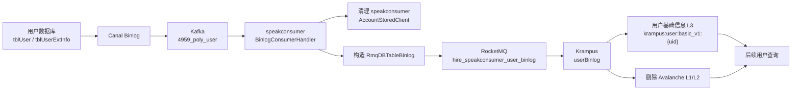
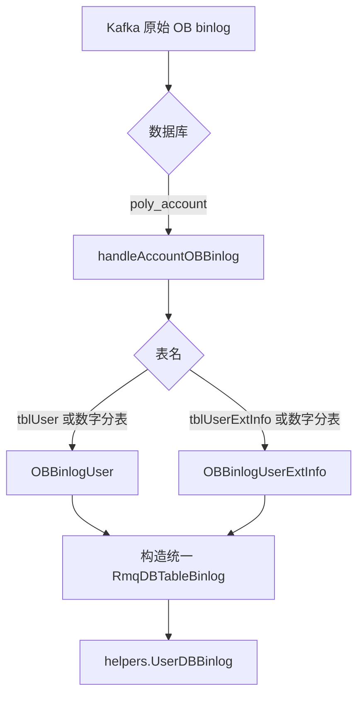
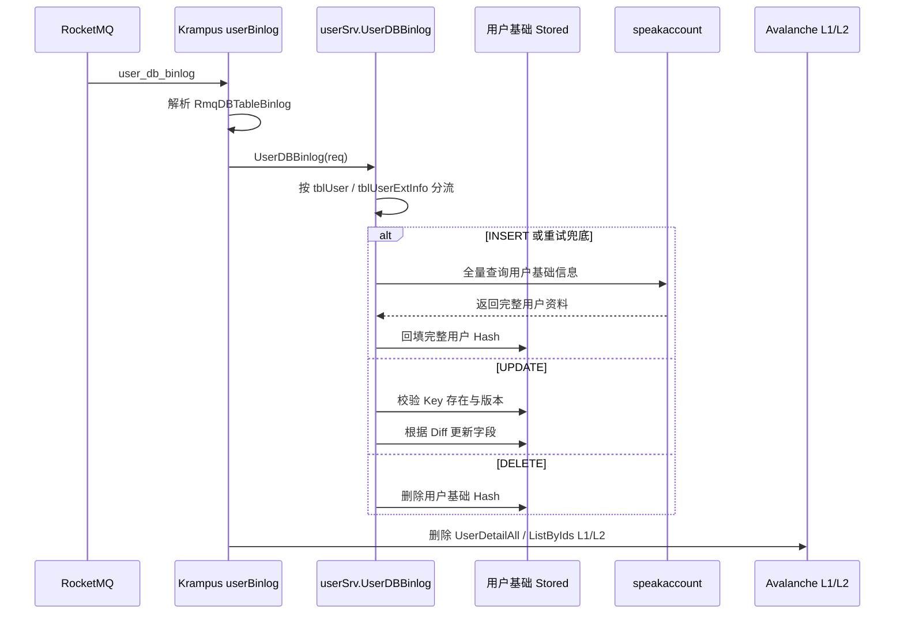

# 用户基础信息 Binlog 到 Krampus

> 本文是《底层服务缓存机制》的补充，聚焦 `tblUser`、`tblUserExtInfo` 两张用户基础信息表，梳理数据库变更经过 `speakconsumer`、Kafka、RocketMQ，最终同步到 Krampus 的用户基础信息 Stored，并触发 Avalanche 接口缓存失效。

## 1. 总体链路

```text
用户数据库变更
    ↓
Canal Binlog → Kafka（当前重点：4959_poly_user）
    ↓
speakconsumer
    ├─ 清理自身 AccountStoredClient
    └─ 转换为 RmqDBTableBinlog
            ↓
        RocketMQ：hire_speakconsumer_user_binlog
            ↓
        Krampus：userBinlog
            ├─ 更新用户基础信息 L3 Stored
            └─ 删除 Avalanche L1/L2
```



核心结论：`speakconsumer` 负责“接收、识别、转换、转发”，Krampus 负责“更新用户基础信息 Stored、失效接口缓存”。

## 2. speakconsumer：从 Kafka 到 RocketMQ

### 2.1 Kafka 入口和表路由

当前 OB Kafka 配置：

```yaml
kafkasub:
  speakconsumer_ob:
    topic:
      - 4959_poly_user
    group: speakconsumer_ob_group
```

处理流程：



关键位置：

- Kafka 消费注册：[speakconsumer/router/mq.go:101](/Users/zyb/GolandProjects/speakconsumer/router/mq.go:101)
- OB 消费入口：[ob_binlog.go:21](/Users/zyb/GolandProjects/speakconsumer/controllers/mq/kafka_consumer/ob_binlog.go:21)
- 数据库路由：[ob_binlog.go:62](/Users/zyb/GolandProjects/speakconsumer/controllers/mq/kafka_consumer/ob_binlog.go:62)
- 用户表路由：[ob_binlog.go:107](/Users/zyb/GolandProjects/speakconsumer/controllers/mq/kafka_consumer/ob_binlog.go:107)

代码仍保留 MySQL 的 `BinlogConsumerHandler` 路径，但 `poly_account` 用户表 MySQL 事件已做退役处理，生产环境重点关注 `4959_poly_user` 的 OB 路径。

### 2.2 speakconsumer 的两项工作

| 动作 | 作用 | 目标 |
|---|---|---|
| 清理自身缓存 | 删除用户表对应的旧缓存 | `AccountStoredClient` |
| 转发标准事件 | 发送统一的用户 binlog 消息 | RocketMQ |

`tblUser` 和 `tblUserExtInfo` 的 `UPDATE`、`DELETE` 会按 uid 清理自身用户缓存；`INSERT` 通常不清理旧缓存。这一步清理的是 `speakconsumer` 使用的缓存，不是 Krampus 的用户基础信息 L3。

### 2.3 标准化消息

统一消息类型是：

```go
libdefines.RmqDBTableBinlog
```

| 字段 | 含义 |
|---|---|
| `Table` | 原始表名，例如 `tblUser12`、`tblUserExtInfo5` |
| `Type` | `I`、`U`、`D`，表示新增、更新、删除 |
| `ID` | 用户 uid |
| `Diff` | INSERT 通常为完整新值，UPDATE 为变化字段，DELETE 为空 |
| `Version` | binlog 版本，用于防止旧消息覆盖新消息 |
| `VersionType` | MySQL 或 OceanBase 版本类型 |

```text
INSERT：ID=NEWVALUES["uid"]，Diff=NEWVALUES
UPDATE：ID=NEWVALUES["uid"]，Diff=b.diff(ctx)
DELETE：ID=OLDVALUES["uid"]，Diff=空
```

发送函数：[speakconsumer/helpers/rmq.go:236](/Users/zyb/GolandProjects/speakconsumer/helpers/rmq.go:236)

```text
topic: hire_speakconsumer_user_binlog
tag: user_db_binlog
group: hire_krampus_user_binlog
```

同一个 uid 会作为 MQ 分片 Key；当 `IDStr` 为空时使用 uid，尽量保证同一用户的消息进入同一分片。

## 3. Krampus：消费并更新用户基础信息

Krampus 消费配置：

```yaml
- service: userBinlog
  topic: hire_speakconsumer_user_binlog
  group: hire_krampus_user_binlog
  tags:
    - user_db_binlog
```

消费者入口：[krampus/router/mq.go:588](/Users/zyb/GolandProjects/krampus/router/mq.go:588)



分流代码：[krampus/internal/user/service.go:151](/Users/zyb/GolandProjects/krampus/internal/user/service.go:151)

```text
tblUser / tblUserExtInfo
    ↓
userBasicUpset
    ↓
更新用户基础信息 Stored
```

## 4. 两张表与用户基础 Stored 的关系

两张表共用一个用户基础信息 Hash：

```text
krampus:user:basic_v1:{uid}
    ├─ tblUser 字段
    ├─ tblUserExtInfo 字段
    ├─ _v        （tblUser MySQL 版本）
    ├─ _v_ext    （tblUserExtInfo MySQL 版本）
    ├─ _v_ob     （tblUser OB 版本）
    └─ _v_ext_ob （tblUserExtInfo OB 版本）
```

Key 定义：[krampus/defines/stored.go:23](/Users/zyb/GolandProjects/krampus/defines/stored.go:23)

```text
tblUser        → _v / _v_ob
tblUserExtInfo → _v_ext / _v_ext_ob
```

共享 Key、独立版本字段，解决两张表的 binlog 到达顺序不同导致的版本冲突。

## 5. Krampus 对三种操作的处理

### 5.1 INSERT：全量回源

```text
INSERT binlog
    ↓
userBasicUpset
    ↓
调用 speakaccount 全量查询
    ↓
写入 krampus:user:basic_v1:{uid}
```

INSERT 不直接依赖单张表的 binlog 字段，因为两张表合并后的完整用户资料无法由单表 INSERT 保证。

### 5.2 UPDATE：按 Diff 增量写入

```text
UPDATE binlog
    ↓
读取 Stored 中对应表的版本字段
    ↓
Key 不存在：丢弃，保护冷数据
    ↓
版本不是最新：丢弃，防止 MQ 乱序旧覆新
    ↓
版本更新：HMSet 变化字段，并续期
```

### 5.3 DELETE：删除用户基础 Stored

```text
DELETE binlog
    ↓
检查 krampus:user:basic_v1:{uid}
    ↓
存在：删除
不存在：忽略
```

核心实现：[krampus/internal/user/service_userbasic.go:31](/Users/zyb/GolandProjects/krampus/internal/user/service_userbasic.go:31)

## 6. 为什么更新 L3 后还要删除 Avalanche L1/L2


Krampus 的 `userBinlog` 会删除：

```text
UserDetailAllGroup
ListByIdsGroup
```

不会删除 `GetRealLoginGroup`，因为：

```text
GetRealLoginGroup：session -> uid
用户基础信息缓存：uid -> 用户资料
```

两者的业务维度和缓存 Key 不同。

## 7. 与 Web 查询的关系

```text
polyai-frontend
    ↓
polyai-server
    ↓
Krampus UserDetailAll / ListByIds
    ↓ miss
用户基础信息 L3 Stored
    ↓ miss
speakaccount 回源
```

binlog 的目标是：

```text
数据库资料变更
    ↓
更新或删除 L3
    ↓
失效 L1/L2
    ↓
Web 后续请求拿到新资料
```

## 8. 需要重点关注的异常点

### 8.1 Kafka 到 RocketMQ 的转发失败

需要确认 `speakconsumer` 是否存在统一补偿机制，否则可能出现：

```text
Kafka 消费成功
    ↓
speakconsumer 清理自身缓存
    ↓
转发 Krampus RocketMQ 失败
    ↓
Krampus 没有收到用户基础信息更新
```

### 8.2 两张表的消息乱序

当前降低乱序风险的机制：

- 同一 uid 使用相同 MQ 分片 Key；
- 两张表使用独立版本字段；
- Krampus 更新前比较 binlog version；
- 旧版本消息不会覆盖新版本数据。

### 8.3 L3 更新成功但 L1/L2 删除失败

排查时分别确认：

```text
L3 UserStoredClient 写入结果
UserDetailAllGroup.Del 结果
ListByIdsGroup.Del 结果
```

## 9. 关键代码索引

| 环节 | 文件 |
|---|---|
| Kafka MySQL binlog 入口 | [speakconsumer/controllers/mq/kafka_consumer/binlog.go](/Users/zyb/GolandProjects/speakconsumer/controllers/mq/kafka_consumer/binlog.go) |
| Kafka OB binlog 入口 | [speakconsumer/controllers/mq/kafka_consumer/ob_binlog.go](/Users/zyb/GolandProjects/speakconsumer/controllers/mq/kafka_consumer/ob_binlog.go) |
| `tblUser` 转换与发送 | [speakconsumer/controllers/mq/kafka_consumer/user.go](/Users/zyb/GolandProjects/speakconsumer/controllers/mq/kafka_consumer/user.go) |
| `tblUserExtInfo` 转换与发送 | [speakconsumer/controllers/mq/kafka_consumer/user_ext.go](/Users/zyb/GolandProjects/speakconsumer/controllers/mq/kafka_consumer/user_ext.go) |
| RocketMQ 用户 binlog 发送 | [speakconsumer/helpers/rmq.go](/Users/zyb/GolandProjects/speakconsumer/helpers/rmq.go) |
| Krampus MQ 消费入口 | [krampus/router/mq.go](/Users/zyb/GolandProjects/krampus/router/mq.go) |
| Krampus 用户 binlog 分流 | [krampus/internal/user/service.go](/Users/zyb/GolandProjects/krampus/internal/user/service.go) |
| Krampus 用户基础信息写入 | [krampus/internal/user/service_userbasic.go](/Users/zyb/GolandProjects/krampus/internal/user/service_userbasic.go) |
| Krampus 用户缓存 Key | [krampus/defines/stored.go](/Users/zyb/GolandProjects/krampus/defines/stored.go) |

