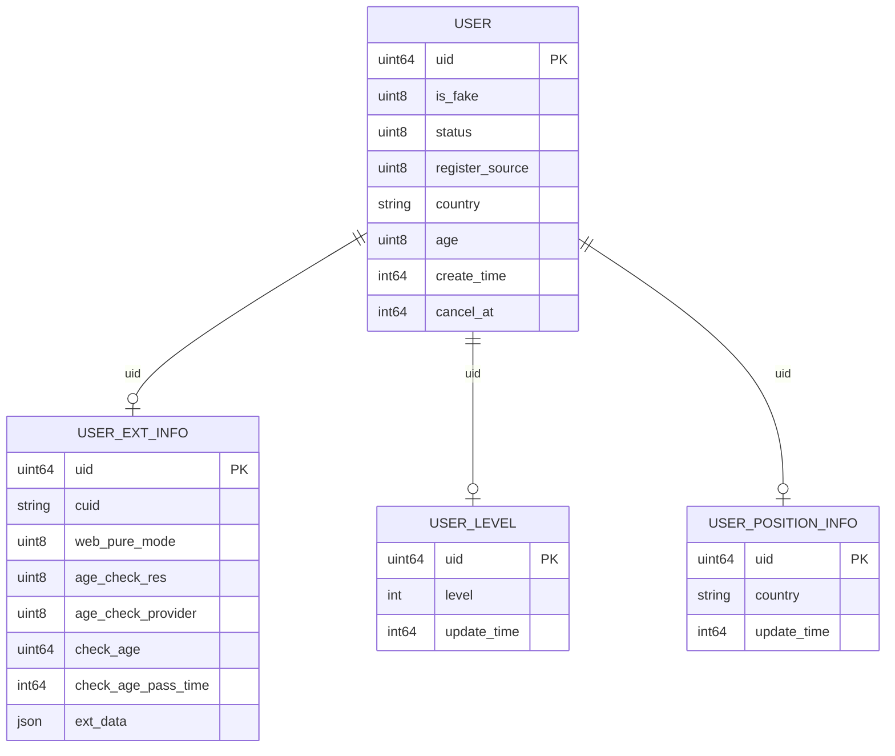
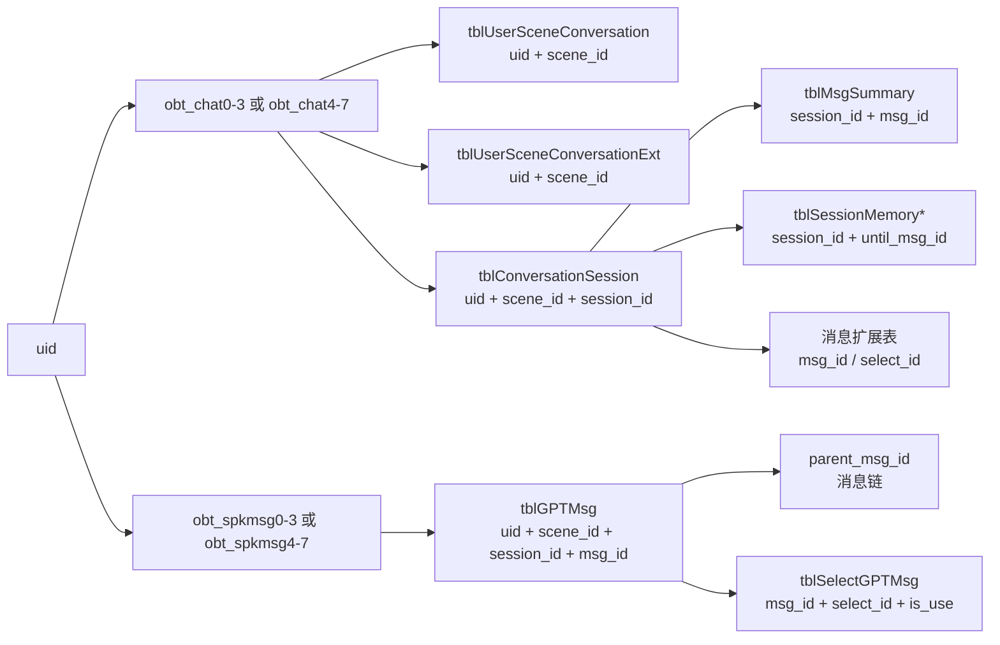

# 用户与对话：业务表、分库分表与代码归类

> 范围：Web 用户与身份、对话与 AI 生成。
>
> 本文只记录源码能够确认的业务表、线上库名、分库分表规则、关键字段和代码归类。权限体系、DBA 线上操作规范、SQL 查询手册暂不纳入。

## 1. 线上数据库总览

以下是当前 Web 业务使用的线上库名。源码中的连接名与线上库名不完全同名，因此同时记录“业务库名”和“代码连接/路由名”，避免把逻辑连接名误当成物理库名。

| 线上库名 | 业务范围 | 代码中的连接或路由 | 当前结论 |
|---|---|---|---|
| `obt_scene` | 角色、场景、推荐所依赖的场景数据 | `polyai-server` 的 scene 相关服务/下游场景服务 | 用户与对话只通过 `scene_id` 引用，本文不展开场景表 |
| `obt_hireuser` | 用户主资料、用户扩展资料及用户侧配置 | `speakaccount` 的 `poly_account` / 用户模型 | 用户域核心库；表按 UID 路由的结论以模型和分表 Router 为准 |
| `obt_chat0-3` | 用户-角色会话、会话扩展、会话容器等 | `speakmsg` 的 `polyhirechat0-7`，线上按 0-3、4-7 展示 | `ChatOceanBaseDB`，按 UID 对应 0-7 集群 |
| `obt_chat4-7` | 用户-角色会话、会话扩展、会话容器等 | `speakmsg` 的 `polyhirechat0-7`，线上按 0-3、4-7 展示 | 与 `obt_chat0-3` 同一类表，按 UID 落到具体集群 |
| `obt_spkmsg0-3` | 主消息、历史消息、候选消息、消息扩展 | `speakmsg` 的 `obspeakmsg0-7`，线上按 0-3、4-7 展示 | `SpeakmsgOceanBaseDB`，按 UID 对应 0-7 集群 |
| `obt_spkmsg4-7` | 主消息、历史消息、候选消息、消息扩展 | `speakmsg` 的 `obspeakmsg0-7`，线上按 0-3、4-7 展示 | 与 `obt_spkmsg0-3` 同一类表，按 UID 落到具体集群 |

### 1.1 名称映射说明

`speakmsg` 当前源码配置使用 `polyhirechat0`～`polyhirechat7`、`obspeakmsg0`～`obspeakmsg7` 作为连接名；本文将其归并到线上使用的 `obt_chat0-3`、`obt_chat4-7`、`obt_spkmsg0-3`、`obt_spkmsg4-7`。源码仓库没有出现 `obt_*` 这组线上别名，因此别名映射来自当前线上库名约定，不把它当成代码中的 DSN 名称。

## 2. 分库分表总规则

### 2.1 对话表的 UID 路由

`speakmsg` 的对话表不是按 `scene_id` 或 `session_id` 选库，而是以 `uid` 为分片键：

```text
cluster = uid % 8
```

会话类表使用 `ChatOceanBaseDB[cluster]`；消息、历史、摘要、记忆和扩展表按具体 Repository 使用不同 DB map，详细归类见“对话与 AI 生成”章节。一次聊天虽然都以 `uid` 为核心分片键，但不代表所有表进入同一个库连接或同一个事务。

### 2.2 对话物理表名

使用 `speakmsg/models/base.go` 的 `ShardingTableName(uid, logicalTable)`：

```text
tableSuffix = ((uid / 8) % 128) + ((uid % 8) * 128)
physicalTable = logicalTable + tableSuffix
```

因此逻辑表 `tblGPTMsg` 会变成 `tblGPTMsg0`～`tblGPTMsg1023`，逻辑表 `tblConversationSession` 会变成对应后缀的 `tblConversationSession0`～`tblConversationSession1023`。物理库由 UID 的 `uid % 8` 选择，物理表由上述公式选择。

### 2.3 用户资料表的 UID 分表

`speakaccount` 用户模型中，`tblUser`、`tblUserExtInfo` 等以 UID 作为业务定位键；用户侧分表 Router 负责把逻辑表映射到实际分表。用户库与对话库是两套独立的数据域：

```text
用户资料：uid -> obt_hireuser -> tblUser / tblUserExtInfo / ...
对话数据：uid -> obt_chat* 或 obt_spkmsg* -> 逻辑表 + 物理后缀
```

不要因为这些表都含有 `uid`，就认为它们处于同一个数据库事务中。

## 3. 用户与身份：核心表代码归类

### 3.1 用户主资料

| 逻辑表 | 核心字段 | 代码归类 | 主要功能 | 源码证据 |
|---|---|---|---|---|
| `tblUser` | `uid`、`is_fake`、`status`、`register_source`、`country`、`age`、`gender`、`create_time`、`cancel_at` | `speakaccount/models/user/User` | 真实用户和虚拟用户的基础资料、注册来源、注销状态、基础年龄性别信息 | `speakaccount/models/user/user.go` |
| `tblUserExtInfo` | `uid`、`cuid`、`pure_mode`、`web_pure_mode`、`age_check_res`、`age_check_provider`、`check_age`、`check_age_pass_time`、`ext_data` | `speakaccount/models/userextinfo/Model` | CUID 绑定、Web 配置、年龄校验结果、用户扩展数据 | `speakaccount/models/userextinfo/userextinfo.go` |
| `tblUserLevel` | `uid`、等级及积分相关字段 | `speakaccount/models/userlevel/UserLevel` | 用户等级；用户详情聚合时与用户主资料、扩展资料一起读取 | `speakaccount/models/userlevel/userlevel.go` |
| `tblUserPositionInfo` | `uid`、位置/国家相关字段 | `speakaccount/models/userposition/UserPositionInfo` | 用户位置资料；用户详情批量聚合的一部分 | `speakaccount/models/userposition/user_position_info.go` |
| `tblUserConfig` | `uid`、配置项 | `speakaccount/models/userconfig/UserConfig` | 用户配置 | `speakaccount/models/userconfig/userconfig.go` |

`tblUser` 与 `tblUserExtInfo` 不是一张表：登录态详情、首次注册/初始化和年龄结果写回，通常需要分别读取或更新主资料与扩展资料。`speakaccount/controllers/user/service.go` 的用户详情聚合代码明确将 `tblUser`、`tblUserExtInfo`、`tblUserLevel`、`tblUserPositionInfo` 合并成一个 Web 用户结果。

### 3.2 用户表分表规则

| 表 | 分表键 | 分表数量 | 物理表名 | 代码证据 |
|---|---|---:|---|---|
| `tblUser` | `uid` | 64 | `tblUser{uid % 64}` | `speakaccount/internal/user/repository/sharding/router.go`、`user.go` |
| `tblUserExtInfo` | `uid` | 64 | `tblUserExtInfo{uid % 64}` | `sharding/router.go`、`userextinfo.go` |
| `tblFakeUser` | `cuid` | 64 | `tblFakeUser{CRC32(cuid) % 64}` | `sharding/router.go`、`fakeuser.go` |
| `tblUserLevel` | 无源码分表键 | 当前为逻辑表名 | `tblUserLevel` | `models/userlevel/userlevel.go` 返回固定表名 |
| `tblUserPositionInfo` | 无源码分表键 | 当前为逻辑表名 | `tblUserPositionInfo` | `models/userposition/user_position_info.go` 返回固定表名 |

用户主资料和扩展资料都使用 UID 分表；游客虚拟用户是例外，使用 `cuid` 的 CRC32 哈希分表。用户资料的读写连接由 `speakaccount` 的账号库读写句柄提供，不使用对话库的 8 集群表路由。

### 3.3 用户表与身份字段的关系



图中关系表示代码聚合和业务关联，不表示已确认的数据库级外键。

## 4. 对话与 AI 生成：核心表代码归类

### 4.1 会话聚合与会话容器

| 逻辑表 | 物理前缀 | 核心字段 | 代码归类 | 所属线上库 |
|---|---|---|---|---|
| `tblUserSceneConversation` | 同名 + UID 后缀 | `uid`、`scene_id`、`last_chat_time`、`is_hidden`、`is_top`、`cuid` | 用户-角色维度的会话列表聚合；保存消息后更新最近聊天状态 | `speakmsg/models/usersceneconversation` | `obt_chat0-3` / `obt_chat4-7` |
| `tblUserSceneConversationExt` | 同名 + UID 后缀 | `uid`、`scene_id`、`summary`、`last_msg_time`、`robot_nickname`、`ext` | 会话摘要、角色昵称、主题和模式扩展配置 | `speakmsg/models/usersceneconversationext` | `obt_chat0-3` / `obt_chat4-7` |
| `tblConversationSession` | 同名 + UID 后缀 | `uid`、`scene_id`、`session_id`、`is_chat`、`archive_time`、`chat_time`、`opening_msg_id` | 一次连续聊天的容器；初始化时读取/创建，保存消息时更新 | `speakmsg/models/conversationsession` | `obt_chat0-3` / `obt_chat4-7` |

### 4.2 消息主链路

| 逻辑表 | 物理前缀 | 核心字段 | 代码归类 | 所属线上库 |
|---|---|---|---|---|
| `tblGPTMsg` | 同名 + UID 后缀 | `uid`、`scene_id`、`session_id`、`msg_id`、`parent_msg_id`、`role`、`content`、`status`、`ext` | 当前用户消息和 AI 消息主记录 | `speakmsg/models/gptmsg`；`internal/msg/repository/gptmsg.go` | 线上归类 `obt_spkmsg0-3` / `obt_spkmsg4-7`；代码使用 `MsgOceanBaseDB/polymsg0～7` |
| `tblHistoryGPTMsg` | 同名 + UID 后缀 | `uid`、`scene_id`、`session_id`、`msg_id`、`archive_time`、`msg_create_time` | 归档消息、历史恢复和历史查询 | `speakmsg/models/historygptmsg`；`internal/msg/repository/historymsg.go` | 代码使用 `OceanBaseDB/polychat1/2`，不能只按表名前缀归入 `obspeakmsg` |
| `tblSelectGPTMsg` | 同名 + UID 后缀 | `uid`、`scene_id`、`msg_id`、`select_id`、`parent_id`、`is_use`、`type`、`content` | 编辑/重生成候选消息，以及当前候选选择状态 | `speakmsg/models/selectgptmsg`；`internal/msg/repository/selectmsg.go` | 线上归类 `obt_spkmsg*`；具体代码连接随 Repository 注入的 DB map 确认 |

一次普通聊天的两条主消息关系：

```text
上一条消息 P
  └─ 用户消息 U：parent_msg_id = P
       └─ AI 消息 A：parent_msg_id = U
```

三组关键关联键的职责不同：

| 字段 | 作用 |
|---|---|
| `uid` | 用户身份和分库分表键 |
| `scene_id` | 角色/场景边界 |
| `session_id` | 一次连续聊天的会话容器 |
| `msg_id` | 单条消息主键/跨扩展表关联键 |
| `parent_msg_id` | 消息顺序和父子消息链 |
| `select_id` | 重生成/编辑候选的选择键 |
| `status`、`is_use`、`archive_time`、`delete_time` | 消息、候选和归档状态及生命周期边界 |

### 4.3 摘要、记忆和消息扩展

| 逻辑表 | 核心字段 | 代码归类 | 典型时机 | 所属线上库 |
|---|---|---|---|---|
| `tblMsgSummary` | `uid`、`session_id`、`msg_id`、`msg_create_time`、`prompt_end_time`、`summary` | 会话摘要 | Prompt 读取、异步摘要更新 | 记忆数据库路由；代码连接为 `polychat1/2` |
| `tblSessionMemory` | `uid`、`scene_id`、`session_id`、`until_msg_id`、`status`、`memory` | 永久记忆 | Prompt 读取、记忆异步更新 | 记忆数据库路由；代码连接为 `polychat1/2` |
| `tblSessionChatMemory` | `uid`、`scene_id`、`session_id`、`msg_id`、`prompt_end_time`、`memory` | 当前会话聊天记忆 | Prompt 读取、记忆异步更新 | 记忆数据库路由；代码连接为 `polychat1/2` |
| `tblSessionMemoryPrompt` | `uid`、`scene_id`、`session_id`、`source_memory_id`、`memory_version`、`prompt_schema_version`、`prompt_memory` | 供模型直接使用的记忆 Prompt 读模型 | Muse 生成前读取、记忆模型刷新 | 记忆数据库路由；代码连接为 `polychat1/2` |
| `tblInspirationGPTMsg` | `uid`、`scene_id`、`msg_id`、`inspiration_id` | 灵感消息扩展 | 灵感能力 | `obt_spkmsg0-3` / `obt_spkmsg4-7` |
| `tblInnerMonologue` | `uid`、`scene_id`、`msg_id`、`select_id`、`inner_monologue_id` | 内心独白扩展 | AI 消息扩展 | `obt_spkmsg0-3` / `obt_spkmsg4-7` |
| `tblDerivedMsg` | `uid`、`scene_id`、`session_id`、`msg_id`、`select_id`、`derived_id` | 状态栏等衍生消息 | 消息扩展 | `obt_spkmsg0-3` / `obt_spkmsg4-7` |
| `tblNarrateMsg` | `uid`、`scene_id`、`msg_id`、`user_msg_id`、`narrate_id` | 旁白消息 | 消息扩展 | `obt_spkmsg0-3` / `obt_spkmsg4-7` |

### 4.4 对话表分库分表规则

| 表类别 | 代表表 | 分库键与库路由 | 分表键与物理表 |
|---|---|---|---|
| 会话聚合 | `tblUserSceneConversation`、`tblUserSceneConversationExt`、`tblConversationSession` | `uid % 8`，使用 `ChatOceanBaseDB[cluster]`，对应线上 `obt_chat0-3` / `obt_chat4-7` | `S(uid)`，共 1024 张：`逻辑表名{S(uid)}` |
| 当前消息 | `tblGPTMsg` | 当前 `GptMsgRepository` 使用 `MsgOceanBaseDB`，代码连接名 `polymsg0～7`；线上业务归类为 `obt_spkmsg0-3` / `obt_spkmsg4-7` | `S(uid)`，共 1024 张：`tblGPTMsg{S(uid)}` |
| 历史消息 | `tblHistoryGPTMsg` | 当前 `HistoryMsgRepository` 使用 `OceanBaseDB`，代码连接名 `polychat1/2` | `S(uid)`，共 1024 张：`tblHistoryGPTMsg{S(uid)}` |
| 候选消息 | `tblSelectGPTMsg` | 由 `SelectMsgRepository` 注入的 DB map 决定，不能只按模型目录判断 | `S(uid)`，共 1024 张：`tblSelectGPTMsg{S(uid)}` |
| 摘要 | `tblMsgSummary` | `SummaryRepository` 使用 `OceanBaseDB`，代码连接名 `polychat1/2` | `S(uid)`，共 1024 张：`tblMsgSummary{S(uid)}` |
| 记忆 | `tblSessionMemory`、`tblSessionChatMemory`、`tblSessionMemoryPrompt` | `OceanBaseDB`，按 UID 选择 `polychat1/2` | 当前源码没有 UID 物理表后缀；压测场景仅追加 `Shadow` |
| 消息扩展 | `tblInspirationGPTMsg`、`tblInnerMonologue`、`tblDerivedMsg`、`tblNarrateMsg` | 以各 Repository 注入的 DB map 为准；部分使用 `SpeakmsgOceanBaseDB`，代码连接名 `obspeakmsg0～7` | 使用 `ShardingTableName` 的表按 `S(uid)` 生成 1024 张 |

对话表的统一计算规则：

```text
cluster = uid % 8
S(uid) = ((uid / 8) % 128) + ((uid % 8) * 128)
physicalTable = logicalTable + S(uid)
```

也就是说，`uid` 同时决定“落哪个集群”和“落哪张物理表”：先按 `uid % 8` 选择库，再按 `S(uid)` 选择 `0～1023` 的物理表后缀。`scene_id`、`session_id`、`msg_id` 负责业务查询范围和表间关联，不参与当前主分库分表计算。

### 4.5 对话库的代码迁移分层

对话相关表目前不是全部使用同一个 DB map，具体表必须看 Repository 构造函数：

| 代码数据源 | 连接名/路由 | 当前确认的代表表或用途 |
|---|---|---|
| `ChatOceanBaseDB` | `polyhirechat0～7` | 用户-角色会话、会话扩展、会话容器 |
| `MsgOceanBaseDB` | `polymsg0～7` | `GptMsgRepository` 的 `tblGPTMsg` 读写及部分消息/冷备能力 |
| `OceanBaseDB` | `polychat1/2` | 历史消息、摘要、会话记忆 |
| `SpeakmsgOceanBaseDB` | `obspeakmsg0～7` | 独立消息扩展、活动等 Repository 使用的专用消息库路由 |

线上 `obt_*` 是业务侧库名，源码配置没有直接出现这些别名。因此表归属不能只看 `tblGPTMsg` 等表名，也不能只看 `speakmsg` 服务名，必须以具体 Repository 注入的 DB map 为准。

## 5. 一次聊天的表关系与分库流转



一次聊天的核心数据顺序是：先以 `uid + scene_id` 找到会话聚合和 `session_id`，再以 `uid + scene_id + session_id` 读消息上下文；Muse 生成后，主消息写入 `tblGPTMsg`，会话列表/会话状态更新到 chat 库，摘要、记忆和扩展消息再按 MQ 异步收敛。

## 6. 用户和对话的表反查

| 功能 | 主要表 | 读写重点 |
|---|---|---|
| USER-001 登录与注册体系 | `tblUser`、`tblUserExtInfo` | 用户详情读取、注册初始化、注销状态和资料更新 |
| USER-002 游客与身份体系 | `tblUser`、`tblUserExtInfo`（服务侧） | 游客/虚拟用户资料与 CUID 关联；Krampus 内部存储不在当前仓库展开 |
| USER-003 新用户体系 | `tblUser`、`tblUserExtInfo`、`tblUserLevel`、`tblUserPositionInfo` | 首次资料创建和用户详情聚合 |
| USER-004 风险等级体系 | `tblUserExtInfo`，以及 speakrisk 服务内部数据 | Web 纯净模式、年龄结果等用户侧状态；风险模型内部表不在当前可访问源码中确认 |
| USER-005 年龄验证体系 | `tblUser`、`tblUserExtInfo` | 基础年龄字段、年龄检测供应商、检测结果和通过时间 |
| CHAT-001 对话初始化 | `tblUserSceneConversation`、`tblUserSceneConversationExt`、`tblConversationSession`、必要时 `tblGPTMsg` | 创建/恢复 `session_id`、初始化扩展和开场白 |
| CHAT-002 发送消息与流式回复 | `tblConversationSession`、`tblGPTMsg`、`tblUserSceneConversation` | 读取上下文，落用户消息 U 和 AI 消息 A，更新最近聊天时间 |
| CHAT-003 历史消息恢复 | `tblHistoryGPTMsg`、`tblConversationSession`、`tblGPTMsg` | 归档消息读取、恢复到会话消息链 |
| CHAT-004 删除/隐藏对话 | `tblUserSceneConversation`、`tblConversationSession`、`tblGPTMsg` 及扩展表 | 会话聚合、消息和异步扩展按 UID/会话/消息范围处理 |
| CHAT-006 编辑与重生成 | `tblGPTMsg`、`tblSelectGPTMsg` | 候选写入、`select_id` 关联、`is_use` 状态切换 |
| CHAT-007 选择候选回复 | `tblSelectGPTMsg`、`tblGPTMsg` | 更新候选采用状态和主消息关联 |
| CHAT-009 游客对话 | `tblUser`/`tblUserExtInfo`（身份侧）、对话主链表 | 游客身份先由 CUID/fake user 映射，再进入对话数据链路 |

## 7. 源码证据索引

| 结论 | 仓库 | 文件/目录 |
|---|---|---|
| 对话逻辑表名 | `speakmsg` | `models/tables.go` |
| UID 到物理表后缀的计算 | `speakmsg` | `models/base.go`：`ShardingTableName`、`GetShardingSuffix` |
| chat 库 0-7 集群路由 | `speakmsg` | `internal/chatdbrouter/router.go`、`helpers/mysql.go` |
| spkmsg 库 0-7 集群路由 | `speakmsg` | `internal/msgdbrouter/router.go`、`helpers/mysql.go` |
| 会话表模型 | `speakmsg` | `models/usersceneconversation`、`models/usersceneconversationext`、`models/conversationsession` |
| 消息表模型 | `speakmsg` | `models/gptmsg`、`models/historygptmsg`、`models/selectgptmsg` |
| 摘要与记忆模型 | `speakmsg` | `models/summary`、`models/sessionmemory`、`models/sessionchatmemory`、`models/sessionmemoryprompt` |
| 用户主资料模型 | `speakaccount` | `models/user/user.go`、`models/tables.go` |
| 用户扩展资料模型 | `speakaccount` | `models/userextinfo/userextinfo.go` |
| 用户详情聚合 | `speakaccount` | `controllers/user/service.go`：`DetailOrRegister`、用户详情聚合逻辑 |
| 用户库连接配置 | `speakaccount` | `conf/mount/resource.yaml`：`poly_account` |
| 对话库连接配置 | `speakmsg` | `conf/mount/resource.yaml`：`polyhirechat*`、`obspeakmsg*`、`polychat1/2` |

## 8. 边界说明

- `obt_*` 是当前线上库名约定；当前源码配置仍使用 `polyhirechat*`、`obspeakmsg*`、`poly_account` 等连接名，二者已在本文做业务映射。
- `obt_scene` 只在用户/对话链路中作为 `scene_id` 的场景数据依赖出现；本次不把场景域表混入用户和对话核心表目录。
- `speakrisk`、Krampus、Passport、Muse 等服务内部数据库未在当前可访问源码中形成可确认的表级映射，因此只记录调用方与业务字段，不虚构内部表名。
- 对话主消息、会话聚合和记忆数据分属不同连接/库路由，不能按“一次聊天一个数据库事务”理解；主消息同步落库，扩展和记忆可能通过 MQ 异步处理。
