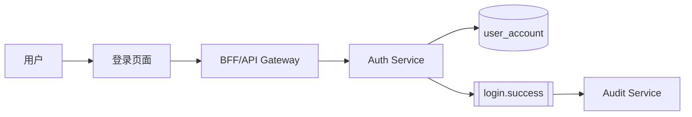
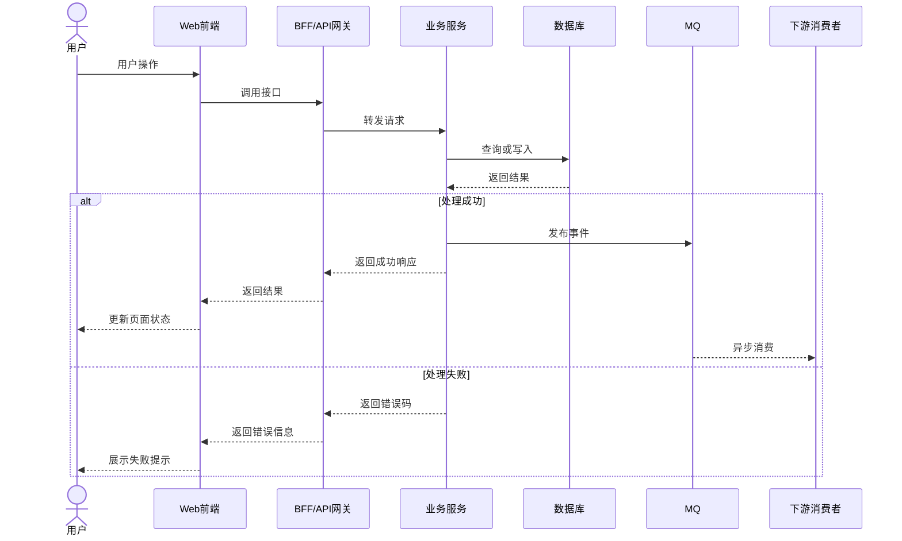
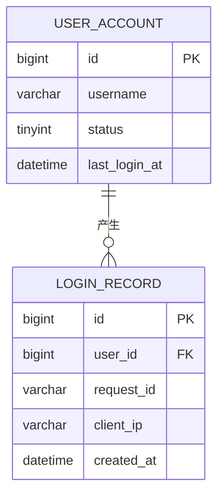
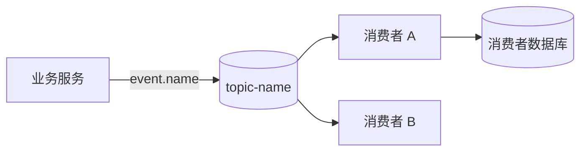
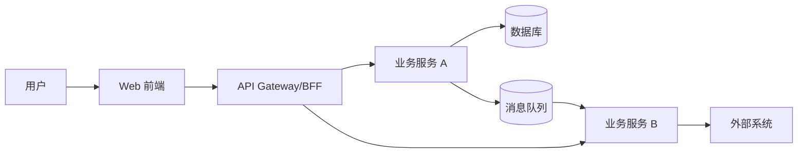
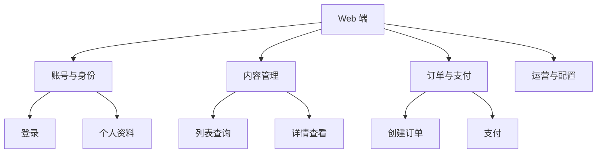

# Web 全栈功能链路梳理文档模板

## 一、推荐方案

采用 **Markdown 作为文档载体 + Mermaid 作为统一制图语言 + 固定模板组织文档**。

这样可以版本化、便于 Code Review，也能让前端、后端、数据库、MQ 信息相互跳转。

## 二、推荐的文档仓库结构

```text
web-feature-map/
├── README.md                         # 使用说明、图例、维护规范
├── overview/
│   ├── feature-index.md              # 功能链路总表
│   ├── system-context.md             # 系统上下文图
│   ├── service-dependency.md         # 微服务依赖图
│   └── glossary.md                   # 业务术语
├── features/
│   ├── F001-user-login/
│   │   ├── README.md                 # 单功能链路卡片
│   │   ├── sequence.md               # 端到端时序图
│   │   ├── database.md               # DB 读写
│   │   ├── mq-events.md              # MQ 事件
│   │   └── api-contract.md           # 接口契约
│   └── F002-order-submit/
├── services/
│   ├── service-catalog.md             # 服务目录
│   └── service-dependency.md
├── database/
│   ├── table-catalog.md               # 表目录
│   └── er-overview.md                 # 核心 ER 图
├── mq/
│   ├── event-catalog.md               # MQ 事件目录
│   └── event-topology.md              # MQ 拓扑图
└── templates/
    ├── feature.md
    ├── sequence.md
    ├── database.md
    ├── mq-event.md
    └── api-contract.md
```

建议以**功能为主索引**，公共服务、表、Topic 再单独维护目录。

## 三、图的形式选择

| 图类型 | 推荐语法 | 用途 |
|---|---|---|
| 功能地图 | Mermaid `flowchart` | 展示所有功能点及层级 |
| 单功能端到端链路 | Mermaid `sequenceDiagram` | 展示前端到后端、DB、MQ 的完整调用过程 |
| 服务依赖图 | Mermaid `flowchart` 或 C4 | 展示网关、BFF、微服务和外部系统关系 |
| 数据库 ER 图 | Mermaid `erDiagram` | 展示当前功能涉及的核心表和关键关联 |
| MQ 事件流图 | Mermaid `flowchart` | 展示 Topic、生产者、消费者和事件方向 |
| 状态流转图 | Mermaid `stateDiagram-v2` | 展示订单、任务、审核等状态变化 |

### 推荐原则

- **功能地图**：只到功能点，不画服务细节。
- **时序图**：只给核心功能画，最有价值。
- **服务依赖图**：画系统全局关系，不展开每个接口。
- **ER 图**：只画本次功能涉及的表，不要画全库。
- **MQ 图**：必须和事件目录配套，图看拓扑，表看字段和规则。
- **状态图**：涉及状态机的功能必须补充。

整体建议使用 Mermaid，PlantUML 只在团队已经有成熟规范时采用，不建议混用两套绘图语言。

## 四、功能链路总表

文件：`overview/feature-index.md`

| 编号 | 功能名称 | 前端入口 | 页面/路由 | API | 核心服务 | DB | MQ | 复杂度 | 状态 |
|---|---|---|---|---|---|---|---|---|---|
| F001 | 用户登录 | 登录页 | `/login` | `POST /api/login` | auth-service | user_account | login.success | 中 | 已梳理 |
| F002 | 创建订单 | 下单页 | `/order/create` | `POST /api/orders` | order-service | orders、order_item | order.created | 高 | 待确认 |

每个功能编号应链接到对应文档：

```markdown
[F001 用户登录](../features/F001-user-login/README.md)
```

## 五、单功能链路卡片模板

每个功能点固定一页，建议文件：`features/{功能大类}/{功能ID}-{中文名称}/README.md`

示例：`features/03-对话与AI生成/01-对话初始化/README.md`

```markdown
# F001 用户登录

## 1. 功能说明

## 2. 前端入口

- 页面：
- 路由：
- 触发方式：
- 登录前/登录后状态：
- PC/H5 差异：

## 3. 链路总览



## 4. 关联接口

| 接口 | 方法 | 用途 | YApi | 调用方 | 服务方 |
|---|---|---|---|---|---|

## 5. 关联服务

| 服务 | 职责 | 调用方式 | 超时/重试 |
|---|---|---|---|

## 6. 数据库读写

| 服务 | 表 | 操作 | 关键字段 | 事务边界 |
|---|---|---|---|---|

## 7. MQ 事件

| Topic/Event | 生产者 | 消费者 | 触发时机 | 幂等 | 重试/死信 |
|---|---|---|---|---|---|

## 8. 成功与失败边界

## 9. 权限、幂等与一致性

## 10. 监控与排障入口
```

### 功能卡片的最小深度要求

每个核心功能不能只写“前端调用了哪个服务”，至少要继续追踪到以下层级：

1. 前端入口：页面/组件、触发动作、请求参数组装、响应如何落 Store。
2. Web BFF：Handler/Resource、Service 主流程、校验、锁、并行调用、分支和错误返回。
3. 下游服务：实际调用的方法、请求字段如何转换、读取/写入哪些模型或缓存。
4. 数据层：表/缓存的读写操作、关键字段、事务或异步边界、幂等条件。
5. MQ：生产位置、真实 Topic、消息 Key、消费者、失败回退和死信策略。
6. 结果边界：前端展示成功、服务处理成功、主库落库成功、异步消费成功要分别描述。

如果某一层只有接口证据而没有继续读到实现，必须写成“已追踪至接口”，不能写成“源码已确认”。

### 推荐的功能内部章节

```markdown
## 1. 功能边界
## 2. 前端入口与参数
## 3. 端到端时序图
## 4. BFF 内部阶段
## 5. 下游服务内部阶段
## 6. 数据读写与事务边界
## 7. MQ 生产与消费
## 8. 成功、失败、超时、重试
## 9. 并发、幂等与一致性
## 10. 代码证据与待补证
```

## 六、核心功能端到端时序图模板

文件：`features/Fxxx-feature-name/sequence.md`

时序图至少覆盖成功路径和主要失败路径。



时序图必须明确：

- 请求发起方；
- 网关/BFF 和服务调用关系；
- HTTP、RPC、MQ 等通信方式；
- 数据库读写位置；
- 同步和异步边界；
- 前端成功、失败、超时后的表现；
- 重试、幂等和补偿策略。

## 七、数据库读写目录模板

文件：`features/Fxxx-feature-name/database.md`

| 表名 | 所属服务 | 读/写 | 操作 | 条件 | 关键字段 |
|---|---|---|---|---|---|
| user_account | auth-service | 读 | SELECT | username | id、status、password_hash |
| user_account | auth-service | 写 | UPDATE | id | last_login_at |
| login_record | audit-service | 写 | INSERT | request_id | user_id、ip、created_at |

### 事务边界

- 主流程中必须保证原子性的操作：
- 可以异步执行的操作：
- 主流程成功标准：
- 数据最终一致性要求：
- 并发和重复请求处理：

### 核心 ER 图



ER 图只画当前功能涉及的核心表，不画全库。

## 八、MQ 事件目录模板

文件：`features/Fxxx-feature-name/mq-events.md`

| Topic | Event | 生产者 | 消费者 | 触发时机 | Key | 幂等方式 | 重试 | 死信 |
|---|---|---|---|---|---|---|---|---|
| `user.events` | `login.success` | auth-service | audit-service | 登录成功后 | user_id | event_id | 3 次 | 是 |

### 事件字段

| 字段 | 类型 | 必填 | 说明 |
|---|---|---|---|
| event_id | string | 是 | 事件唯一 ID |
| event_type | string | 是 | 事件类型 |
| occurred_at | datetime | 是 | 事件产生时间 |
| business_id | string | 是 | 业务主键 |
| payload | object | 是 | 业务数据 |

### MQ 拓扑图



事件文档必须明确：

- Event 版本；
- 生产时机；
- 消费成功标准；
- 幂等键；
- 重试策略；
- 死信处理；
- 顺序性要求；
- 是否允许丢失或重复消费；
- 补偿和人工处理方式。

## 九、接口契约目录模板

文件：`features/Fxxx-feature-name/api-contract.md`

| 接口 | 方法 | YApi | 请求方 | 服务方 | 状态 |
|---|---|---|---|---|---|
| `/api/login` | POST | [YApi](https://yapi.yukework.com/project/{projectId}/interface/api/{apiId}) | Web | BFF | 已确认 |

### 请求参数

| 字段 | 类型 | 必填 | 说明 | 来源 |
|---|---|---|---|---|

### 响应结构

| 字段 | 类型 | 说明 | 来源 |
|---|---|---|---|

### 错误码

| 错误码 | 含义 | 前端处理 | 是否可重试 |
|---|---|---|---|

### 契约补充

- 超时策略：
- 重试策略：
- 幂等要求：
- 权限要求：
- 兼容性要求：
- 前端消费方式：

字段建议标记为：已确认、源码事实、候选字段、待后端确认、待 YApi 确认。

## 十、服务依赖图模板

文件：`overview/service-dependency.md`



服务依赖图只描述系统边界、调用方向和主要依赖，不展开具体接口字段。

## 十一、功能地图模板

文件：`overview/system-context.md` 或 `overview/feature-map.md`



功能地图只到功能点，不展开服务、表和 Topic。

## 十二、建议建设顺序

1. 建立 `feature-index.md`，确定所有功能点编号。
2. 梳理系统上下文图和服务依赖图。
3. 逐个补齐功能卡片。
4. 对核心功能补时序图。
5. 从功能卡片汇总数据库读写目录。
6. 从功能卡片汇总 MQ 事件目录。
7. 补齐接口契约和 YApi 链接。
8. 最后增加状态图、异常链路和排障信息。

## 十三、维护原则

- 功能卡片是主文档。
- 时序图是核心链路证据。
- 服务、数据库、MQ、API 目录是可复用索引。
- 不把推测字段写成确定契约。
- 只记录当前功能涉及的表和 Topic，避免全库、全系统失控膨胀。
- 每次接口、服务、表或 Topic 发生变更时，同步更新对应功能卡片和公共目录。
- 图中名称必须和接口、服务、表、Topic 目录保持一致。
