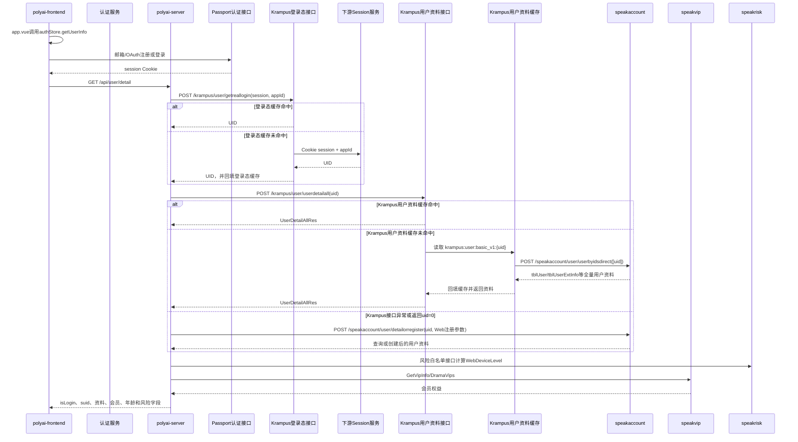

# 用户-001 登录与注册体系

## 1. 业务边界

登录与注册围绕真实用户 `session → uid → 用户资料 → PolyWebUserInfo → 前端用户态` 展开，包含页面鉴权、邮箱注册/登录、OAuth 注册/登录、登录态恢复、登出和账号注销。

这里需要区分四类职责：Passport 负责注册/登录认证提交；Krampus 负责登录成功后的 `session → uid` 解析和当前 Web 用户资料查询；speakaccount 的 `detailorregister` 负责用户资料创建或补全，并作为 Krampus 查询异常或历史兼容场景的回退；前端不生成 UID。

Web 用户接口 YApi：[用户详情 835296](https://yapi.yukework.com/project/10756/interface/api/835296)、[注销 902340](https://yapi.yukework.com/project/10756/interface/api/902340)、[登出兜底 1611479](https://yapi.yukework.com/project/10756/interface/api/1611479)。`/session/web/*` 认证接口当前无前端 YApi 定义。

## 2. 注册实际分为两层

### 2.1 认证账户注册

前端没有单独的 `/register` API。邮箱和 OAuth 使用统一的登录型接口，由认证服务根据账号是否存在完成注册或登录：

```text
邮箱验证码
→ Passport认证接口 POST /session/web/emaillogin
→ 校验邮箱和验证码
→ 新账号创建或已有账号认证
→ 签发session Cookie
```

```text
OAuth code/id_token
→ Passport认证接口 POST /session/web/oauthlogin
→ 校验OAuth身份
→ 新账号创建或已有账号认证
→ 签发session Cookie
```

当前 `polyai-server` 仓库没有 `/session/web/*` 的认证实现，因此 Passport 负责认证提交是当前业务约定和前端协议边界；不能从 Web 仓库推断 Passport 内部账号表、验证码存储或 OAuth 绑定表。

### 2.2 Web 用户资料注册/补全

认证服务返回真实 UID 后，`polyai-server` 调用：

```text
speakaccount.GetUserDetailOrRegister(
    uid,
    registerSource=1,
    clientIp,
    localLanguage,
    localTimezone,
)
```

这一步负责 Poly Web 用户资料的创建或补全，不是认证账户注册本身。具体链路见[新用户体系](../03-新用户体系/README.md)。

### 2.3 认证完成后的用户资料读取顺序

Passport 签发 `session` 后，`SessionMiddleware` 先解析 `session → uid`，随后再查询用户资料。两次调用不是同一个 Krampus 接口：登录态解析调用 Krampus 的 `getreallogin`，用户资料查询调用 Krampus 的 `userdetailall`。

```text
Passport签发的session
→ polyai-server /middleware/session.go:GetRealLogin
→ Krampus /krampus/user/getreallogin
→ Krampus Avalanche登录态缓存
   ├─ 命中 → uid
   └─ 未命中 → Krampus调用下游 /session/api/getlogin → uid并回填登录态缓存
→ polyai-server /api_speakaccount/krampus_helper.go:GetUserDetailOrRegister
→ Krampus /krampus/user/userdetailall(uid)
→ Krampus UserDetailAllGroup / 用户基础资料缓存
   ├─ 缓存命中 → 返回用户资料
   └─ 缓存未命中 → Krampus调用 speakaccount /speakaccount/user/userbyidsdirect 直查DB
                    → 回填 krampus:user:basic_v1:{uid}
→ BaseUserInfo
→ PolyWebUserInfo / /api/user/detail

如果 Krampus 用户资料接口报错，或返回 `uid=0`，`polyai-server` 才执行第二层兼容回退：调用 speakaccount `/speakaccount/user/detailorregister`。该接口可能创建或补全 Web 用户资料。它不是 Krampus 用户基础资料缓存未命中的常规回源路径。
```

源码中 `GetUserDetailOrRegister` 明确把 `detailorregister` 作为回退函数；Krampus 返回异常或 `Uid=0` 时才执行回退。正常的 Krampus 用户资料缓存未命中由 Krampus 自己处理：读取 `krampus:user:basic_v1:{uid}`，再调用 speakaccount `/speakaccount/user/userbyidsdirect` 直查 DB 并回填。当前 polyai-server 仍保留 `web_krampus_login_gray_conf`，所以静态源码只能确认两套分支都存在；若线上配置已完成全量放量，则认证请求走 Krampus 外层登录态接口，但其下游 `/session/api/getlogin` 仍只在 Krampus 登录态缓存未命中时调用。

Krampus 当前代码对真实登录态配置了 Avalanche 缓存，缓存时间为 24 小时并带随机延长。因此 Krampus 是 Web 的登录态访问入口，但不是每个请求都会继续访问下游 session 服务。

## 3. 登录态恢复链路



## 4. Session 如何解析 UID

`middleware/session.go:GetRealLogin` 读取 `session` Cookie，按 `LoginGray(ctx)` 分流：

| 分支 | Client | 下游接口 | 结果 |
|---|---|---|---|
| Krampus 登录态主路径 | `api_krampus.NewClient(ctx).GetRealLogin` → Krampus | `/krampus/user/getreallogin`；Krampus 缓存未命中时再调用下游 `/session/api/getlogin` | `GetLoginRes.UID`；Krampus 外层接口有 Avalanche 登录态缓存 |
| Passport 认证/兼容路径 | Passport Client | `/session/api/getlogin`、`/session/web/*` | 认证提交或兼容解析，最终得到 `GetLoginResp.UID` |

随后 `SessionMiddleware` 将 UID/CUID 写入上下文，设置 `X-Zyb-Ctx-Krampus-Sharding: cuid`，调用 `setRealUserInfo`。`setRealUserInfo` 再通过 `GetUserDetailOrRegister` 取得 `BaseUserInfo`，组装 `PolyWebUserInfo` 并序列化写入 `ProxyKeyUserInfo`。

注意：`uid` 的来源是登录态查询；Krampus/speakaccount 只负责资料读取或资料注册补全，不在这条 Web 链路中重新生成 UID。

## 5. 用户资料和注册来源聚合

`service/sv_user/detail.go:GetUserDetail` 会继续聚合：

- location 根据 IP 获取当前国家；
- Krampus 直接返回用户资料；异常或无效时由 speakaccount `detailorregister` 兼容创建/补全并返回昵称、生日、年龄、注册来源、纯净模式和年龄状态；
- speakvip 查询 Web 会员和漫剧会员；
- 邮箱注册来源调用 Passport `GetUserInfo(uid)` 获取邮箱；
- OAuth 注册来源调用 Passport `GetOAuthEmail(uid)` 获取邮箱；
- Controller 将内部 UID 转换为 Web 使用的 `suid`。

关键注册字段：`uid`、`registerSource`、`registerCountry`、`country`、`createTime`、`isNew`、`userEmail`。

## 6. 登出和注销

| 动作 | 前端 | polyai-server | 下游 |
|---|---|---|---|
| 登出 | `/session/web/logout`，失败时 `/api/user/logout` | 清空 Zybuss Cookie | Krampus `DelRealLoginCache(session)` |
| 注销 | `/api/user/cancel` | 用户 Handler/Service | speakaccount `Cancel(uid)` |

## 7. 状态流转

```text
未登录
→ 邮箱/OAuth提交
→ Passport认证服务注册或登录
→ session Cookie
→ Krampus登录态接口解析UID
→ Krampus直接读取用户资料
→ 异常/无效时兼容回源 speakaccount detailorregister
→ PolyWebUserInfo注入
→ auth Store写入isLogin和用户详情
```

## 8. 源码证据

- 前端登录/注册入口：`polyai-frontend/stores/auth.ts:183-330`、`components/InsertLogin/index.vue`。
- Session：`polyai-server/middleware/session.go:GetRealLogin/SessionMiddleware/SessionMiddlewareWithCuID`。
- 用户资料读取和回源：`api/api_speakaccount/krampus_helper.go:GetUserDetail/GetUserDetailOrRegister`。
- speakaccount 资料接口：`api/api_speakaccount/speak_account.go:GetUserDetail/GetUserDetailOrRegister`。
- Web 用户态组装：`middleware/session.go:setRealUserInfo`、`middleware/current_user.go:GetCurrentUserInfoFromSpeakAccount`。
- 用户详情聚合：`service/sv_user/detail.go:GetUserDetail`。
- Passport：`api/api_passport/passport.go`。
- Krampus：`api/api_krampus/client.go`。
