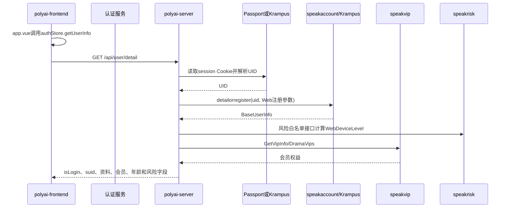

# 用户-001 登录与注册体系

## 1. 业务边界

登录与注册围绕真实用户 `session → uid → PolyWebUserInfo → 前端用户态` 展开，包含页面鉴权、邮箱注册/登录、OAuth 注册/登录、登录态恢复、登出和账号注销。

Web 用户接口 YApi：[用户详情 835296](https://yapi.yukework.com/project/10756/interface/api/835296)、[注销 902340](https://yapi.yukework.com/project/10756/interface/api/902340)、[登出兜底 1611479](https://yapi.yukework.com/project/10756/interface/api/1611479)。`/session/web/*` 认证接口当前无前端 YApi 定义。

## 2. 注册实际分为两层

### 2.1 认证账户注册

前端没有单独的 `/register` API。邮箱和 OAuth 使用统一的登录型接口，由认证服务根据账号是否存在完成注册或登录：

```text
邮箱验证码
→ POST /session/web/emaillogin
→ 认证服务校验邮箱和验证码
→ 新账号创建或已有账号登录
→ 签发session Cookie
```

```text
OAuth code/id_token
→ POST /session/web/oauthlogin
→ 认证服务校验OAuth身份
→ 新账号创建或已有账号登录
→ 签发session Cookie
```

当前 `polyai-server` 仓库没有 `/session/web/*` 的认证实现，因此只能确认前端协议和登录后的 Session 边界，不能推断认证服务内部账号表、验证码存储或 OAuth 绑定表。

### 2.2 Web 用户资料注册/补全

认证服务返回真实 UID 后，`polyai-server` 调用：

```text
speakaccount.GetUserDetailOrRegister(
    uid,
    registerSource=1,
    clientIp,
    localLanguage,
    localTimezone,
)
```

这一步负责 Poly Web 用户资料的创建或补全，不是认证账户注册本身。具体链路见[新用户体系](../03-新用户体系/README.md)。

## 3. 登录态恢复链路



## 4. Session 如何解析 UID

`middleware/session.go:GetRealLogin` 读取 `session` Cookie，按 `LoginGray(ctx)` 分流：

| 分支 | Client | 下游接口 | 结果 |
|---|---|---|---|
| 命中登录灰度 | Krampus Client | `/session/api/getlogin` | `GetLoginRes.UID` |
| 未命中登录灰度 | Passport Client | `/session/api/getlogin` | `GetLoginResp.UID` |

随后 `SessionMiddleware` 将 UID/CUID 写入上下文，设置 Krampus 分片 Header，调用 `setRealUserInfo`，再把 `PolyWebUserInfo` 序列化写入 `ProxyKeyUserInfo`。

## 5. 用户资料和注册来源聚合

`service/sv_user/detail.go:GetUserDetail` 会继续聚合：

- location 根据 IP 获取当前国家；
- speakaccount/Krampus 返回昵称、生日、年龄、注册来源、纯净模式和年龄状态；
- speakvip 查询 Web 会员和漫剧会员；
- 邮箱注册来源调用 Passport `GetUserInfo(uid)` 获取邮箱；
- OAuth 注册来源调用 Passport `GetOAuthEmail(uid)` 获取邮箱；
- Controller 将内部 UID 转换为 Web 使用的 `suid`。

关键注册字段：`uid`、`registerSource`、`registerCountry`、`country`、`createTime`、`isNew`、`userEmail`。

## 6. 登出和注销

| 动作 | 前端 | polyai-server | 下游 |
|---|---|---|---|
| 登出 | `/session/web/logout`，失败时 `/api/user/logout` | 清空 Zybuss Cookie | Krampus `DelRealLoginCache(session)` |
| 注销 | `/api/user/cancel` | 用户 Handler/Service | speakaccount `Cancel(uid)` |

## 7. 状态流转

```text
未登录
→ 邮箱/OAuth提交
→ 认证服务注册或登录
→ session Cookie
→ Passport/Krampus解析UID
→ speakaccount detailorregister创建/补全资料
→ PolyWebUserInfo注入
→ auth Store写入isLogin和用户详情
```

## 8. 源码证据

- 前端登录/注册入口：`polyai-frontend/stores/auth.ts:183-330`、`components/InsertLogin/index.vue`。
- Session：`polyai-server/middleware/session.go:GetRealLogin/SessionMiddleware/SessionMiddlewareWithCuID`。
- 用户资料注册：`middleware/current_user.go:GetCurrentUserInfoFromSpeakAccount`、`api/api_speakaccount/speak_account.go:GetUserDetailOrRegister`。
- 用户详情聚合：`service/sv_user/detail.go:GetUserDetail`。
- Passport：`api/api_passport/passport.go`。
- Krampus：`api/api_krampus/client.go`。
