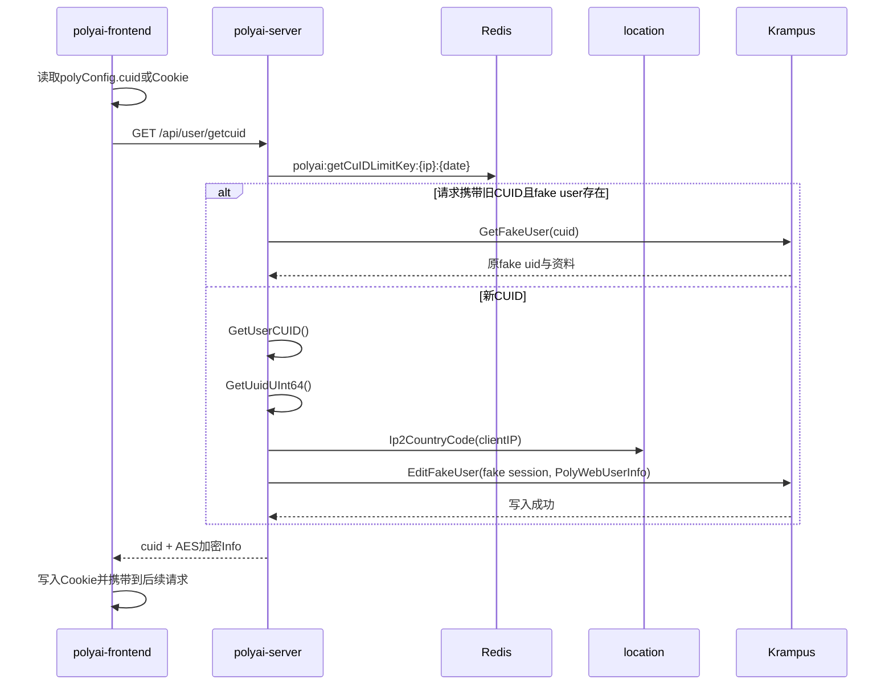

# 用户-002 游客与身份体系

## 1. 身份模型

Web 游客不是只有一个 Cookie 字符串，而是由 `cuid → fake session → fake uid → PolyWebUserInfo` 组成的服务端身份链。

接口 YApi：[获取用户 CUID 873128](https://yapi.yukework.com/project/10756/interface/api/873128)。

| 字段 | 生成/读取位置 | 作用 |
|---|---|---|
| `cuid` | `libutils.GetUserCUID()` 或前端 Cookie | 浏览器/设备维度关联键 |
| fake `session` | `FakeSessionPrefix + cuid` | Krampus fake user 的查询分片键 |
| fake `uid` | `galaxutils.GetUuidUInt64()` | 游客在 Web 后端和下游服务中的虚拟 UID |
| `IsFake=1` | `PolyWebUserInfo` | 区分游客与真实登录用户 |
| `sceneId` | 前端 `secretSceneId` 解码 | 对话角色和按角色限流维度 |

## 2. CUID/UID 生成链路



## 3. 服务端生成逻辑

`service/sv_user/get_cuid.go:GetCUid` 的顺序：

1. 根据客户端 IP 和美东日期累加 `RedisKeyGetSessionLimitKey`；
2. 超过 `CrawlerUidSearchNumDailyLimit` 时刷新 IP 过滤配置并进行白名单判断；
3. 如果请求有 CUID，先检查 Bootstrap 已存在状态；
4. 再调用 Krampus `GetFakeUser(cuid)` 查询是否已有虚拟 UID；
5. 不存在时生成新的 CUID；
6. 使用 `galaxutils.GetUuidUInt64()` 生成虚拟 UID；
7. 通过 location 获取国家，解析语言和时区；
8. 构造 `PolyWebUserInfo{UID, IsFake:1, Country, MotherTongue, LocalTimezone, CreateTime}`；
9. 以 `FakeSessionPrefix + CUID` 作为 Krampus 分片值调用 `EditFakeUser`；
10. 将用户信息 AES 加密后返回 `Info`，CUID 返回给前端。

## 4. CUID 的持续生命周期

- 用户详情接口 `GetUserDetail` 会 `defer resetCUidTimeout(ctx, cUid)`，读取 fake user 后重新 `EditFakeUser`，用于续期；
- 当前 IP 国家变化时，`resetCUidCountry` 会更新 fake user 的 `Country`，但保留 `RegisterCountry`；
- 请求上下文写入 `CommonParamCUidKey`，同时设置 `X-Zyb-Ctx-Krampus-Sharding`；
- `SessionMiddlewareWithCuID` 无真实 session 时从 Krampus fake user 恢复 UID、性别、生日和年龄。

## 5. 游客身份进入对话

主站游客消息接口会把以下字段传入 BFF：

```text
CuID          ← 当前请求 CUID
SceneID       ← secretSceneId Base54 解码
WebDeviceLevel← PolyWebUserInfo.WebDeviceLevel
MsgList       ← 前端本地历史消息
PureMode/Filter← polyai-server 审核开关
```

同时在 polyai-server 本地执行 IP、UID、CUID、SceneID 维度的轮次和角色数限制，详见 [风险等级体系](../04-风险等级体系/README.md)。

## 6. 源码证据

- 前端：`plugins/02.cuid-init.ts`、`stores/useCuid.ts`。
- CUID/UID：`service/sv_user/get_cuid.go:GetCUid`。
- fake user：`api/api_krampus/client.go:GetFakeUser/EditFakeUser`。
- 请求身份：`middleware/session.go:SessionMiddlewareWithCuID`。
- 对话透传：`service/sv_chat/msgbystreamasguest.go:MsgByStreamAsGuest`。
- Redis Key：`components/cache/cache.go`。
