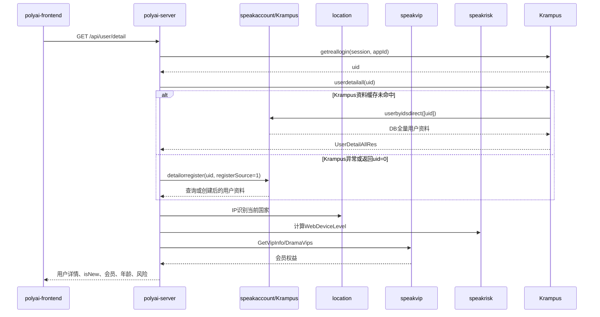

# 用户-003 新用户体系

用户资料入口 YApi：[获取用户详情 835296](https://yapi.yukework.com/project/10756/interface/api/835296)。

## 1. “新用户”如何产生

Web 新用户不是前端本地生成的。登录成功后，polyai-server 以认证服务返回的真实 UID 为主键，先通过 Krampus 读取用户资料；只有 Krampus 查询异常或返回无效 UID 时，才调用 speakaccount 的 `detailorregister` 完成创建或补全：

```text
认证服务 Session
→ polyai-server 通过 Krampus getreallogin 解析真实 UID
→ Krampus userdetailall 查询用户资料
→ Krampus 用户缓存未命中时调用 speakaccount userbyidsdirect 回填基础资料缓存
→ 若 Krampus 查询异常或返回 uid=0，polyai-server 调用 speakaccount detailorregister
→ registerSource=1(Web)，必要时创建或补全用户资料
→ PolyWebUserInfo
→ isNew / 用户配置 / 会员 / 风险 / 对话
```

## 2. 初始化时序



## 3. BFF 到用户服务的请求字段

`api_speakaccount.Client.GetUserDetailOrRegister` 实际发送：

| 字段 | 来源 | 用途 |
|---|---|---|
| `uid` | Passport/Krampus Session 解析结果 | 真实用户主键 |
| `registerSource=1` | polyai-server 固定写入 | 标识 Web 注册来源 |
| `clientIp` | `utils.GetClientIP(ctx)` | 国家/注册环境初始化 |
| `localLanguage` | Referer 语言或请求头转换 | 初始化 `MotherTongue` |
| `localTimezone` | `UserLocalTimezone` 请求头 | 用户时区和本地策略 |

Krampus 的 `userdetailall` 由 `UserDetailAllGroup` 负责缓存。组内用户基础资料缓存未命中时，Krampus 调用 `/speakaccount/user/userbyidsdirect` 直查 speakaccount DB，并将结果回填到 `krampus:user:basic_v1:{uid}`。这条回源是“资料缓存冷数据自愈”；polyai-server 的 `detailorregister` 是另一层“接口异常/无效结果兜底”，后者才具备创建用户资料的语义。

## 4. PolyWebUserInfo 的形成

`middleware/session.go:setRealUserInfo` 将 speakaccount 返回的 `BaseUserInfo` 转成请求上下文对象，关键字段包括：

```text
UID
NickName / Avatar / Profile
MotherTongue / Country / LocalTimezone
AppCuid
CreateTime / IsNew / Status
Age / Birthday / Gender
AgeCheckRes / AgeCheckRemainCnt
WebPureMode / IdentityType
RegisterSource / RegisterCountry
ChatConf
WebDeviceLevel
```

其中：

- `IsNew` 根据 `CreateTime` 由 `libutils.UserIsNew` 计算；
- `WebDeviceLevel` 不是 speakaccount 字段，而是在用户上下文形成后由 `GetWebDeviceLevel` 注入；
- `AppCuid` 连接真实用户与 Web 设备/游客身份；
- `RegisterSource` 决定后续是否去 Passport 查询邮箱；
- `Country` 既来自用户资料，也会和当前 IP 国家比较并触发资料更新。

## 5. 用户详情的二次聚合

`service/sv_user/detail.go:GetUserDetail` 还会继续聚合：

1. 当前 IP 国家；
2. `speakvip.GetVipInfo`：Web 会员信息；
3. `speakvip.DramaVips`：漫剧会员信息；
4. 邮箱注册用户的 Passport `GetUserInfo(uid)`；
5. OAuth 注册用户的 Passport `GetOAuthEmail(uid)`；
6. 真实 UID 到 Web `suid` 的 Base54 转换。

fake user 分支不会按真实用户完整注册流程处理，而是使用当前 fake user 上下文，刷新 CUID 有效期和国家后返回游客详情。

## 6. 新用户状态流转

```text
认证成功
→ Krampus getreallogin解析UID
→ Krampus userdetailall读取资料
→ 缓存未命中时speakaccount userbyidsdirect直查并回填Krampus缓存
→ Krampus异常/uid=0时speakaccount detailorregister
→ 用户资料创建/补全
→ CreateTime确定
→ IsNew计算
→ 用户上下文注入
→ 风险、会员、用户配置继续计算
→ 前端auth Store落地
```

## 7. 源码证据

- Session 和上下文：`middleware/session.go:setRealUserInfo`。
- 用户资料查询：`middleware/current_user.go:GetCurrentUserInfoFromSpeakAccount`。
- 用户详情聚合：`service/sv_user/detail.go:GetUserDetail`。
- speakaccount Client：`api/api_speakaccount/speak_account.go`。
- 前端回读：`polyai-frontend/stores/auth.ts:getUserInfo`。
