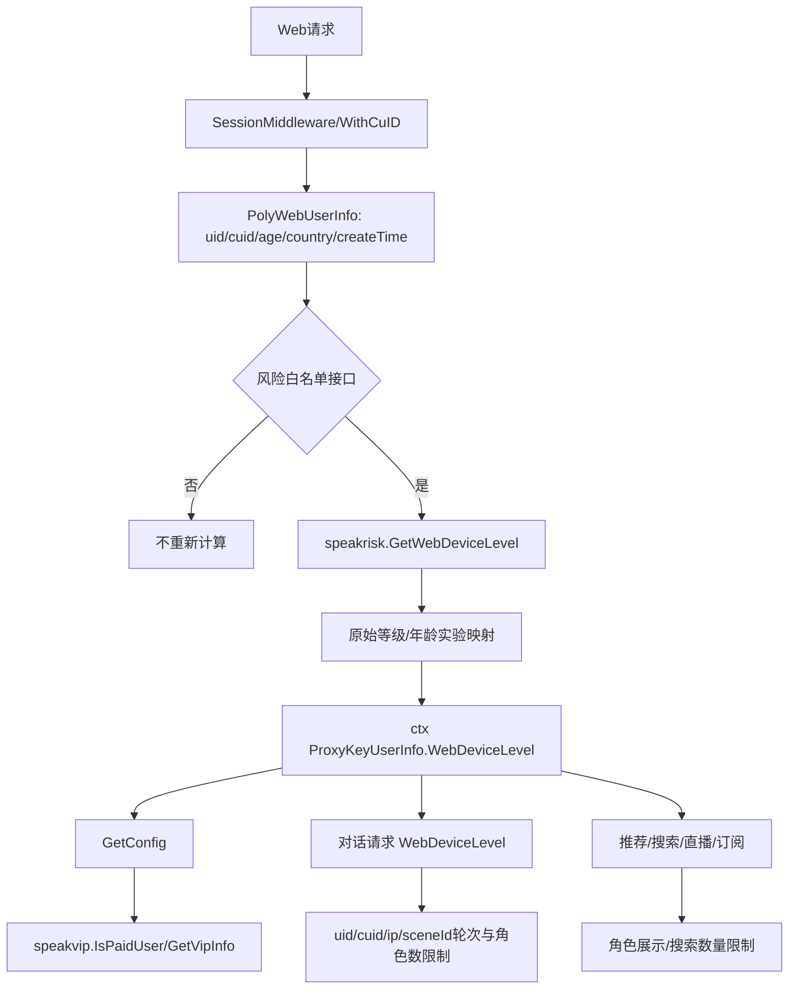

# 用户-004 风险等级体系

相关接口 YApi：[用户配置 891713](https://yapi.yukework.com/project/10756/interface/api/891713)、[获取风险等级 1317889](https://yapi.yukework.com/project/10756/interface/api/1317889)、[用户扩展配置 1322212](https://yapi.yukework.com/project/10756/interface/api/1322212)。

## 1. 这不是一次单独的风险查询

Web 风险等级实际是一个“身份上下文 + 风险服务 + 业务策略”的组合结果：

```text
session/CUID
→ UID、年龄、国家、注册时间、时区、客户端 IP
→ speakrisk 原始等级
→ 年龄实验映射
→ VIP/付费用户例外
→ WebDeviceLevel 注入请求上下文
→ 用户配置、角色数量/搜索限制、对话轮次、内容模式和功能开关
```

## 2. 风险等级获取入口

### 2.1 Session 中间件注入

`polyai-server/middleware/session.go:GetWebDeviceLevel` 只对风险白名单接口计算风险。典型接口包括：

- `/api/conversation/init`
- `/api/conversation/msgbystream`
- `/api/conversation/msgbystreamasguest`
- `/api/conversation/regeneratemsgbystream`
- `/api/user/config`
- `/api/user/getRiskLevel`
- `/api/scene/search`
- `/api/live/list`
- `/api/subscribe/list`

它使用当前 `PolyWebUserInfo` 的 `AppCuid`、`UID`、`Age` 调用 `speakrisk.GetWebDeviceLevel(cuid, uid, age)`，计算完成后写入 `ctx[ProxyKeyUserInfo].WebDeviceLevel`，供后续 Handler/Service 使用。

### 2.2 用户配置计算

`service/sv_user/get_config.go:GetConfig` 另外调用：

```text
middleware.GetUserDeviceLevel(cuid, uid, age, localTimezone)
```

此路径用于补充尚未注入 `WebDeviceLevel` 的用户，并影响 `/api/user/config` 返回的业务开关。

### 2.3 显式风险等级接口

`POST /api/user/getRiskLevel` 不会重新执行完整风控计算，而是读取当前请求上下文的 `WebDeviceLevel`，使用 `polyai:getRiskLevelLock:{uid}` 做 1 秒 UID 并发锁后返回 `riskLevel`。因此结果依赖此前 Middleware 是否已经完成风险注入。

## 3. 风险计算输入

| 输入 | 来源 | 用途 |
|---|---|---|
| `cuid` | CUID Cookie / 请求上下文 | 设备、游客身份和风控关联 |
| `uid` | Session 或 fake user | 登录用户/游客虚拟用户身份 |
| `age` | speakaccount 用户资料或 fake user | 风险模型和年龄策略 |
| `country` | location IP 识别、用户资料 | 同 UID 请求时补充给 `GetDeviceLevel` |
| `uidRegisterTime` | 用户详情 `CreateTime` | 同 UID 请求时补充给 `GetDeviceLevel` |
| `localTimezone` | 用户资料/请求头 | 风险计算和本地日期限流 |
| `clientIP` | 请求上下文 | `GetDeviceLevel` 风险计算和 IP 限流 |
| `age_verab` | Cookie | 年龄实验组 2/3/4/5 的等级映射 |
| VIP/付费状态 | `speakvip.IsPaidUser(uid)` | 中/高风险设备的付费用户例外 |
| 配置开关 | `speakconfig.GetDeviceLevelConfigSwitch` | 是否允许补充计算设备风险 |

## 4. 等级划分与映射

### 4.1 Web 对外等级

| 数值 | 语义 | 证据 |
|---:|---|---|
| `0` | 未入组/未计算 | 前端默认值；无 CUID、开关关闭或未命中风险白名单时出现 |
| `1` | 低风险 | 前端 `userConfig.ts`、YApi、后端响应注释 |
| `3` | 高风险 | 前端 `userConfig.ts`、YApi、后端响应注释 |

### 4.2 内部原始等级

源码使用 `RiskDeviceLowest`、`RiskDeviceLow`、`RiskDeviceMedium`、`RiskDeviceHigh`、`RiskDeviceHighest` 等内部常量。当前 Web 映射规则为：

```text
普通接口：RiskDeviceLowest → RiskDeviceLow(1)，RiskDeviceHighest → RiskDeviceHigh(3)
/api/user/getRiskLevel：返回 speakrisk 返回的原始等级，不做上述转换
age_verab=2/3/4/5：Lowest → Low(1)，其他结果 → High(3)
```

风险服务报错时，`GetWebDeviceLevel` 和 `GetDeviceLevel` 均按高风险兜底。

## 5. VIP、角色数量和对话轮次如何参与

### 5.1 VIP/付费用户参与设备风险补充计算

`GetUserDeviceLevel` 的实际路径是：

```text
无 CUID → 返回 0
设备风险开关关闭 → 返回 0
上下文已有 WebDeviceLevel → 返回 0，不重复计算
调用 speakrisk.GetDeviceLevel
若结果为 Medium/High
    → speakvip.IsPaidUser(uid)
    → 付费用户返回 0
    → 非付费用户保留 Medium/High
```

该判断使用本地缓存 `gcCache:IsPaidUser:{uid}`；付费结果默认缓存，非付费结果缓存 60 秒。

### 5.2 角色数量和聊天轮次不是 speakrisk 的模型输入

角色数量和对话轮次不会传给 `speakrisk`，但会在风险/身份结果注入后，作为 Web 业务侧的二次限制条件。它们使用 `uid`、`cuid`、IP 和 `sceneId` 关联。

主站游客对话 `service/sv_chat/msgbystreamasguest.go`：

- IP 天级聊天轮次：`polyai:web:ip:chat:round:{ip}_{date}`，超过 1000 拒绝；
- UID 天级总聊天量：`polyai:web:user:chat:total:count:{uid}_{date}`；
- `restriction=2` 时超过 `FakeUidChatDailyLimit` 返回需要登录；
- 请求把 `user.WebDeviceLevel` 透传给 `speakbffchat`；
- `SceneID` 由前端 `secretSceneId` 解码得到。

投放页游客对话 `service/sv_chat/msgbystreamasguestdelivery.go`：

- 每月角色集合：`polyai:web:delivery:month:scenes:{cuid}_{YYYYMM}`，默认最多 2 个角色；
- 单角色月聊天轮次：`polyai:web:delivery:chat:round:{cuid}:{sceneId}_{YYYYMM}`，默认最多 5 轮；
- 单 IP 天级轮次：`polyai:web:delivery:ip:chat:round:{ip}_{date}`，超过 1000 拒绝；
- 角色数量检查先于轮次消耗；下游失败会 Lua 原子回滚轮次。

因此要区分：

```text
speakrisk：决定风险等级
polyai-server：结合 UID/CUID/IP/sceneId 计算业务额度和限流
speakbffchat：接收 WebDeviceLevel、CUID、UID、SceneID 并执行对话链路
```

### 5.3 推荐/搜索中的角色数量限制

风险结果还进入角色推荐和搜索逻辑：

- 高风险时开启纯净模式和过滤模式；
- `GetRecListBuzz` 高风险时限制角色展示，特定 realistic 角色会查询 `speakvip.GetVipInfo`，VIP 类型达到 3 时允许例外；
- 搜索使用 `polyai:web:user:search_members:num:{uid}_{date}` 记录每日查看角色数量；
- 风险高低和审核模式共同决定角色搜索/推荐结果，而不是只由一个风险字段决定。

## 6. 注入与消费图



## 7. 源码证据

- 风险注入：`polyai-server/middleware/session.go:GetWebDeviceLevel`。
- 设备风险补充和 VIP 例外：`polyai-server/middleware/current_user.go:GetDeviceLevel/GetUserDeviceLevel/GetIsPaidUser`。
- 用户配置消费：`polyai-server/service/sv_user/get_config.go:GetConfig`。
- 显式风险接口：`polyai-server/service/sv_user/edit.go:GetRiskLevel`。
- 推荐和 VIP 例外：`polyai-server/service/sv_scene/get_rec_list.go:GetRecListBuzz`。
- 游客轮次/角色数量：`polyai-server/service/sv_chat/msgbystreamasguest.go`、`msgbystreamasguestdelivery.go`。
- Redis Key：`polyai-server/components/cache/cache.go`。
- 前端风险定义：`polyai-frontend/stores/userConfig.ts`、YApi 1317889。
