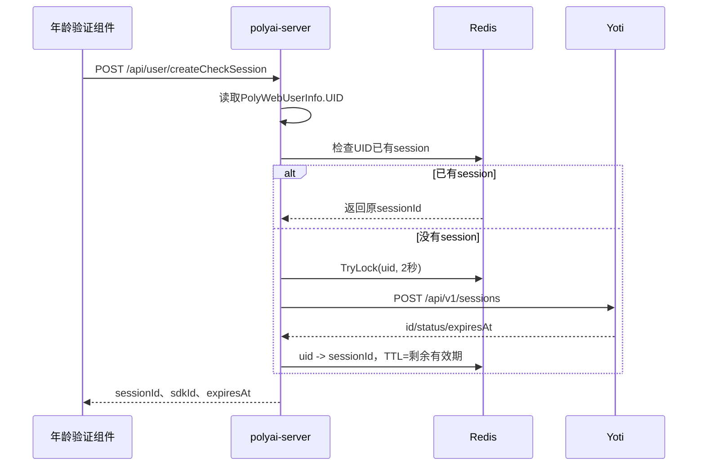
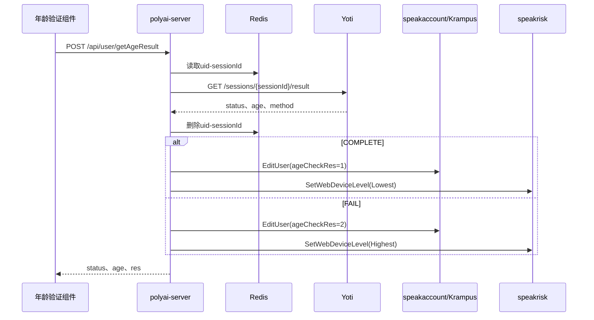

# 用户-005 年龄验证体系

相关接口 YApi：[创建校验 Session 1287250](https://yapi.yukework.com/project/10756/interface/api/1287250)、[获取校验结果 1287255](https://yapi.yukework.com/project/10756/interface/api/1287255)、[写入校验结果 1315982](https://yapi.yukework.com/project/10756/interface/api/1315982)、[修改性别/年龄 1274756](https://yapi.yukework.com/project/10756/interface/api/1274756)。

## 1. 年龄验证不是单一页面功能

年龄验证由配置、实验、前端触发、外部 Yoti Session、Redis 会话关联、用户资料写回和风险等级写回组成：

```text
/api/user/config
→ ageCheckSwitch / expAgeVerification
→ Chat或纯净模式触发showAgeVerification
→ createCheckSession
→ UID-sessionId Redis映射
→ Yoti验证
→ getAgeResult/createCheckResult
→ speakaccount/Krampus写ageCheckRes
→ speakrisk写Lowest/Highest
→ 后续WebDeviceLevel映射
```

## 2. 配置和触发

`service/sv_user/get_config.go:GetConfig`：

1. 通过国家读取 `GetAgeCheckSwitchConfig`；
2. `Enable=1` 时返回 `ageCheckSwitch=1`；
3. `Filter=0` 直接进入 Web 年龄实验；
4. `Filter!=0` 时还要经过 `IsNotVipOrBanlance(uid)`；
5. 通过 AB 引擎得到 `expAgeVerification`。

前端 `stores/userConfig.ts` 只在开关和实验分组满足条件时请求风险等级并发出 `showAgeVerification`。聊天状态中 `ageCheckRes` 不通过或次数不足时，也会从 `components/Chat/store/state.ts` 触发年龄验证。

## 3. Yoti Session 创建



后端固定构造的 Yoti 参数包括：

- `Type=OVER`；
- `TTL=900`；
- 年龄估算阈值 18；
- Digital ID 年龄估算阈值 19；
- Doc Scan 开启，`AUTO/PASSIVE`；
- 同步检查开启；
- HTTP 超时 10 秒，创建最多重试 3 次，指数退避。

游客 fake user 在 `CreateCheckSession` 直接返回 `ErrorUserIsGuest`。

## 4. 结果查询和状态写回



当 Yoti 状态为 `COMPLETE` 或 `FAIL` 时才写回用户资料和风险；Yoti 查询失败时 Redis 映射保留，便于后续重试。结果查询接口最多重试 2 次，每次间隔 3 秒。

## 5. 另一条结果写回路径

`POST /api/user/createCheckResult` 不查询 Yoti，而是接收前端 `res=1/2`：

```text
res=1 → speakaccount.EditUser(ageCheckRes=1)
      → speakrisk.SetWebDeviceLevel(RiskDeviceLowest)

res=2 → speakaccount.EditUser(ageCheckRes=2)
      → speakrisk.SetWebDeviceLevel(RiskDeviceHighest)
```

该接口只接受 1 或 2；用户资料写入失败返回失败，风险写入失败只记录日志，不回滚已经成功的用户资料写入。

## 6. 年龄结果如何进入风险体系

年龄验证写入的是 speakrisk 的内部原始等级，不是直接写 Web 对外的 1/3：

```text
RiskDeviceLowest  → 普通Web接口映射为 RiskDeviceLow(1)
RiskDeviceHighest → 普通Web接口映射为 RiskDeviceHigh(3)
```

在 `age_verab=2/3/4/5` 实验组，`GetWebDeviceLevel` 进一步把最低风险视为永久低风险，其余结果视为永久高风险。

## 7. 状态字段和 Redis

| 字段/Key | 作用 |
|---|---|
| `ageCheckSwitch` | 国家配置是否开启年龄验证 |
| `expAgeVerification` | 年龄验证 AB 分组 |
| `ageCheckRes` | 0 未完成、1 通过、2 未通过 |
| `ageCheckRemainCnt` | 前端剩余验证机会展示 |
| `polyai:age_check_uid_sessionid_key:{uid}` | UID 到 Yoti sessionId 映射 |
| `polyai:age_check_create_session_lock:{uid}` | 同一 UID 创建 Session 的并发锁 |
| `age_verab` | Web 年龄实验 Cookie |

## 8. 源码证据

- 配置：`service/sv_user/get_config.go:GetConfig`、`api/api_speakconfig`。
- 前端：`components/AgeVerification/`、`stores/userConfig.ts`、`components/Chat/store/state.ts`。
- Session 创建/结果：`service/sv_user/age_check.go`。
- 路由：`router/http.go` 用户年龄验证路由。
- 用户写回：`api/api_speakaccount/speak_account.go:EditUser`。
- 风险写回：`speakrisk.SetWebDeviceLevel`。
- Redis Key：`components/cache/cache.go`。
