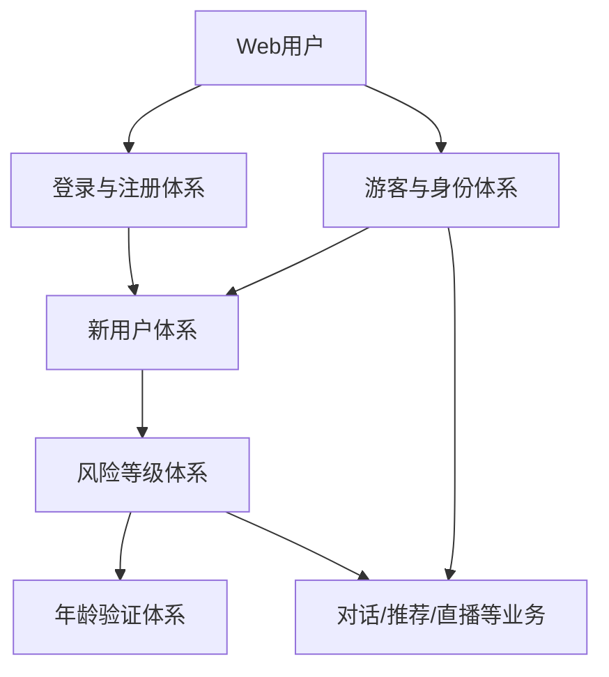
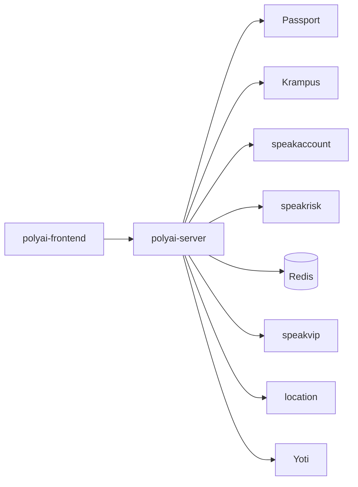

# 01 用户与身份

## 业务范围

本文档覆盖 Web 的登录注册、身份、游客身份、用户初始化、风险等级和年龄验证链路：

## 功能大类

| 功能 ID | 功能 | 入口 | 主要链路 | 状态 |
|---|---|---|---|---|
| USER-001 | 登录与注册体系 | 注册、登录、恢复、鉴权、登出、注销 | 认证服务 → Session → Passport/Krampus → 用户资料 | 部分下游边界已确认 |
| USER-002 | 游客与身份体系 | CUID、游客 fake user、虚拟 UID | polyai-server → Redis/location/Krampus | 源码链路已确认 |
| USER-003 | 新用户体系 | 首次登录后的用户资料创建/初始化 | polyai-server → speakaccount/Krampus/location/speakvip | 源码链路已确认 |
| USER-004 | 风险等级体系 | 风险获取、映射、注入和业务消费 | polyai-server → speakrisk → 请求上下文/用户配置/对话 | 源码链路已确认 |
| USER-005 | 年龄验证体系 | 开关、Session、结果回写、风险联动 | Redis → Yoti → speakaccount/Krampus → speakrisk | 源码链路已确认 |

## 服务依赖图

## 横向身份字段

| 字段 | 作用 |
|---|---|
| `session` Cookie | 登录态凭证，polyai-server 通过 Passport 或 Krampus 解析 UID |
| `uid` | 登录用户内部身份；Web 响应通常转换为 `suid` |
| `suid` | 前端使用的加密用户 ID |
| `cuid` | 设备/访客身份，游客链路和风控链路的重要关联键 |
| `webDeviceLevel` | Web 风险等级，polyai-server 从用户上下文或 speakrisk 结果获得 |
| `ageCheckRes` | 年龄校验结果，前端用于决定是否阻断聊天或展示验证 |

## 功能大类文档

- [USER-001 登录与注册体系](./01-登录与注册体系/README.md)
- [USER-002 游客与身份体系](./02-游客与身份体系/README.md)
- [USER-003 新用户体系](03-新用户体系/README.md)
- [USER-004 风险等级体系](./04-风险等级体系/README.md)
- [USER-005 年龄验证体系](./05-年龄验证体系/README.md)

原有 14 张细节卡片已删除，当前以这 5 个能力域作为用户体系主导航。
- [用户与登录接口目录](./api-index.md)
- [用户与登录体系依赖服务目录](./用户依赖服务目录.md)
- [CHAT-009 游客对话](../03-对话与AI生成/09-游客对话/README.md)
