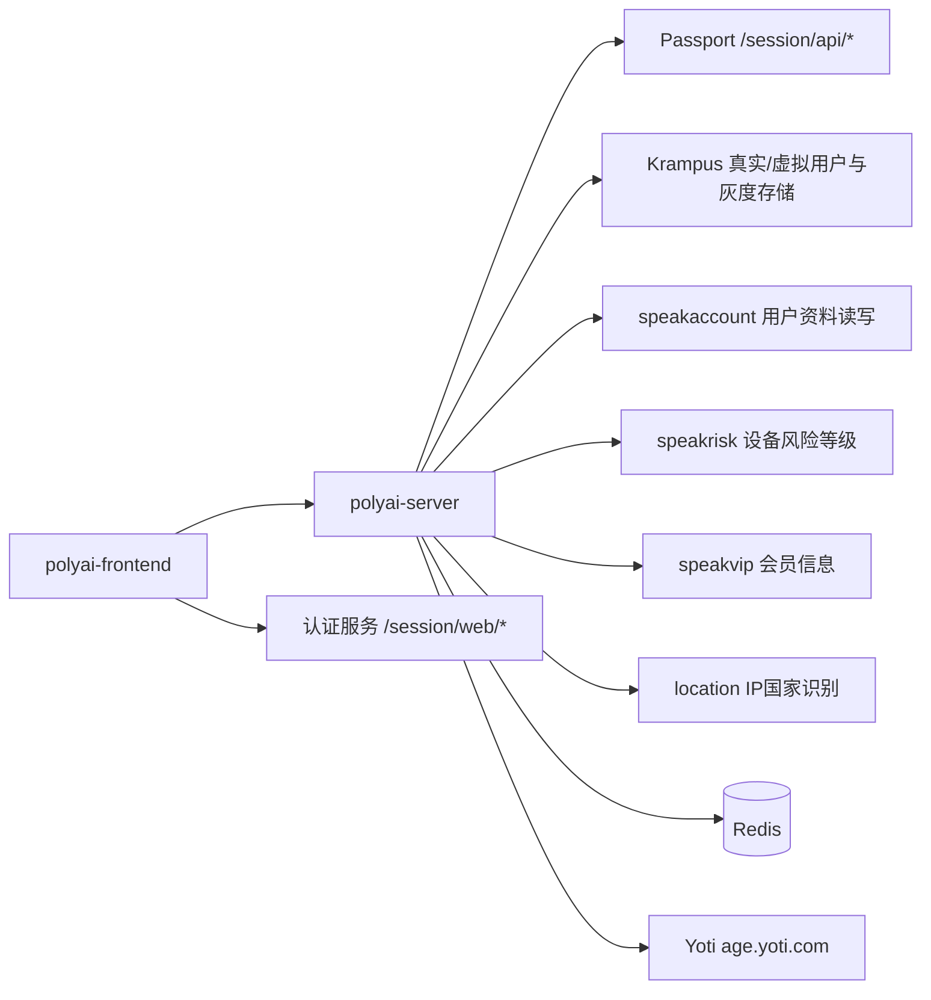
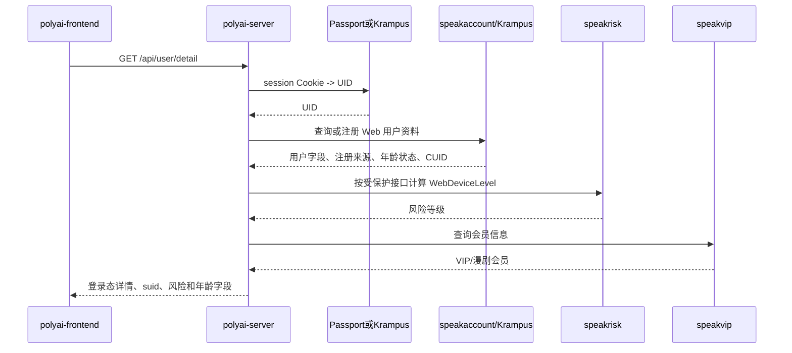
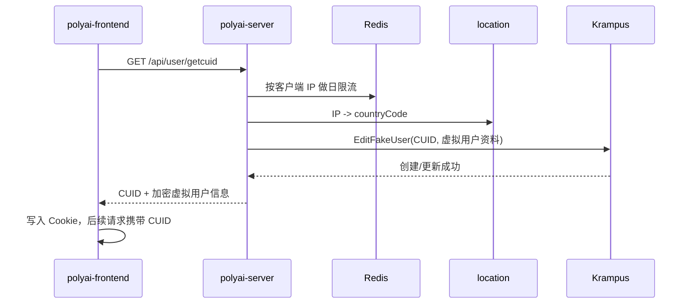
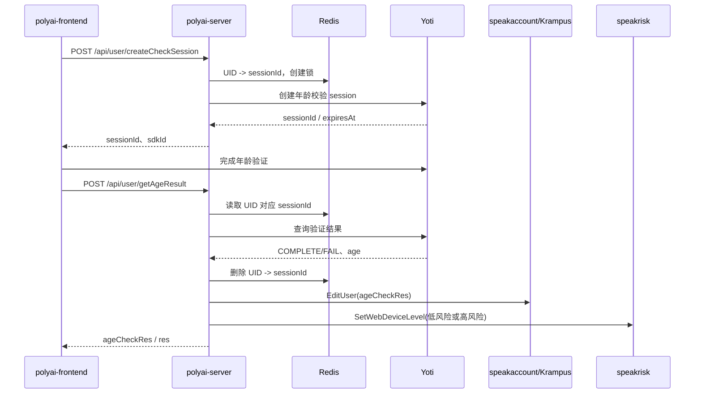

# 用户与登录体系依赖服务目录

本文档记录登录、登录态恢复、CUID/游客、风险等级和年龄校验实际涉及的依赖。服务名和调用方法以 `polyai-server` 当前源码为准；认证入口 `/session/web/*` 的实现不在当前服务仓库内，因此单独标明边界。

## 1. 依赖关系图

## 2. 服务职责与源码证据

| 依赖 | 调用方 | 真实调用 | 在登录体系中的职责 | 证据 |
|---|---|---|---|---|
| 认证服务 | polyai-frontend | `/session/web/sendemailcode`、`/session/web/emaillogin`、`/session/web/oauthlogin`、`/session/web/logout` | 邮箱验证码/OAuth 登录和主登出入口；当前 `polyai-server` 仓库未包含这些 Web 认证 Handler | `polyai-frontend/stores/auth.ts:183-272,401-418` |
| Passport | `polyai-server/middleware/session.go`、`service/sv_user/detail.go` | `/session/api/getlogin`、`/session/api/getuserinfo`、`/session/api/getoauthemail`、`/session/api/logoff` | 非 Krampus 灰度路径的 session→UID 解析；按注册来源补充邮箱；提供登录态注销接口客户端 | `api/api_passport/passport.go:17-172` |
| Krampus | `middleware/session.go`、`service/sv_user/get_cuid.go`、`service/sv_user/logout.go` | 真实登录解析、`GetFakeUser`、`EditFakeUser`、删除真实登录缓存；speakaccount 资料读写存在 Krampus 灰度封装 | 登录灰度、游客虚拟用户、CUID 与虚拟 UID 的持久关联，以及部分用户资料灰度存储 | `api/api_krampus/client.go:96-181`；`service/sv_user/get_cuid.go:72-145`；`service/sv_user/logout.go` |
| speakaccount | `middleware/session.go`、`service/sv_user/detail.go`、`age_check.go` | `/speakaccount/user/detailorregister`、`/speakaccount/user/getdetail`、`/krampus/user/edit`、`/speakaccount/user/cancel` 等 | 用户资料、注册来源、年龄/年龄校验结果、CUID、纯净模式等字段的读取和写回；账号注销 | `api/api_speakaccount/speak_account.go:32-120`；`service/sv_user/detail.go:30-118` |
| speakrisk | `middleware/session.go`、`middleware/current_user.go`、`service/sv_user/age_check.go` | `GetWebDeviceLevel`、`GetDeviceLevel`、`SetWebDeviceLevel` | 计算 Web 设备/用户风险等级；年龄校验完成后把通过/失败映射为低/高风险 | `middleware/session.go:598-669`；`middleware/current_user.go:129-177`；`service/sv_user/age_check.go:324-449` |
| speakvip | `service/sv_user/detail.go`、`middleware/current_user.go` | `GetVipInfo`、`DramaVips`、`IsPaidUser` | 登录态详情聚合会员信息；付费用户在部分设备风险逻辑中被豁免 | `service/sv_user/detail.go:38-102`；`middleware/current_user.go:185-206` |
| location | `service/sv_user/get_cuid.go`、`service/sv_user/detail.go`、`middleware/current_user.go` | `Ip2CountryCode` | 通过客户端 IP 推导国家；创建/刷新游客资料和登录用户国家字段 | `service/sv_user/get_cuid.go:40-116`；`service/sv_user/detail.go:35-64` |
| Redis | `service/sv_user/get_cuid.go`、`edit.go`、`age_check.go` | CUID 日限流、风险查询锁、年龄 session 映射、年龄创建锁 | 限流、并发互斥和短期年龄校验会话关联；不是用户资料主存储 | `components/cache/cache.go:55-56,98`；相关 service 文件 |
| Yoti | `polyai-server/service/sv_user/age_check.go` | `POST https://age.yoti.com/api/v1/sessions`、`GET .../sessions/{sessionId}/result` | 年龄校验会话创建和结果读取；服务端使用 Redis 将 UID 与 sessionId 绑定 | `service/sv_user/age_check.go:96-144,281-319` |

## 3. 关键调用链

### 3.1 登录态恢复

### 3.2 游客 CUID 创建

### 3.3 年龄校验完成后的状态写回

## 4. 依赖边界

| 边界 | 当前能确认的内容 | 当前不扩展的内容 |
|---|---|---|
| `/session/web/*` | 前端请求路径、参数分支、登录后依赖 session Cookie | 认证服务内部验证码校验、OAuth 换 token、Cookie 签发实现 |
| Passport/Krampus | `polyai-server` 的客户端路径、请求字段和灰度选择 | Passport/Krampus 内部数据库表和缓存实现 |
| speakaccount | Web 侧用户资料查询、编辑、注销接口契约 | speakaccount 内部表结构 |
| speakrisk | 请求字段、风险等级读取与年龄结果回写调用 | 风险模型内部规则 |
| Yoti | session 创建、结果读取、重试次数和 Redis 绑定 | Yoti 外部平台内部判定算法 |

## 5. 与功能点的反查

| 依赖 | 功能 ID |
|---|---|
| 认证服务 / Passport / Krampus | USER-001、USER-003 |
| speakaccount | USER-001、USER-003、USER-005 |
| speakrisk | USER-003、USER-004、USER-005，并影响 CHAT-001、CHAT-002、CHAT-009 |
| Redis | USER-002、USER-004、USER-005 |
| location | USER-002、USER-003 |
| speakvip | USER-001、USER-003 |
| Yoti | USER-005 |
