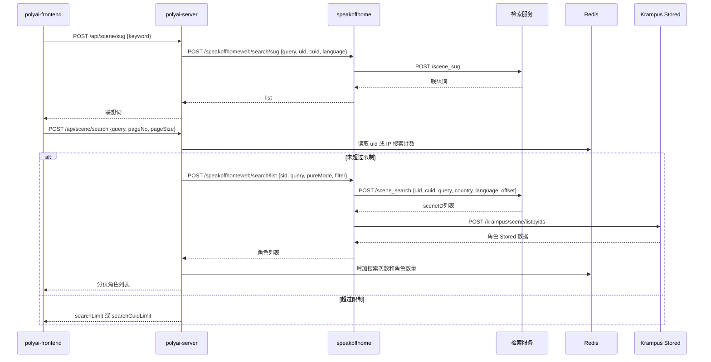

# SEARCH-001 搜索与联想词

## 1. 功能概述

- 入口：顶部搜索框、`pages/search/[[SID]].vue`
- 触发：输入防抖调用联想词；提交或进入搜索结果页调用搜索。
- 关键标识：`sid`、`uid`、`cuid`、`query`、`page/pageSize`、语言和国家。
- 状态：源码链路已确认；检索服务内部为外部边界。

## 2. 核心源码流程：一次搜索

1. `SearchCharacter.vue` 或 `pages/search/[[SID]].vue` 调用 `SMApiSceneSearch`，提交 `query`、`pageNo`、`pageSize`、`limit` 和实验组参数。
2. `polyai-server/router/http.go` 将请求交给 `SessionMiddlewareWithCuID、IpFilter、Captcha`，准备 `uid/cuid` 和用户上下文。
3. `service/sv_scene.Search` 根据用户上下文计算 `pureMode`、`filterMode`、`auditMode`；高风险或年龄实验会强制开启过滤模式。
4. 假 UID 进入 `fakeUidSearch`，按 `polyai:web:fake:user:ip:search:num:{ip}_{date}` 限制 IP 搜索次数；真实 UID 进入 `uidSearch`，读取 UID 搜索次数和返回角色数量。
5. 未超限时调用 `search`，将 `query`、`sid`、语言、国家、`pureMode`、`filter` 和 `auditMode` 交给 `api_bffhome.GetSearchList`。
6. `speakbffhome/search.ListV2` 先做关键词过滤，再由 `api/search.Client.SceneSearch` 调用检索服务 `/scene_search`；失败时调用 SearchBackStop。
7. 检索服务只返回 `sceneID`。BFF 并发调用 Krampus `SceneListByIDs` 和 speakbasic 举报列表，再执行审核、分发、敏感词、漫画/游戏类型过滤。
8. BFF 返回角色列表，`polyai-server` 组装 `secretSceneId`、名称、简介、头像、标签等字段，并增加 Redis 搜索计数后返回前端。

| 步骤 | 关键字段/状态变化 | 源码证据 |
|---|---|---|
| 请求进入 | `uid`、`cuid`、`sid` | `polyai-server/router/http.go`、`middleware/session.go` |
| 搜索限制 | UID/IP 日计数 | `service/sv_scene/search.go`、`components/cache/cache.go` |
| 检索请求 | `query`、`country`、`language`、`offset` | `speakbffhome/api/search/client.go:SceneSearch` |
| 结果补全 | `sceneID` → 角色展示字段 | `speakbffhome/controllers/web/search/service.go`、`krampus/controllers/scene/service_list.go` |

## 3. 端到端时序图

## 4. 前端链路

| 层级 | 文件/函数 | 说明 |
|---|---|---|
| 搜索框 | `components/menu-layout/SearchCharacter.vue` | 输入防抖 `getSugList`；提交 `handleSugClick`；调用 `SMApiSceneSug/SMApiSceneSearch` |
| 搜索页 | `pages/search/[[SID]].vue` | 联想词和分页搜索；维护 `pageNo`、`searchNext`、限制状态 |
| API | `networkapi/yapiApi/index.ts` | `/api/scene/sug`、`/api/scene/search`，YApi：902381、871713 |

## 5. Web 后端链路

| 层级 | 文件/函数 | 说明 |
|---|---|---|
| Router | `polyai-server/router/http.go` | `/scene/sug`、`/scene/search`，先经过 `SessionMiddlewareWithCuID、IpFilter、Captcha` |
| Handler | `controllers/http/scene/scene.go` | `GetSugInfoList`、`Search` |
| Service | `service/sv_scene/get_sug_info.go` | 调用 `api_bffhome.GetSugInfo` |
| Service | `service/sv_scene/search.go` | 根据 fake/real UID 分流，计算纯净/过滤/审核模式，执行限制和结果补充 |
| BFF Client | `api/api_bffhome/bff_home.go` | `/speakbffhomeweb/search/sug`、`/speakbffhomeweb/search/list` |

## 6. 下游服务链路

| 服务 | 方法/接口 | 关键处理 |
|---|---|---|
| speakbffhome | `search.Service.Sug` | 清理长度和 Emoji 后调用 `sug.Client.SceneAssociate` |
| speakbffhome | `search.Service.ListV2` | 关键词过滤、调用检索服务、失败时调用 SearchBackStop、批量取角色详情、举报/分发/审核过滤 |
| 检索服务 | `/scene_sug` | 返回联想词，内部实现不可访问 |
| 检索服务 | `/scene_search` | 返回 sceneID，内部召回/排序/索引不可访问 |
| Krampus | `/krampus/scene/listbyids` | 从 Stored 批量补齐角色基础、翻译、扩展、标签和运营标签 |

## 7. Redis / DB / MQ

| 资源 | Key/表 | 操作 | 说明 |
|---|---|---|---|
| Redis | `polyai:web:user:search:num:{uid}_{date}` | 读/增 | 登录用户每日搜索次数 |
| Redis | `polyai:web:user:search_members:num:{uid}_{date}` | 读/增 | 登录用户每日返回角色数量 |
| Redis | `polyai:web:fake:user:ip:search:num:{ip}_{date}` | 读/增 | 游客按 IP 的每日搜索限制 |
| DB | 无当前请求直接读写 | - | 角色在线补全走 Krampus Stored |
| MQ | 未发现当前请求 Producer | - | 检索和 Stored 内部异步实现不在当前链路 |

## 8. 异常与边界

- 检索服务失败时，BFF 调用 SearchBackStop；兜底仍失败则返回空结果。
- `pureMode/filter/auditMode` 会受用户风险等级、年龄实验 Cookie、用户配置影响。
- 游客超限返回 `searchCuidLimit`，前端引导登录；登录用户超限返回 `searchLimit` 或 `searchScenesNumLimit`。
- 搜索广告黑名单通过 Redis Set 判断并设置 `adLimit`。

## 9. 源码证据

| 结论 | 仓库 | 文件 |
|---|---|---|
| 前端入口和请求 | polyai-frontend | `components/menu-layout/SearchCharacter.vue`、`pages/search/[[SID]].vue` |
| Web 限制与过滤 | polyai-server | `service/sv_scene/search.go` |
| BFF 搜索实现 | speakbffhome | `controllers/web/search/service.go`、`api/search/client.go`、`api/sug/client.go` |
| 角色补全 | krampus | `controllers/scene/service_list.go`、`internal/scene/repo/scene.go` |
