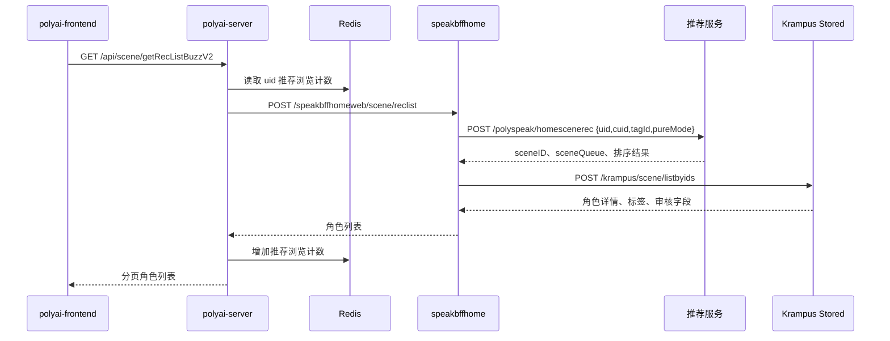

# SEARCH-002 首页与分类角色推荐

## 1. 功能概述

- 入口：`components/DiscoverList/index.vue`、标签页 `pages/tags/[tagId].vue`。
- 触发：首次加载、分页、切换分类/性别、刷新。
- 关键字段：`sid`、`uid`、`cuid`、`source/sourceSub`、`tagId`、`filterGender`、`page/pageSize`、`pureMode`、`filter`、`is_audit_seen`。
- 状态：源码链路已确认；推荐服务召回排序为外部边界。

## 2. 核心源码流程：一次推荐

1. `components/DiscoverList/index.vue:getList` 或 `pages/tags/[tagId].vue:getRoleList` 组装分页、分类、性别和实验参数，调用推荐 API。
2. `polyai-server` 经过 `SessionMiddlewareWithCuID、IpFilter、Captcha` 后进入 `GetRecListBuzz`/`GetRecListBuzzV2` 或 `GetRecListByScene`。
3. `service/sv_scene.GetRecListBuzz` 读取用户上下文，计算推荐纯净模式、过滤模式、审核模式和投放用户状态；高风险用户会强制过滤。
4. 根据 fake/real UID 和 `pageNo` 分流；游客限制只取第一页，登录用户读取 `polyai:web:user:psres:num:{uid}_{date}` 判断推荐浏览量，超限时切换补充来源。
5. `GetScenesFromPsrec` 调用 `api_bffhome.GetRecList`，把 `uid/cuid`、`source/sourceSub`、`tagId`、分页、模式字段和 `ProxyKeyUserInfo` 传给 speakbffhome。
6. `speakbffhome` 的推荐服务调用 `/polyspeak/homescenerec`，获得 `sceneID`、`sceneQueue` 和排序结果；BFF 再通过 Krampus Stored 批量补齐角色信息。
7. BFF 和 Web 层继续执行审核、分发、举报、敏感词和角色类型过滤，并按场景补充真人信息、照片数量或漫画更新。
8. 返回列表后，Web 层增加推荐浏览计数；直播入口、漫画更新和 `downloadAppMark` 按条件写入响应。

| 步骤 | 关键字段/状态变化 | 源码证据 |
|---|---|---|
| 请求进入 | `uid`、`cuid`、`sid`、分页字段 | `polyai-server/router/http.go`、`controllers/http/scene/scene.go` |
| 模式计算 | `pureMode`、`filter`、`is_audit_seen` | `service/sv_scene/get_rec_list.go` |
| 推荐限制 | `uid` 推荐浏览日计数 | `service/sv_scene/get_rec_list.go`、`components/cache/cache.go` |
| 召回与补全 | `sceneID`、`sceneQueue` → 角色字段 | `speakbffhome/api/psrec/client.go`、`krampus/controllers/scene/service_list.go` |

## 3. 端到端时序图

## 4. 链路说明

| 层级 | 文件/函数 | 说明 |
|---|---|---|
| 前端 | `components/DiscoverList/index.vue:getList` | 调用 `SMApiSceneGetRecListBuzzV2`，同时获取风险配置和广告插入位置 |
| 前端 | `pages/tags/[tagId].vue:getRoleList` | 调用 `SMApiSceneGetRecListByScene` 获取标签/活动角色列表 |
| API | `networkapi/yapiApi/index.ts` | `/api/scene/getRecListBuzzV2`、`/api/scene/getRecListByScene`，YApi：[1733381](https://yapi.yukework.com/project/10756/interface/api/1733381)、[900306](https://yapi.yukework.com/project/10756/interface/api/900306) |
| Router/Handler | `polyai-server/router/http.go`、`controllers/http/scene/scene.go` | `GetRecListBuzzV2`、`GetRecListByScene` |
| Service | `service/sv_scene/get_rec_list.go` | 风险/纯净模式、游客/登录分流、推荐浏览限制、补充角色和直播/漫画内容 |
| BFF | `api/api_bffhome/bff_home.go:GetRecList` | 调用 `/speakbffhomeweb/scene/reclist`，传递 `ProxyKeyUserInfo` |
| 推荐服务 | `speakbffhome/api/psrec/client.go` | 调用 `/polyspeak/homescenerec`，返回 sceneID 和排序信息 |
| 角色数据 | `speakbffhome/api/krampus/client.go` | `/krampus/scene/listbyids` 批量补齐展示字段 |

## 5. 关键分支与资源

- 游客只返回第一页；登录用户按 `polyai:web:user:psres:num:{uid}_{date}` 控制推荐浏览量。
- 超过 `UserDiscoverySceneNum` 后切换补充来源，并设置 `downloadAppMark`。
- 高风险用户开启纯净/过滤模式；真人角色对 VIP 用户存在例外判断。
- 结果补充可能调用 `davinci.GetSceneMomentBySceneIDs` 获取照片数量。
- 漫画分类可能通过 `polyai:web:user:psres:comic:{uid}_{date}` 记录每日更新插入状态。

## 6. 数据与边界

| 类型 | 结论 |
|---|---|
| Redis | 已确认浏览计数、推荐计数、漫画更新展示状态；TTL 由 `cache.DefaultExpire` 或显式 86400 秒设置 |
| DB | `polyai-server` 当前请求不直接访问角色 DB；Krampus Stored 的底层模型可追溯到 `tblScene`、`tblSceneExtInfo`，但在线接口走 Stored |
| MQ | 当前请求未发现 Producer；推荐服务内部召回和异步更新不在可访问链路 |

## 7. 源码证据

- 前端：`components/DiscoverList/index.vue`、`pages/tags/[tagId].vue`。
- Web：`polyai-server/service/sv_scene/get_rec_list.go`、`api/api_bffhome/bff_home.go`。
- BFF：`speakbffhome/controllers/web/scene/service.go`、`api/psrec/client.go`、`api/krampus/client.go`。
- 数据补全：`krampus/controllers/scene/service_list.go`、`internal/scene/repo/scene.go`。
