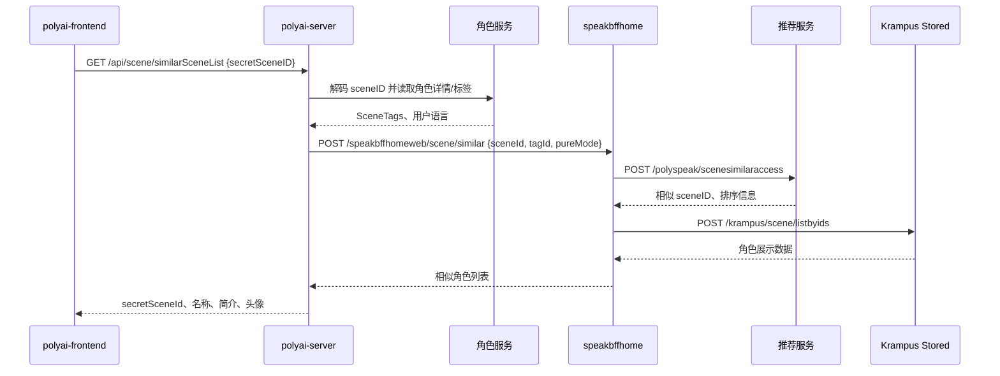

# SEARCH-003 相似角色推荐

## 1. 功能概述

- 入口：角色详情页 `components/Chat/PageProfile.vue`、`components/Chat/Plugins/RecommendRole/ui.vue`、漫画详情页。
- 触发：已有角色详情或聊天角色信息可用时，以 `secretSceneID` 请求相似角色。
- 关键字段：`secretSceneID`、解码后的 `sceneID`、角色标签 `tagId`、`uid/cuid`、`pureMode`、`filter`、`is_audit_seen`。
- 状态：源码链路已确认；推荐服务相似度召回为外部边界。

## 2. 核心源码流程：一次相似推荐

1. 角色详情页或聊天推荐组件调用 `SMApiSceneSimilarSceneList`，只提交加密角色 ID `secretSceneID`。
2. `GetSimilarSceneList` 进入 `GetSimilartList`，先 Base54 解码为 `sceneID`，再调用角色服务获取当前角色详情和 `SceneTags`。
3. Web 层读取推荐/过滤/审核开关，并结合 `uid/cuid`、年龄和风险等级计算 `pureMode`、`filter`、`is_audit_seen`。
4. `api_bffhome.GetSimilarScene` 将 `sceneID`、角色 `tagId`、模式字段和上下文转发到 speakbffhome。
5. speakbffhome 的 `SimilarSceneV2` 调用推荐服务 `/polyspeak/scenesimilaraccess`，获得相似角色 `sceneID` 和排序信息。
6. BFF 调用 Krampus `SceneListByIDs` 从 Stored 批量补齐名称、简介、头像和审核字段，并执行审核、敏感词、隐藏类型过滤。
7. Web 层过滤特殊角色，重新编码 `secretSceneId`，按需要调用 davinci 补充照片数，返回前端。

| 步骤 | 关键字段/状态变化 | 源码证据 |
|---|---|---|
| 输入解码 | `secretSceneID` → `sceneID` | `polyai-server/service/sv_scene/get_similar_scene.go` |
| 标签获取 | `sceneID` → `SceneTags/tagId` | 同上，角色服务 Client |
| 模式计算 | `pureMode`、`filter`、`is_audit_seen` | 同上 |
| 召回补全 | `sceneID` → 角色展示字段 | `speakbffhome/controllers/web/scene/service.go`、`krampus/controllers/scene/service_list.go` |

## 3. 端到端时序图

## 4. 链路说明

| 层级 | 文件/函数 | 说明 |
|---|---|---|
| 前端 | `components/Chat/PageProfile.vue` | `getSimilarSceneList` 调用相似角色接口 |
| 前端 | `components/Chat/Plugins/RecommendRole/ui.vue` | 聊天页推荐角色组件调用同一接口 |
| API | `networkapi/yapiApi/index.ts` | `GET /api/scene/similarSceneList`，YApi：905208 |
| Router/Handler | `polyai-server/router/http.go`、`controllers/http/scene/scene.go` | `GetSimilarSceneList` |
| Service | `service/sv_scene/get_similar_scene.go:GetSimilartList` | 解码 sceneID、读取角色标签、计算风险/纯净模式、调用 BFF、过滤 specialty |
| BFF | `speakbffhome/controllers/web/scene/service.go:SimilarSceneV2` | 调用 psrec，相似结果再由 Krampus 批量补齐 |
| 推荐服务 | `speakbffhome/api/psrec/client.go:WebSimilarScene` | `/polyspeak/scenesimilaraccess`，返回 sceneID 和排序信息 |
| 角色补全 | `speakbffhome/api/krampus/client.go:SceneListByIDs` | 读取 Stored 角色信息 |

## 5. 数据与边界

| 类型 | 结论 |
|---|---|
| Redis | 当前相似角色主链路未发现专用业务计数 Key |
| DB | 当前请求没有直接 DB 读写；角色详情和标签由角色服务/Stored 提供 |
| MQ | 当前请求未发现 Producer 或 Consumer |
| 过滤 | 高风险开启纯净/过滤模式；隐藏漫画类型、审核池和敏感词由 BFF 侧继续过滤 |

## 6. 源码证据

- 前端：`components/Chat/PageProfile.vue`、`components/Chat/Plugins/RecommendRole/ui.vue`。
- Web：`polyai-server/service/sv_scene/get_similar_scene.go`、`api/api_bffhome/bff_home.go`。
- BFF：`speakbffhome/controllers/web/scene/service.go`、`api/psrec/client.go`。
- 角色补全：`speakbffhome/api/krampus/client.go`、`krampus/controllers/scene/service_list.go`。
