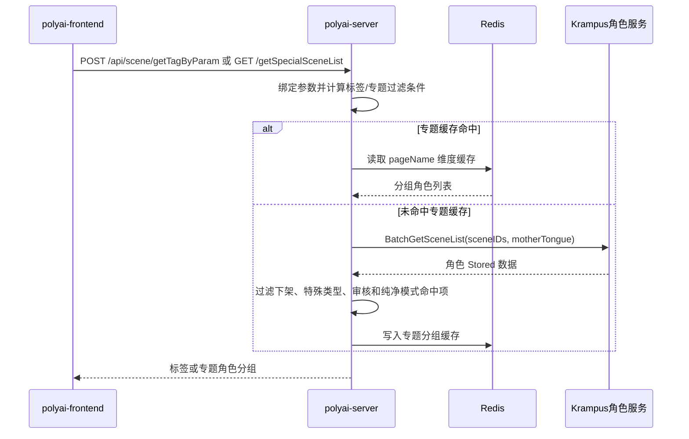

# SEARCH-004 标签与专题导航

## 1. 功能概述

- 页面入口：`pages/tags/index.vue`、`pages/tags/[tagId].vue`、`components/topics/Index.vue`。
- 功能聚合：标签目录、标签详情、专题页角色分组。
- 状态：源码链路已确认。
- 关键字段：`tagId`、`pageName`、`sceneID`、`secretSceneId`、`motherTongue`、`filterMode`。

## 2. 核心源码流程

### 标签目录与标签详情

1. 前端标签首页调用 `SMApiSceneGetTagByParam`，标签详情页调用 `SMApiSceneGetTagById`；标签详情拿到标签后，再调用 `SMApiSceneGetRecListByScene` 拉取角色列表，该推荐部分归入 SEARCH-002。
2. `polyai-server/router/http.go` 将请求交给 `GetAllTag` 或 `GetTagById`，Handler 绑定请求后调用 `sv_scene.GetAllTag/GetTagById`。
3. 标签服务设置展示过滤条件：`GetAllTag` 固定过滤 `story`、`character origin`、`identity`、`personality` 之外的父标签，并只取在线状态；具体标签和层级数据由下游角色/标签服务返回。

### 专题页

1. `components/topics/Index.vue` 传入 `pageName` 调用 `SMApiSceneGetSpecialSceneList`。
2. `GetSpecialTopicList` 先按运行环境校验 `pageName` 是否存在于在线或测试专题配置，再读取 Redis 缓存。
3. 未命中缓存时，从服务端专题配置取得分组 `sceneID`，调用 `service.BatchGetSceneList` 批量读取角色数据，过滤特殊类型、下架、未通过审核和纯净模式命中的角色。
4. 结果将真实 `sceneID` 编码为 `secretSceneId`，按分组返回，并以 `pageName + motherTongue + filterMode` 写入 Redis，TTL 为 2 小时。

## 3. 时序图

## 4. API 与源码证据

| API | YApi | Web 入口 | 服务实现 |
|---|---|---|---|
| `POST /api/scene/getTagByParam` | [900285](https://yapi.yukework.com/project/10756/interface/api/900285) | `GetAllTag` | `service/sv_scene/gettaglist.go` |
| `POST /api/scene/getTagById` | [900899](https://yapi.yukework.com/project/10756/interface/api/900899) | `GetTagById` | `service/sv_scene/gettaglist.go` |
| `GET /api/scene/getSpecialSceneList` | [914393](https://yapi.yukework.com/project/10756/interface/api/914393) | `GetSpecialSceneList` | `get_special_topic_list.go` |

## 5. 数据与边界

| 类型 | 结论 |
|---|---|
| Redis | 专题缓存 Key 由 `pageName`、语言和 `filterMode` 构成，TTL 2 小时 |
| DB | `polyai-server` 不直接访问角色表，角色数据通过 `BatchGetSceneList` 获取 |
| MQ | 当前入口未发现 MQ Producer |

