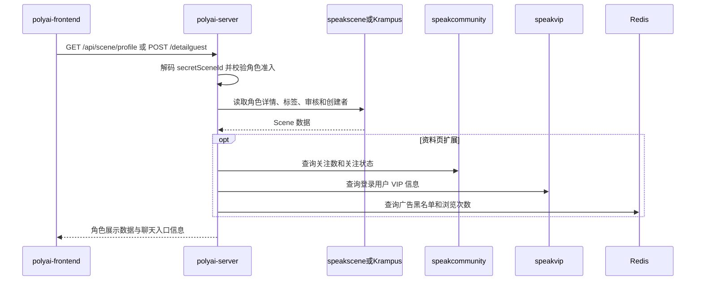

# SEARCH-005 角色详情与资料页

## 1. 功能概述

- 页面入口：聊天页初始化、`components/Chat/PageProfile.vue`、`components/Chat/RoleProfile.vue`。
- 功能聚合：游客角色详情、登录用户角色资料、资料页的准入和展示数据。
- 状态：源码链路已确认。
- 关键字段：`secretSceneId`、解码后的 `sceneID`、`uid`、`cuid`、`createUID`、`specialty`、`opStatus`、`sceneAgeGroup`。

## 2. 核心源码流程

1. 游客进入聊天页时，前端调用 `SMApiSceneDetailguest`；资料页按登录态在 `SMApiSceneProfile` 与 `SMApiSceneProfileguest` 之间选择。
2. `SceneDetailGuest` / `GetSceneProfile` 入口先绑定参数；Service 对 `secretSceneID` 做 Base54 解码，拒绝直接传入数字 ID。
3. 通过 `api_speakscene` 或 `service.BatchGetSceneList` 读取角色 Stored 数据，检查角色是否存在、删除、私有、仅作者可见、审核状态和真人角色展示条件。
4. Service 按当前用户语言和是否为创建者选择原始名称或翻译名称，编码角色 ID 和创建者 ID 为 `secretSceneId/secretCreateUserId`。
5. 资料页继续聚合关注数/关注状态；按降级配置读取照片数量、VIP 信息和记忆红点；广告黑名单与角色年龄组决定 `adLimit`。
6. 组装聊天入口需要的角色信息、开场白、背景、类型、标签和风控/年龄检测字段后返回前端。

## 3. 时序图

## 4. API 与源码证据

| API | YApi | 前端入口 | Web 实现 |
|---|---|---|---|
| `POST /api/scene/detailguest` | [873348](https://yapi.yukework.com/project/10756/interface/api/873348) | 聊天页游客初始化 | `scenedetailguest.go` |
| `GET /api/scene/profile` | [882719](https://yapi.yukework.com/project/10756/interface/api/882719) | `PageProfile.vue`、`RoleProfile.vue` | `get_profile_info.go` |
| `GET /api/scene/profileguest` | [882875](https://yapi.yukework.com/project/10756/interface/api/882875) | `PageProfile.vue` | `get_profile_info.go` |

## 5. 数据与边界

| 类型 | 结论 |
|---|---|
| Redis | 游客/登录用户资料页浏览集合、广告黑名单 Set |
| DB | Web 层通过角色服务和 Stored 获取角色数据，不直接读角色表 |
| 其他服务 | `speakcommunity` 提供关注数据，`speakvip` 提供 VIP 信息，`davinci` 可提供照片数量 |
| MQ | 当前入口未发现 MQ Producer |

