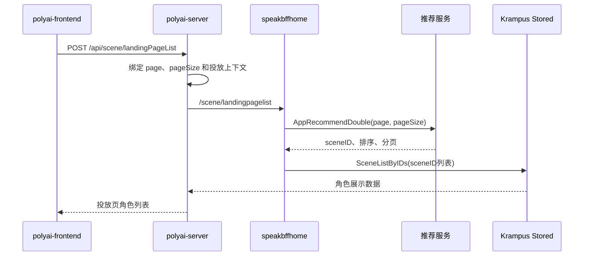

# SEARCH-006 投放落地页推荐

## 1. 功能概述

- 页面入口：`polyai-frontend/pages/get-app/discover.vue`、`components/DiscoverList/index.vue` 的投放场景。
- API：`POST /api/scene/landingPageList`。
- 状态：源码链路已确认。
- 关键字段：`page`、`pageSize`、`uid`、`cuid`、`motherTongue`、服务端投放配置。

## 2. 核心源码流程

1. 前端投放发现页调用 `SMApiSceneLandingPageList`，传入分页参数。
2. `polyai-server` 的 `GetLandingPageList` 完成参数绑定后调用 `sv_scene.GetLandingPageList`。
3. `api_bffhome.GetLandingPageList` 转发到 `speakbffhomeweb/scene/landingpagelist`。
4. `speakbffhome/controllers/app/landing/service.go:GetLandingPageList` 先调用 `psRecCli.AppRecommendDouble` 获取角色 ID、排序和分页信息，再调用 `krampusCli.SceneListByIDs` 补齐角色数据，并执行落地页过滤。
5. Web 层返回适合投放页展示的角色列表；它使用独立的落地页推荐方法，不是普通 Web `scene/reclist` 的直接复用。

## 3. 时序图

## 4. API 与源码证据

| API | YApi | Web 入口 | 服务实现 |
|---|---|---|---|
| `POST /api/scene/landingPageList` | [1790146](https://yapi.yukework.com/project/10756/interface/api/1790146) | `GetLandingPageList` | `service/sv_scene/landing_list.go` → `api_bffhome.GetLandingPageList` |

## 5. 数据与边界

- 当前 `polyai-server` 入口未发现 MQ Producer。
- 推荐召回和角色补全已追踪到 `speakbffhome/controllers/app/landing/service.go`；推荐服务内部召回策略仍是当前可访问链路之外的边界。

