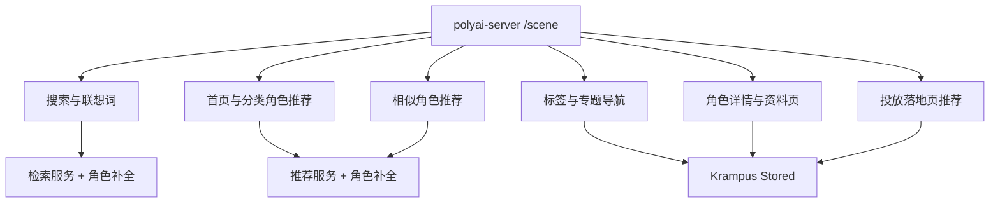
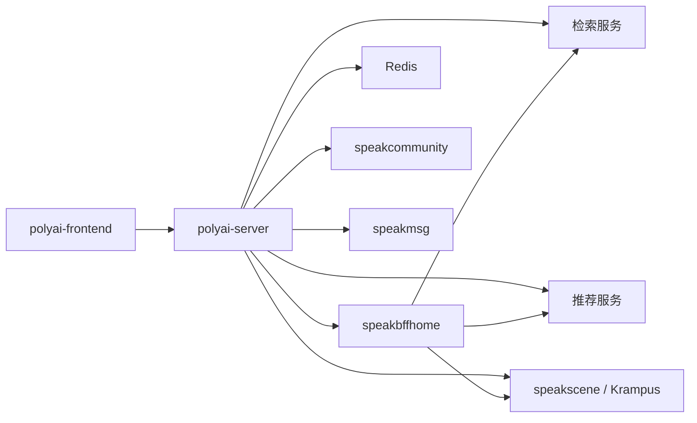

# 02 发现与搜推

## 1. 功能聚类

搜推以 `polyai-server/controllers/http/scene` 和 `/scene` 路由为 Web 入口，按用户行为聚合为以下能力：

| 目录 | 功能 ID | 能力范围 |
|---|---|---|
| [01-搜索与联想词](./01-搜索与联想词/README.md) | SEARCH-001 | 搜索框联想词、关键词搜索、搜索限制与结果补全 |
| [02-首页与分类角色推荐](./02-首页与分类角色推荐/README.md) | SEARCH-002 | 首页推荐、分类/标签角色列表、分页、刷新和风险过滤 |
| [03-相似角色推荐](./03-相似角色推荐/README.md) | SEARCH-003 | 角色详情页、聊天页、漫画页的相似角色召回 |
| [04-标签与专题导航](./04-标签与专题导航/README.md) | SEARCH-004 | 标签目录、标签详情、专题页角色分组 |
| [05-角色详情与资料页](./05-角色详情与资料页/README.md) | SEARCH-005 | 角色详情、角色资料页、登录/游客展示差异 |
| [06-投放落地页推荐](./06-投放落地页推荐/README.md) | SEARCH-006 | 投放落地页的角色列表和独立推荐分组 |

## 2. 总体入口图

## 3. 聚类原则

- `getRecListBuzzV2` 与 `getRecListByScene` 共享推荐计算、风险过滤和角色补全，归入同一“首页与分类角色推荐”能力。
- `getTagByParam`、`getTagById`、`getSpecialSceneList` 都是导航数据准备，归入“标签与专题导航”。
- `detailguest`、`profile`、`profileguest` 都围绕角色进入聊天前的展示与准入，归入“角色详情与资料页”。
- `landingPageList` 有独立的投放入口、认证方式和配置数据，单独归入“投放落地页推荐”。

## 4. 服务依赖图

## 5. 入口证据

| 层级 | 位置 | 说明 |
|---|---|---|
| Router | `polyai-server/router/http.go:178-210` | 注册搜索、推荐、标签、专题、详情、相似推荐路由 |
| Handler | `polyai-server/controllers/http/scene/scene.go` | 参数绑定后调用 `sv_scene` 服务 |
| Service | `polyai-server/service/sv_scene/` | 风险模式、限流、服务编排、结果补全 |
| 前端 API | `polyai-frontend/networkapi/yapiApi/index.ts` | 生成请求契约和 YApi 关联 |

