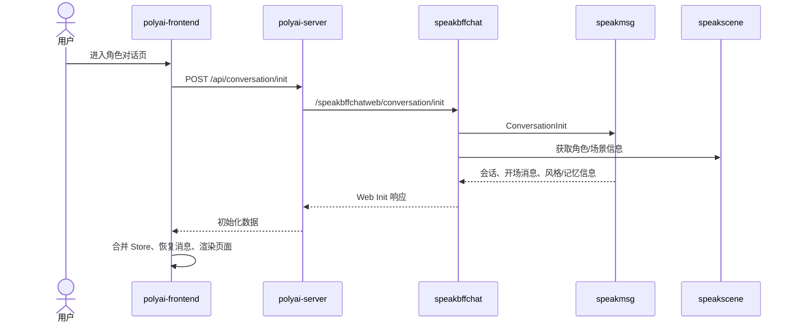

# CHAT-001 对话初始化

## 状态

- 分析状态：源码已确认
- 证据等级：L1/L2
- 主要入口：`POST /api/conversation/init`
- YApi：[854980](https://yapi.yukework.com/project/10756/interface/api/854980)

## 前端入口

`polyai-frontend/components/Chat/store/state.ts:326-381`

- 登录用户调用 `SMApiConversationInit`。
- 游客调用 `SMApiSceneDetailguest`，不会创建登录用户会话。
- 请求携带 `secretSceneId`、未成年输入/输出检测开关、`supportCompactStream=1` 和 Web SOV 资格快照。
- 返回结果合并到聊天 Store，随后格式化开场消息并触发页面展示埋点。

## 链路图

## 关键源码

| 层级 | 位置 | 说明 |
|---|---|---|
| Web | `polyai-frontend/components/Chat/store/state.ts:326` | `getInitial` |
| API | `polyai-frontend/networkapi/yapiApi/index.ts` | `SMApiConversationInit` |
| Proxy | `polyai-server/conf/mount/proxy_bffchat.yaml` | `speakbffchatweb` 代理配置 |
| BFF | `speakbffchat/controllers/web/conversation/api.go` | `init` 路由 |
| BFF | `speakbffchat/controllers/web/conversation/service_init.go:34` | Init 业务逻辑 |
| MSG | `speakmsg/controllers/inner/api.go` | `/speakmsginternal/conversation/init` |

## 源码级深挖：初始化不是单一请求

当前链路需要区分两个阶段：

1. 页面进入时的 `conversation/init`：主要读取角色、用户会话、Session、最近消息和权益，同时清理未读状态。
2. 首次发送时的 `ConversationInitSave`：获取/创建 Session，初始化会话扩展，必要时写入开场白，再把结果交给 Muse 生成。

因此，页面 Init 成功不代表数据库已经创建了完整聊天会话；真正的初始化落库通常发生在首次发送消息的 `initsave` 阶段。

## speakbffchat Init 内部阶段

源码：`controllers/web/conversation/service_init.go:34`。

### 1. 身份、参数与互斥

- 从请求上下文读取 UID，并通过压测 UID 规则修正。
- UID 为空直接返回；SceneID 为空返回场景不存在。
- 以 `user + scene` 生成 `LOCK_KEY_USER_SCENE_INIT`，申请 5 秒 Redis 互斥锁。
- 抢锁失败时当前实现返回空响应，不继续重复初始化。

### 2. 角色准入

调用 `getSceneDetailNew` 获取角色展示信息，并检查角色下架、审核状态、公开状态以及 Realistic 场景的国家/审核限制。开场白为空时返回数据库逻辑异常。

这一步主要读取 speakscene 及其下游数据，不是 speakmsg 消息读取。

### 3. 并行聚合

`GetInitSceneCreatorAndConversation` 使用协程池并行执行：

- `s.msgCli.ConversationInit`：读取用户-角色会话初始化信息。
- `s.speakAccountCli.UserDetailByID`：读取角色创建者信息。

BFF 随后继续聚合相册、关注数、VIP、装扮、语音、聊天风格轮次、记忆和 SOV 能力，最终返回 Web 视图模型，而不是直接透传 speakmsg 响应。

## speakmsg ConversationInit 内部阶段

源码：`speakmsg/controllers/inner/service.go:810-973`。

### 并行读取

| 读取项 | 模块/对象 | 作用 |
|---|---|---|
| 用户场景会话 | `userSceneSrv.GetValidByUIDSceneID` | 会话主状态、最近聊天时间、隐藏/置顶 |
| 会话扩展 | `userSceneExtSrv.GetDetailByUSceneID` | Persona、聊天风格、背景、状态栏、SOV |
| 当前 Session | `sessionSrv.GetLatestChatSessionId` / `GetSessionByIdV2` | 当前 Session、剧情扩展 |
| 最近消息 | `gptMsgSrv.GetMsgLimitListByUSceneID(... limit=1)` | 判断是否已有消息、最后一条是否开场白 |
| 未读状态 | `gptMsgSrv.GetAndSetReadMsgKey` | 读取并清理未读标记 |

这些读取通过协程并行执行。会话扩展读取失败会影响主流程；未读标记读取失败则被降级为无未读，不阻断初始化。

### 响应组装

`formatUserSceneInit` 将会话主表和扩展表映射为 `UserSceneInit`：

- 没有扩展记录时使用默认聊天风格和默认语聊风格。
- 有扩展记录时读取 Persona、CustomVoice、装扮、背景、聊天风格和 Transition。
- 回填 `SessionID`、`FictionRecall`、`HadUnread`、`ExistNormalMsg`、`LastMsgIsPrologue`。
- 如果最近 AI 消息存在候选，继续读取 `GetChooseByParentMsgId`。
- 如果 Session 扩展存在 `OpeningMsgID`，通过 `lookupOpeningPrologue` 找回开场白。

`ConversationInit` 本身没有调用 `SaveRecords`；它主要是读路径，并通过 Redis 未读 Key 产生状态变化，不能描述为“初始化接口直接创建完整会话”。

## 首次发送时的 ConversationInitSave

调用位置：`speakbffchat/controllers/web/conversation/service_msg_stream.go:189`；封装位置：`internal/conversation/service.go:510`。

请求携带 UID、SceneID、SessionID、SelectID、开场白文本/音频、语言、媒体类型、是否需要昵称、是否需要记忆和是否需要上一轮轮次。

在 speakmsg `ConversationInitSave` 中依次完成：

1. 校验 UID 和 SceneID。
2. SessionID 为空时调用 `GetSetLatestSession` 获取或创建最新 Session。
3. `NeedMemory` 开启时查询并刷新记忆初始化状态。
4. `SelectID` 大于 0 时读取选择消息，已被使用的候选不会重复返回。
5. 对 `UserSceneConversationExt` 执行 `FirstOrCreate`，读取昵称、Persona、Summary、Relax、StateBar 和 SOV 扩展。
6. 按需计算当前 Session 的最后消息轮次。
7. 读取有效的用户-角色场景。
8. 通过 `InitSceneMsg` 构造开场白消息；必要时写入开场白并记录 `OpeningMsgID`。
9. 结束时触发 `FlushStoredAsync`，进入 `hire_speakmsg_conv_async` 异步一致性链路。

返回的 `SessionID`、`MemoryInfo`、`SelectMsg`、`LastMsgRound` 会被 BFF 注入后续 Muse 请求；`FindMaster` 等字段还会根据是否真正插入开场白决定。

## 初始化涉及的数据与事件

| 数据/事件 | 阶段 | 作用 |
|---|---|---|
| `tblUserSceneConversation` | Init 读取；InitSave 读取/更新 | 用户-角色会话主状态 |
| `tblUserSceneConversationExt` | Init 读取；InitSave FirstOrCreate | Persona、风格、背景、状态栏、SOV |
| `tblConversationSession` | Init 读取；InitSave 获取/创建 | 当前 Session 与剧情扩展 |
| `tblGPTMsg` | Init 读取最近消息；InitSave 必要时写开场白 | 判断已有聊天、开场白和消息分支 |
| Redis 未读 Key | Init 读取并清理 | 清除会话未读状态 |
| `hire_speakmsg_conv_async` | InitSave 结束后 | Stored/DB 异步一致性与补偿 |

