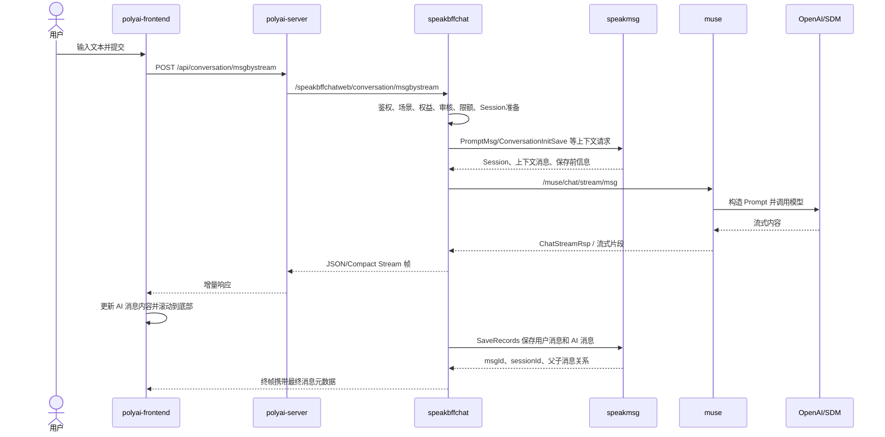

# CHAT-002 非 SOV 模式发送消息与流式回复

数据层详图：

- [用户与对话业务表、分库分表](../../../database/业务表与分库分表.md)

## 状态

- 分析状态：源码已确认
- 证据等级：L1/L2
- 登录接口：`POST /api/conversation/msgbystream`
- 登录接口 YApi：[855221](https://yapi.yukework.com/project/10756/interface/api/855221)
- 游客接口：`POST /api/conversation/msgbystreamasguest`
- 游客接口 YApi：[872688](https://yapi.yukework.com/project/10756/interface/api/872688)
- 游客链路详见：[CHAT-009 游客对话](../09-游客对话/README.md)
- 流式协议：普通 JSON 流；支持 Compact Stream，前端通过下载进度增量解析。

## 前端入口

主要位置：

- `polyai-frontend/components/Chat/store/state.ts`：非 SOV 请求选择 `/api/conversation/msgbystream`；SOV 请求已拆到 [CHAT-010](../10-SOV模式发送消息与流式回复/README.md)。
- `polyai-frontend/networkapi/yapiApi/index.ts:10277-10507`：请求和响应契约。
- `polyai-frontend/components/Chat/store/state.ts`：发送、流式帧解析、终帧处理和错误恢复。

请求关键字段包括：`secretSceneId`、`mediaType`、`speechText`、`sid`、`isRetry`、`currentChatStyleId`、`supportCompactStream` 和未成年检测开关。非 SOV 请求不以 `webSovEligible` 作为计费模式切换条件。

响应关键字段包括：`content`、`isEnd`、`msgId/msgIdStr`、`parentMsgId`、`selectId`、`dangerousWords`、`pws`、`currentRound` 和歌曲/记忆等扩展字段。

## 端到端时序图

## BFF 关键阶段

`speakbffchat/controllers/web/conversation/service_msg_stream.go:47` 的 `MsgByStream` 当前可确认包含：

1. 输入参数、CUID 和用户上下文处理；
2. 纯净模式/未成年检测/危险词检测；
3. Web 聊天日限额和权益判断；
4. 角色场景查询和聊天 Session 初始化；
5. 调用 Muse 流式生成；
6. 未成年回复重试或安全模型分支；
7. 调用 `speakmsg.SaveRecords` 保存一轮消息；
8. 将最终消息 ID、候选 ID、展示扩展字段写入终帧。

`callMuseStream` 位于 `service_msg_stream.go:794`，构造 `muse.ChatMsgReq` 并调用 `s.museCli.MsgByStream`。

本卡片只描述非 SOV 分支：BFF 按普通聊天风格执行会员/积分/免费轮次判断，不执行 SOV 宝石预占、SOV Prompt 轮次和 SOV 生成类型注入。SOV 分支见 [CHAT-010](../10-SOV模式发送消息与流式回复/README.md)。

## 存储与成功边界

- Muse 产生内容只代表模型生成成功。
- `speakmsg.SaveRecords` 成功后，用户消息和 AI 消息才完成持久化闭环。
- 前端收到终帧不应简单等同于 DB 已落库，需以 BFF 保存结果和终帧字段判断。
- 游客链路与登录链路不同，不调用普通登录链路的 `UserSceneInitSave` 和 `SaveRecords`，详见 CHAT-009。

## 异常路径

- 输入审核失败：BFF 在调用 Muse 前返回错误。
- Muse 失败：不应写入正常 AI 消息，前端进入发送失败态。
- 未成年回复重试：BFF 可先发出特殊 `isEnd=99` 帧，再走安全模型重试。
- 保存失败：需要确认前端终帧、部分消息和重试行为。
- 客户端超时/主动取消：需要补充 Muse context cancel、BFF 保存策略和消息状态证据。

## 源码级深挖：MsgByStream 内部阶段

### 1. 请求预处理与权限

`MsgByStream` 进入后先完成用户/CUID 解析、场景与 Mod 查询、纯净模式过滤、用户/角色未成年检测、危险词检测、聊天日限额和 VIP/聊天风格权益判断。此阶段任何失败都不会进入 Muse。

### 2. 初始化会话上下文

首次发送或需要补齐会话时，BFF 调用 `UserSceneInitSave` → speakmsg `ConversationInitSave`，获得：

- 当前 `SessionID`；
- 用户 Persona、记忆和昵称；
- 选择消息 `SelectMsg`；
- 上一轮消息轮次；
- 是否插入过开场白；
- 当前会话的 SOV/风格扩展。

这些结果随后被转换为 `muse.ChatMsgReq`，不是由前端直接决定最终 Prompt 上下文。

### 3. Muse 请求组装

源码：`service_msg_stream.go:794-870`。

BFF 传给 Muse 的关键上下文包括 `UserContent`、`ChatStyleID`、`Memory`、`PermanentMemory`、`FindMaster`、`HitAudit`、`UserInfo`、`VipItem`、`CuIDVc`、`SceneModDetail`、`SelectMsg`、`ChatSessionID`、`GuardItem` 和未成年检测配置。

其中 `FindMaster` 会根据 InitSave 是否真正插入开场白决定；`ChatSessionID` 来自 speakmsg，而不是简单使用前端 sid。

### 4. Muse 内部生成

Muse 入口为 `/muse/chat/stream/msg`。进入 `StreamMsg` 后根据危险设备、审核态、纯净模式、SOV、聊天风格、第三方模型分流和自研 GPT 兜底策略选择生成路径。Prompt 组装阶段会通过 speakmsg `PromptMsg` 获取历史消息/上下文，然后调用 OpenAI、SDM 或其他模型适配器产生流式内容。

### 5. BFF 流处理与安全重试

BFF 接收 Muse 流后转换为 Web JSON/Compact Stream 帧并刷新给前端。若命中未成年审核策略，可能先发送 `isEnd=99` 的中间状态，再使用安全聊天风格重新调用 Muse；再次命中时发送错误终帧，不进入正常保存流程。

### 6. 保存一轮消息

Muse 正常结束后，BFF 组装用户消息和 AI 消息调用 `speakmsg.SaveRecords`：

- speakmsg 通过 Galaxy 一次申请两个消息 ID；
- 用户消息 ParentMsgID 指向上一条消息；
- AI 消息 ParentMsgID 指向本轮用户消息；
- 主消息写入 `tblGPTMsg` 逻辑表；
- 更新会话最近时间、未读/缓存等状态；
- 扩展消息和记忆数据进入对应异步 Topic。

因此“模型返回内容”“前端收到终帧”“主消息持久化成功”是三个不同成功边界。

## 关键失败分支

| 阶段 | 失败结果 |
|---|---|
| 输入/场景/权益预检 | 不调用 Muse，直接返回业务错误 |
| Muse 首次生成 | 前端得到失败态；是否保存半成品需继续追踪取消/异常处理源码 |
| 未成年安全重试 | 可能发送中间终帧，再走安全风格或直接结束 |
| SaveRecords | 生成已完成但消息可能未持久化，需结合终帧和日志判断 |
| 客户端主动断流 | Context 传播、Muse 停止和部分内容保存策略尚未确认 |
