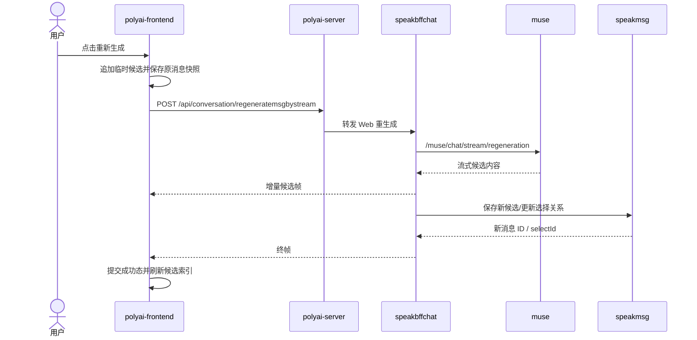

# CHAT-003 AI 消息重新生成

## 状态

- 分析状态：源码已确认
- 证据等级：L1/L2
- 接口：`POST /api/conversation/regeneratemsgbystream`
- YApi：[895820](https://yapi.yukework.com/project/10756/interface/api/895820)

## 前端链路

`polyai-frontend/components/Chat/store/state.ts:1017-1123`：

- 将当前 AI 消息复制为恢复快照；
- 在候选列表中追加临时消息并切换选中态；
- 以当前消息 `msgId`、角色 ID、聊天风格和安全检测参数发起流式请求；
- 按原消息是否为 SOV 选择普通或 SOV 重生成入口；
- 流式失败时恢复原消息和之前的选中索引；
- 成功后更新候选消息、选择 ID、内容和积分余额。

## 端到端时序图

## 后端证据

| 层级 | 位置 | 说明 |
|---|---|---|
| BFF 路由 | `speakbffchat/controllers/web/conversation/api.go:40` | `regeneratemsgbystream` |
| BFF Service | `speakbffchat/controllers/web/conversation/service_regenerate.go:37` | 重生成入口 |
| Muse 路由 | `muse/controllers/http/chat/api.go` | `/muse/chat/stream/regeneration` |
| Muse Service | `muse/controllers/http/chat/service_regeneration.go` | 重生成模型分流 |
| 消息中台 | `speakmsg/controllers/inner/api.go` | `regenerateadd`、`regeneratelistadd`、`saverecords` |

## 源码级一致性结论

- 重生成失败时前端恢复原消息和原选中项；BFF 已对额度消费做失败补偿。
- BFF 生成新的 SelectID，调用 `MsgRegenerateAdd` 写入候选内容、原 MsgID、Session、模型、风格、审核和 SOV 扩展。
- speakmsg 选择服务对同一 MsgID 执行候选互斥：其他候选 `is_use=0`，目标 SelectID `is_use=1`。
- SOV 重生成依据原消息 `MsgAttr` 判定，不能仅依据前端当前开关。
- Stored 异步模式通过 `BuildSelectMsgSwitchUseOp` 写入扩展操作，双写模式同时更新数据库选择表和 Stored 数组。

## 源码级深挖：重生成不是简单覆盖原消息

### 1. BFF 前置处理

`controllers/web/conversation/service_regenerate.go:37` 负责校验用户、场景、目标消息、免费重生成次数/额度、聊天风格和 SOV 资格，并读取原消息上下文。重生成会申请新的 SelectID，不能复用前端临时生成的 ID 作为最终持久化 ID。

### 2. Muse 重生成分流

Muse `controllers/http/chat/service_regeneration.go:StreamRegeneration` 会根据以下条件分流：

- 危险设备安全路径；
- App 审核纯绿/合规路径；
- 审核命中纯绿路径；
- Tale Saga 纯净模式；
- SOV 重生成；
- Extended、Long Reply 等特殊聊天风格；
- 第三方 LLM 分流与自研 GPT 兜底。

最终仍由 Muse 的 Prompt/模型链路生成新的候选内容，但安全路由和计费路由可能与普通发送不同。

### 3. 候选消息关系

BFF 在生成前后维护目标 AI 消息与候选消息的关系。新候选需要关联原消息的父消息/Session，并生成新的 SelectID；前端暂时显示临时候选，只有收到成功终帧后才替换正式消息 ID、内容和选中状态。

### 4. 持久化与一致性

需要同时关注三类数据：

- `tblGPTMsg`：新 AI 候选消息主体；
- `tblSelectGPTMsg`：候选/选择关系和扩展字段；
- `hire_speakmsg_msg_ext_async`：选择消息、内心独白、派生消息等扩展异步写入。

重生成失败时，前端会恢复原消息快照；但后端是否已经生成并写入了孤儿候选、以及重试是否扣除额度，需要用日志和数据库验证，不能只根据前端回滚判断后端状态。
