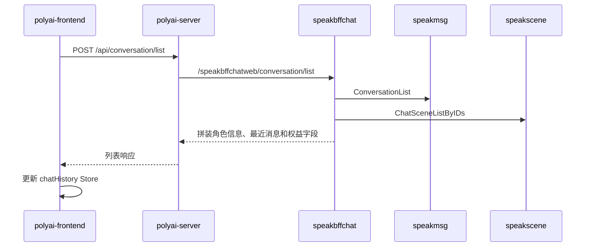
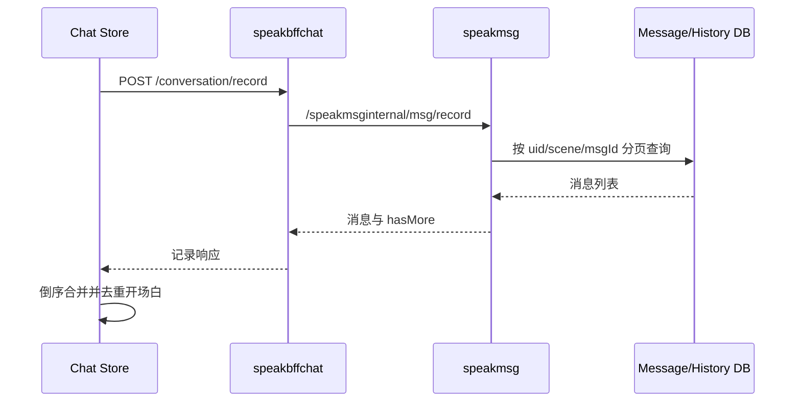

# CHAT-004 会话列表与历史消息

## 状态

- 分析状态：源码已确认
- 证据等级：L1/L2

## 功能范围

主要 YApi： [会话列表 872027](https://yapi.yukework.com/project/10756/interface/api/872027)、[消息记录 854988](https://yapi.yukework.com/project/10756/interface/api/854988)、[归档列表 904982](https://yapi.yukework.com/project/10756/interface/api/904982)、[归档消息 904990](https://yapi.yukework.com/project/10756/interface/api/904990)、[恢复消息 905009](https://yapi.yukework.com/project/10756/interface/api/905009)。

- 最近会话列表；
- 对话页面消息记录分页；
- 历史归档列表；
- 历史消息恢复；
- 删除/隐藏会话；
- 删除指定消息后的消息。

## 会话列表链路

前端 `stores/chatHistory.ts:19-49` 以 30 秒为最短远程刷新间隔，支持强制刷新；发送消息后通过 `updateSceneChatTimeInChatList` 乐观更新排序时间。

## 对话记录链路

## 历史归档链路

`speakbffchat/controllers/web/conversation/service_history.go` 已定位：

- `HistoryListMsg` 先获取角色详情，再按归档时间调用 `speakmsg` 查询历史消息；
- 会按纯净模式决定消息过滤；
- 可能补充内心独白和实况生图任务信息；
- `HistoryMsgRestore` 使用用户+角色分布式锁，调用 `speakmsg.HistoryRestoreByArchiveTime` 恢复归档消息。

## 关键接口

| Web 接口 | 下游接口 | 用途 |
|---|---|---|
| `/api/conversation/list` | `/speakmsginternal/conversation/list` | 最近会话列表 |
| `/api/conversation/record` | `/speakmsginternal/msg/record` | 当前消息记录 |
| `/api/conversation/history/archiveList` | `/speakmsginternal/historymsg/archivelist` | 归档时间列表 |
| `/api/conversation/history/msglist` | `/speakmsginternal/historymsg/msglistbyarchive` | 归档消息 |
| `/api/conversation/history/msgrestore` | `/speakmsginternal/historymsg/restorebyarchive` | 历史恢复 |

## 源码级深挖：列表与历史不是同一条读链路

### 会话列表

`service_list.go` 先获取当前用户和 VIP 信息，再调用 speakmsg `ConversationList`，随后按返回的 SceneID 批量调用 speakscene 补齐角色展示信息、角色状态和 Web UI 字段，最后由 BFF 组装列表。列表排序和最近聊天时间主要来自 `UserSceneConversation`，不是前端本地计算结果。

### 当前会话记录

`record` 走 speakmsg 消息记录查询，按 UID、SceneID、Session/消息 ID 和分页参数读取消息。前端收到后会倒序合并、去重开场白和已有消息，因此“服务端返回顺序”和“页面展示顺序”需要分别记录。

### 历史归档

`HistoryListMsg` 会先补场景详情，再调用 speakmsg `HistoryListByArchiveTime`；根据纯净模式过滤内容，并按需补充内心独白和实况生图信息。`HistoryMsgRestore` 使用用户+角色分布式锁后调用 `HistoryRestoreByArchiveTime`，恢复不是简单重新查询，而是可能触发归档数据回迁和会话状态更新。

### 删除与隐藏的边界

列表隐藏、消息删除、历史归档恢复分别对应不同服务和状态字段。当前源码已确认 speakmsg 存在 `hiddenordel`、`delaftermsgid` 和 `speakmsg_del` 事件，删除主要采用软删除和异步清理扩展数据。

### 历史恢复的底层流程

源码：`speakmsg/controllers/inner/service_history.go:360`。

1. 读取用户-角色会话，并调用 `ColdMsgHandle` 判断是否存在冷备数据；存在时强制查主。
2. 获取当前在聊 Session，调用 `SaveHistoryExcludeIntro`：当前 Session 除开场白外的消息先归档。
3. 将当前 Session 更新为非在聊，并记录历史聊天轮次。
4. 创建新的 SessionID，调用 `RestoreHistoryMsgsWithLock`，在锁内从历史消息表或 OSS 冷备恢复指定 `archiveTime` 的消息。
5. 根据恢复结果创建新的在聊 Session，或更新已有恢复 Session，并恢复 `OpeningMsgID`。
6. 清理最近消息缓存，更新 `UserSceneConversation.last_chat_time/update_time/use_cai/top`。
7. 重置 PromptLimit，并返回恢复消息数。

底层历史仓储使用 `HistoryGptMsg.GetTableName(ctx, uid)`，逻辑表为 `tblHistoryGPTMsg?`；历史消息删除采用 `delete_time` 软删除。冷备路径还会涉及 OSS 文件和冷备数据库记录。
