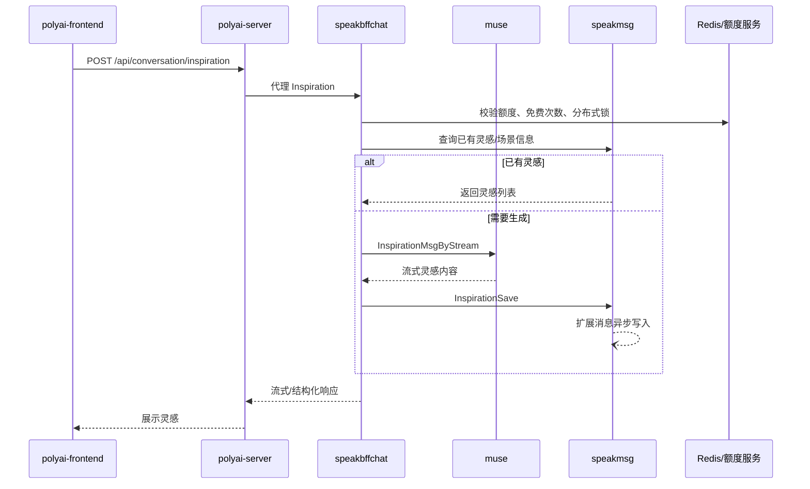

# CHAT-005 对话灵感

主要接口 YApi：[灵感回复 895825](https://yapi.yukework.com/project/10756/interface/api/895825)、[游客灵感 1805690](https://yapi.yukework.com/project/15698/interface/api/1805690)。

## 功能定义

用户在对话页获取灵感列表或生成灵感内容；已登录用户涉及额度/免费次数与持久化，游客走独立上下文链路。

## 端到端链路

## 代码证据

| 层级 | 位置 | 说明 |
|---|---|---|
| 前端 | `components/Chat/store/state.ts:954-965` | 调用 `SMApiConversationInspiration` |
| BFF | `controllers/web/conversation/api.go` | Inspiration 相关路由 |
| BFF | `service_inspiration.go` | 已有灵感查询、额度/锁校验、生成和保存 |
| BFF | `service_inspiration_guest.go` | 游客灵感，使用 Redis 上下文和 Muse |
| 消息 | speakmsg `InspirationSave` | 灵感持久化，扩展数据进入 `hire_speakmsg_msg_ext_async` |

