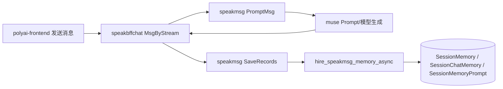

# CHAT-006 对话上下文与记忆

相关接口 YApi：[记忆编辑 855128](https://yapi.yukework.com/project/10756/interface/api/855128)。消息发送接口见 [CHAT-002](../02-发送消息与流式回复/README.md)。

## 功能定义

发送消息时读取当前会话历史、长期记忆及记忆 Prompt，交给 Muse 参与生成；生成后按策略异步更新记忆相关数据。

## 端到端链路

## 关键证据

- speakbffchat `service_msg_stream.go` 构造 Muse 请求时携带 `Memory`、`PermanentMemory`、`ChatSessionID` 等上下文。
- Muse `internal/chat/prompt_gpt.go`、`prompt_sdm.go` 调用 speakmsg `PromptMsg` 获取上下文。
- speakmsg 使用会话消息、记忆模型和 Prompt 相关表；记忆扩展通过 `hire_speakmsg_memory_async` 异步处理。

