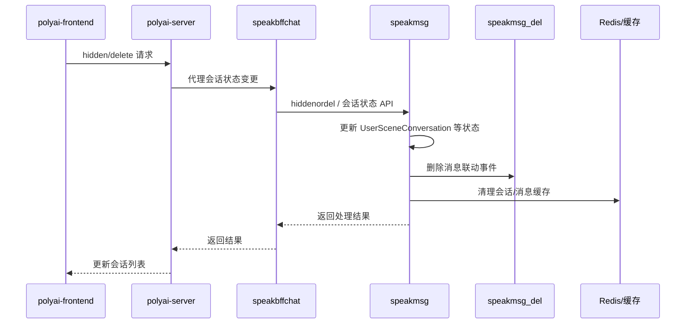

# CHAT-007 删除 / 隐藏会话

主要接口 YApi：[隐藏会话 1316261](https://yapi.yukework.com/project/10756/interface/api/1316261)。

## 功能定义

用户从会话列表或对话页隐藏、删除会话，前端更新列表展示，后端同步更新会话状态，并触发消息或缓存清理。

## 端到端链路

## 已确认代码证据

| 层级 | 位置 | 说明 |
|---|---|---|
| Web API | speakbffchat `controllers/web/conversation/api.go` | 会话隐藏/删除相关路由已注册 |
| 消息服务 | speakmsg `controllers/inner/api.go` | 存在 `hiddenordel` 内部接口 |
| MQ | speakmsg `helpers/rmq.go` | 删除消息流程可投递 `speakmsg_del`，tag 为 `DelUserSceneMsg` |
| 数据 | speakmsg `usersceneconversation` | 会话列表、隐藏/置顶、最近时间等状态所在模块 |

## 当前结论

会话“从列表隐藏”和“物理删除消息”不能简单视为同一个动作：前者主要影响会话索引状态，后者会触发消息删除和缓存清理。当前已确认服务、字段、删除范围和 MQ 入口；BondJourney 专用删除是独立分支。

## 源码级实现

### 前端入口

- 会话抽屉入口：`components/menu-layout/ChatDrawerPanel.vue` 的 `hideChat`。
- 调用 `SMApiConversationHiddennew`，请求 `POST /api/conversation/hiddennew`。
- 隐藏请求传 `IsDeleted: "0"`；删除契约使用 `IsDeleted: "1"`。
- 成功后调用 `chatStore.getChatListFromRemote({ isForce: true })` 刷新列表。

### BFF 到 speakmsg

1. BFF `controllers/web/conversation/service_msg.go:HiddenOrDel` 按 `uid + scene + operation` 加 5 秒 Redis 锁。
2. 普通路径调用 `appconversation.DeleteConversationWithBondJourneyReset`。
3. 常规请求下游 `/speakmsginternal/conversation/hiddenordel`，字段为 `uid`、`sceneId`、`sessionId`、`isDeleted`。
4. 带 BondJourney reset 信息时，进入 `ConversationDeleteWithReset`，先做 Session 写围栏和事件边界校验，再同步执行删除事务。

### speakmsg 状态与删除范围

源码：`controllers/inner/service_del.go:30`。

| 操作 | 会话主表 | 会话扩展 | ChatMsg | HistoryGptMsg | Session/缓存 |
|---|---|---|---|---|---|
| 隐藏 `isDeleted=0` | 更新 `is_hidden=1`，并取消置顶 | 不删除 | 不删除 | 不删除 | 清理未读 Key |
| 删除 `isDeleted=1` | 删除/软删除会话记录 | 删除扩展记录 | 按 UID+Scene 删除并带时间边界 | 通过 `speakmsg_del` 异步删除 | 删除 Session、ChatStore、最近消息缓存、Summary、PromptLimit |

删除操作以当前时间作为 `DelMsgLastCreateTime`，避免删除开始后新产生的消息被误删。

## `speakmsg_del` 消费链路

1. `helpers.DelUserSceneMsg` 投递 Topic `speakmsg_del`、tag `DelUserSceneMsg`，payload 包含 UID、SceneID 和删除时间边界。
2. `router/mq.go:SpeakMsgDelConsumer` 使用 `tag + messageId` Redis 锁防止重复消费。
3. `DelHistoryMsgByMQ` 分批处理语音聊天记录、`DerivedMsg`、`NarrateMsg`、冷备 OSS/数据库记录和 `HistoryGptMsg` 软删除。
4. 主消息 `ChatMsg` 的删除由 `DelAllMsgByUSceneID` 及 Stored/DB 流程处理，不由该 consumer 单独完成。

## 已闭环项

- 前端入口、请求字段和刷新逻辑。
- `is_hidden`、`delete_time` 字段语义。
- `speakmsg_del` 消费端实际处理对象。

