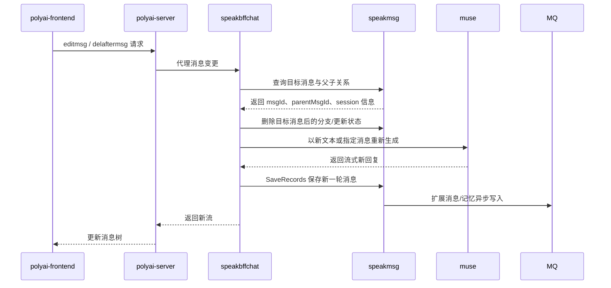

# CHAT-008 编辑消息 / 删除后重算

主要接口 YApi：[编辑消息 883179](https://yapi.yukework.com/project/10756/interface/api/883179)、[删除后续消息 1316266](https://yapi.yukework.com/project/10756/interface/api/1316266)、[删除指定消息 883176](https://yapi.yukework.com/project/10756/interface/api/883176)。

## 功能定义

用户编辑历史消息，或删除某条消息及其后续内容后重新生成对话分支。该链路涉及消息树、父子关系、上下文截断和 Muse 重新生成。

## 端到端链路

## 已确认代码证据

| 层级 | 位置 | 说明 |
|---|---|---|
| 前端 | `components/Chat/Message.vue`、`components/Chat/ReplayEditDialog.vue` | 删除后重算入口与编辑弹窗 |
| Web API | speakbffchat `controllers/web/conversation/api.go` | 注册 `editmsg`、`delaftermsg`、`regeneratemsgbystream` 等路由 |
| BFF | `service_regenerate.go` | 重新生成服务入口，负责消息上下文和生成调用 |
| 消息服务 | speakmsg `controllers/inner/api.go` | 存在 `delaftermsgid`、消息记录和候选消息相关内部接口 |
| Muse | `controllers/http/chat/api.go` | 提供 stream regeneration 接口 |
| 数据 | `models/gptmsg` | 通过 `msg_id`、`parent_msg_id`、`session_id` 形成消息关系 |

## 当前结论

该功能不是简单覆盖原消息：发送与重新生成都会基于消息 ID、父消息 ID 和 Session 形成新的消息分支；候选消息、选择关系和扩展数据通过 `hire_speakmsg_msg_ext_async` 进入最终一致性处理。

## `delaftermsgid` 源码实现

### 前端到 BFF

- 前端入口：`components/Chat/Message.vue:handlerDelete`。
- 删除 AI 消息时取其父消息 ID；删除用户消息时取自身消息 ID。
- 调用 `SMApiConversationDelaftermsg`，请求 `POST /api/conversation/delaftermsg`。
- 成功后清理本地缓存并重新拉取聊天记录。
- BFF `service_msg.go:DelAfterMsgID` 按 `uid + sceneId + msgId` 加锁，再调用 speakmsg `DelAfterMsgId`。

### speakmsg 删除顺序

`controllers/inner/service_del.go:213` → `internal/msg/service.go:1006`：

1. 读取目标消息，允许从已软删消息读取删除边界，保证重试可重复执行。
2. `ParentMsgID=0` 的开场白禁止删除。
3. 读取父消息候选列表返回前端。
4. 调用 `DelUserSceneMsgByID`，从目标消息开始删除当前 Session 后续消息，并返回被删消息列表。
5. 清理 ChatStore 热点消息。
6. 异步软删语音消息、`DerivedMsg` 和 `NarrateMsg`。
7. 更新父消息的 dating `TotalScore` 或 Memory Reel 字段。
8. 清理当前 Session 删除时间之后的 Summary 和永久记忆。
9. 重置 PromptLimit、清理最近消息缓存、更新会话更新时间。
10. 记忆已完成且仍有父消息时，触发一次记忆重生成。

`IncludeChatPK=2` 是特殊分支，只删除指定父消息下的选择消息，不执行整段对话截断。

## 编辑消息实现

前端 `components/Chat/ReplayEditDialog.vue` 调用 `SMApiConversationEditmsg`。BFF `MsgEdit`：

1. 按 `uid + sceneId` 加 5 秒编辑锁。
2. 校验用户、场景、消息和 SelectID。
3. 读取编辑重试限制配置。
4. 调用 speakmsg `MsgEdit`，传入目标 MsgID、当前 SelectID、消息类型和文本。
5. 返回新的 SelectID。

AI 编辑成功后，前端将旧候选全部设置 `isUse=0`，追加新候选并设为 `isUse=1`；用户消息则直接更新本地文本。

## 重生成候选与 `isUse`

- BFF 先调用 `MsgRegenerateCheck` 读取原消息属性、当前 Session、人设和重生成次数。
- Muse 生成成功后申请新的 SelectID，调用 speakmsg `MsgRegenerateAdd`，写入 AI 内容、原 MsgID、Session、模型、聊天风格、审核和 SOV 扩展。
- speakmsg 选择服务按同一 MsgID 先将其他候选 `is_use=0`，再将目标 SelectID 设为 `is_use=1`。
- Stored 异步模式使用 `BuildSelectMsgSwitchUseOp`；双写模式同时更新选择表和 Stored 数组。

## 已闭环项

- 前端删除、编辑入口。
- `delaftermsgid` 删除范围和主要副作用。
- 重生成候选写入和 `isUse` 互斥更新。

