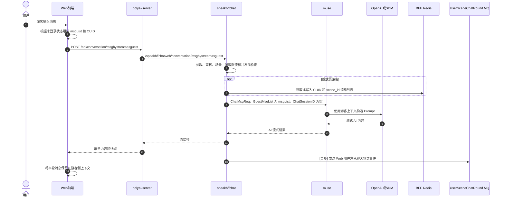

# CHAT-009 游客对话

## 1. 功能概述

- 功能说明：未登录 Web 用户在角色页直接发送消息并获取流式 AI 回复。
- 前端入口：聊天 Store 根据登录态选择游客流式接口。
- 核心差异：游客链路不创建登录用户会话，不走普通 `UserSceneInitSave` 和 `speakmsg.SaveRecords`。
- 分析状态：源码链路已确认。
- 证据等级：L1/L2。
- YApi：[游客流式聊天 872688](https://yapi.yukework.com/project/10756/interface/api/872688)。

## 2. 端到端时序图

## 3. 前端链路

| 层级 | 文件/方法 | 说明 | 证据 |
|---|---|---|---|
| Chat Store | `polyai-frontend/components/Chat/store/state.ts:49` | 未登录时选择 `/api/conversation/msgbystreamasguest` | L1 |
| Chat Store | `polyai-frontend/components/Chat/store/state.ts` | 发送请求、解析流式帧、合并游客消息上下文 | L1 |
| API 契约 | `polyai-frontend/networkapi/yapiApi/index.ts:10919` | 游客流式请求和响应类型 | L1/L2 |

游客请求关键字段：`secretSceneId`、`mediaType`、`speechText`、`msgList`、`localLanguage`、`localTimezone`、`msgFlag`、输入/输出未成年检测字段。

`msgList` 是游客侧携带的上下文消息列表，包含 `msgId`、`parentMsgId`、`content`、`role` 和 `createTime` 等字段。

## 4. polyai-server 和 BFF 链路

| 层级 | 文件/方法 | 说明 | 证据 |
|---|---|---|---|
| polyai-server | `router/http.go:81-83` | 注册游客聊天、游客投放聊天和游客 TTS 路由 | L1 |
| BFF Router | `speakbffchat/controllers/web/conversation/api.go:16` | `POST msgbystreamasguest` | L1 |
| BFF Resource | `controllers/web/conversation/resource.go:41` | 绑定 `ChatAsGuestReq`，设置 Web 和流式模式 | L1 |
| BFF Service | `controllers/web/conversation/service_msg_stream_guest.go:33` | 游客聊天主流程 | L1 |
| BFF Muse 调用 | `service_msg_stream_guest.go:322` | 构造 `muse.ChatMsgReq` 并调用 `MsgByStream` | L1 |

`ChatAsGuest` 的前置处理包括输入检查、纯净模式过滤、场景/Mod 查询、未成年输入输出检查、危险词检测、游客并发锁、真人角色限制、安全模型切换和 Muse 流式调用。

## 5. Muse 上下文链路

游客调用 `callGuestMuseStream` 时确认的关键参数：

| 参数 | 游客行为 |
|---|---|
| `GuestMsgList` | 使用前端传入的 `msgList` 作为游客历史上下文 |
| `ChatSessionID` | 传空，不建立 speakmsg 登录会话上下文 |
| `FindMaster` | 固定为 `false`，不走登录会话开场白查找 |
| `UserInfo.IsFake` | 使用游客虚拟用户身份 |
| `CuIDVc` | 传递游客 CUID、系统和客户端信息 |
| `TripartiteSession.UserCai` | 固定不支持三方会话调度 |

Muse 在 Web 游客场景下不回查服务端消息存储；当没有已有 Prompt 消息时，使用 `GuestMsgList` 补充模型上下文。

## 6. 数据库和 Redis

### 普通游客聊天

普通游客链路没有调用登录用户的 `speakmsg.SaveRecords`，也没有调用 `ConversationInitSave` 创建 `tblConversationSession`、`tblUserSceneConversation` 或 `tblGPTMsg` 的普通会话落库流程。

本轮上下文由前端通过 `msgList` 继续携带，前端负责将返回消息合并到游客上下文。

### 投放页游客聊天

当 `IsDelivery=1` 且 CUID 非空时，BFF 使用 Redis 保存投放页游客消息：

| Redis Key | 操作 | 作用 | 证据 |
|---|---|---|---|
| `RedisKeyWebDeliveryMsg(cuid, sceneID)` | `LLen`、`RPush`、`Expire`、`RPop`、`Del` | 保存游客开场白、用户消息和 AI 消息；失败时回滚 | `service_msg_stream_guest.go:506-578`，L1 |

投放页首轮会先写入角色开场白和用户消息；Muse 成功后写入 AI 消息；首轮失败清空 Redis Key，非首轮失败只弹出本轮用户消息。

## 7. MQ

游客回复成功后，BFF 异步调用 `sendUserSceneChatRoundMq`：

| Topic | Tag | Producer | 触发时机 | 关键字段 | 证据 |
|---|---|---|---|---|---|
| `speakbffchat_userscenechatround` | `gen_web_userscene_chatround` | speakbffchat `ChatAsGuest` | 游客流式回复终帧写出后 | `uid`、`scene_id`、本地日期 | `defines/rmq.go`、`service_msg_stream_guest.go:314-316`，L1 |

该事件用于用户-角色聊天轮次处理，不等价于消息主表落库事件。

## 8. 成功与失败边界

- 前置检查失败：不会调用 Muse。
- 游客并发锁获取失败：直接返回 Redis 锁错误。
- Muse 生成失败：返回错误，不产生正常游客消息持久化结果。
- 未成年输出命中：先发送安全重试控制帧，再使用安全风格重新调用 Muse。
- Muse 成功：向前端返回流式内容和终帧；普通游客上下文由前端继续维护。
- 投放页游客 Redis 写入失败或流失败：按首轮/非首轮策略回滚 Redis 消息列表。
- 游客轮次 MQ：在终帧写出后异步发送，不是主回复成功的同步返回条件。

## 9. 与登录对话的边界

| 对比项 | 登录对话 | 游客对话 |
|---|---|---|
| 流式接口 | `msgbystream` | `msgbystreamasguest` |
| Session | 使用 `session_id` | Muse 请求 `ChatSessionID` 为空 |
| 历史上下文 | speakmsg PromptMsg/Session | 前端 `msgList` / 投放页 Redis |
| 主消息保存 | `speakmsg.SaveRecords` | 普通游客不走该保存流程 |
| DB 会话表 | 参与主链路 | 普通游客不创建登录会话 |
| 轮次 MQ | 登录/游客均可能发送 | `gen_web_userscene_chatround` |

## 10. 源码证据

| 结论 | 仓库 | 文件 | 方法/位置 |
|---|---|---|---|
| 前端根据登录态选择游客 URL | polyai-frontend | `components/Chat/store/state.ts` | URL 选择逻辑 |
| 游客接口契约 | polyai-frontend | `networkapi/yapiApi/index.ts` | `SmApiConversationMsgbystreamasguest*` |
| BFF 游客入口 | speakbffchat | `controllers/web/conversation/api.go` | `RegisterHandlers` |
| 游客主流程 | speakbffchat | `controllers/web/conversation/service_msg_stream_guest.go` | `ChatAsGuest` |
| 游客 Muse 请求 | speakbffchat | `controllers/web/conversation/service_msg_stream_guest.go` | `callGuestMuseStream` |
| Web 游客上下文处理 | muse | `controllers/http/chat/service_zygpt_stream.go` | Web GuestMsgList 分支 |
| 游客消息 Redis 回滚 | speakbffchat | `controllers/web/conversation/service_msg_stream_guest.go` | `persistDeliveryMsg`、回滚方法 |
