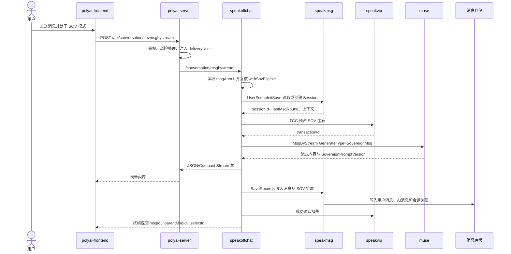

# CHAT-010 SOV 模式发送消息与流式回复

## 1. 功能概述

- 业务说明：Web 在具备 SOV 资格且当前角色支持时，使用 SOV 风格、SOV Prompt 轮次和宝石计费完成一次流式对话。
- 页面入口：角色对话页发送消息；前端根据 `CHAT_SOV_IS_ACTIVE` 选择 SOV 请求路径。
- 功能状态：源码链路已确认
- 证据等级：L1/L2
- 重要边界：SOV 在 Web 层是独立 API 入口，但 `speakbffchat` 复用普通 `MsgByStream` Handler；是否进入 SOV 业务分支由 `msgAttr` 和服务端资格复核共同决定。

## 2. 核心源码流程

1. 前端 `components/Chat/store/state.ts` 的 `sendMsg` 读取 `CHAT_SOV_IS_ACTIVE`。登录用户将 `webSovEligible=serializeWebSovEligibility(userConfigStore.sovEnabled)` 放入请求；SOV 状态下请求 `/api/conversation/sovmsgbystream`，超时使用 45 秒。
2. `polyai-server/conf/mount/proxy_bffchat.yaml` 将 `/conversation/sovmsgbystream` 的下游目标改写为 `/conversation/msgbystream`，但使用 40 秒代理超时；`middleware/session.go` 将该路径纳入 Web 设备风险计算和会话白名单。
3. `speakbffchat/controllers/web/conversation/resource.go` 仍由 `MsgByStream` 绑定请求、设置 Web 流参数并进入 `service_msg_stream.go:MsgByStream`。
4. `MsgByStream` 先完成 CUID/UID、角色、审核、未成年检测、危险词、VIP、日限额、Redis 互斥锁、`UserSceneInitSave` 和 Persona/Session 上下文准备。登录用户的 `req.CuID` 会优先替换为 App CUID，否则使用 UID；但跨请求的浏览器 CUID 仍保存在 `webCUID` 用于降级和游客继承。
5. BFF 根据 `req.MsgAttr` 判断 `isSovMsg`。SOV 消息必须同时满足 `webSovEligible=1`、用户未被 Web 检查账号规则拦截、角色属于可用 SOV 场景；随后调用 `prepareWebSovSend`，读取当前 SOV 风格并覆盖 `req.CurrentChatStyleId`。
6. SOV 不走普通聊天风格轮次扣减，强制开启长上下文；根据 `conversation.LastMsgRound` 和 SOV 风格计算本轮宝石消耗及固定 Prompt 轮次。若未命中降级开关或未成年豁免，则调用 `speakVipCli.OpalConsume` 做 TCC 预占，生成 `transactionId`。
7. `callMuseStream` 构造 `muse.ChatMsgReq`，通过 `applyWebSovMuseParams` 注入 `PromptChatRound`、`GenerateType=SovereignMsg` 和 `SovereignHitSafeMode`，然后仍调用 `s.museCli.MsgByStream`；Muse 返回流式内容后由 BFF 转为 Web JSON/Compact Stream 帧。
8. Muse 成功后，BFF 异步确认宝石扣费；失败则异步取消 TCC 并退还宝石。消息保存仍复用普通 `SaveRecords`，但在消息扩展中写入 `MsgAttr`、`SovereignConsumeOpalAmount`、`SovereignTransactionId` 和 `SovereignPromptVersion`。
9. 保存结果中的 `msgId`、`parentMsgId`、`selectId`、`sessionId` 等元数据随终帧返回前端；前端按普通流式协议增量更新消息内容，但通过 `msgAttr` 保留该消息的 SOV 类型，供后续重新生成选择 SOV 路径。

## 3. 端到端时序图

## 4. 前端链路

| 层级 | 源码 | 关键逻辑 |
|---|---|---|
| 页面状态 | `polyai-frontend/components/Chat/store/state.ts` | `sendMsg` 读取 `CHAT_SOV_IS_ACTIVE` |
| 资格注入 | `polyai-frontend/stores/userConfig.ts` | `sovEnabled` 由 `webSovEligible===1` 决定 |
| 请求分流 | `polyai-frontend/components/Chat/store/state.ts` | `resolveMsgByStreamUrl(..., true)` 返回 `/api/conversation/sovmsgbystream` |
| 请求字段 | 同上 | `webSovEligible`、角色、文本、当前风格、CUID、未成年开关 |
| 流式消费 | 同上 | 复用普通 JSON/Compact Stream 解析；终帧保留 `msgAttr` |
| 重生成关联 | 同上 | 原消息 `msgAttr` 含 `1` 时请求 `/api/conversation/sovregeneratemsgbystream` |

## 5. Web 后端与下游链路

| 层级 | 源码 | 关键逻辑 |
|---|---|---|
| Web 代理 | `polyai-server/conf/mount/proxy_bffchat.yaml` | SOV 路径改写为 BFF 普通 `msgbystream`，超时 40 秒 |
| BFF Handler | `speakbffchat/controllers/web/conversation/resource.go:MsgByStream` | 绑定请求、设置 Web 流能力、调用 Service |
| BFF 主流程 | `speakbffchat/controllers/web/conversation/service_msg_stream.go:MsgByStream` | 普通前置检查、Session 初始化、SOV 分支、Muse、SaveRecords |
| SOV 判定 | `service_msg_stream.go` + `service_sovereign.go` | `msgAttr` 命中 SOV 标记，并复核资格和角色 |
| 资格来源 | `polyai-server/service/sv_user/get_config.go` | `WebSovEligible=1` 的前置开关受 `ShowShopIcon` 和 Web SOV 审核开关约束 |
| 模型调用 | `service_msg_stream.go:callMuseStream` | SOV 参数注入后调用 `museCli.MsgByStream` |
| 消息保存 | `service_msg_stream.go` | 复用 `speakmsg.SaveRecords`，写入 SOV 消费与 Prompt 版本扩展 |

## 6. 关键分支与资金边界

| 条件 | 处理 |
|---|---|
| 资格缺失、用户被拦截或角色不支持 | 返回 `ErrorSovereignModeOnlySupportNormalScene`，不调用 Muse |
| 宝石不足 | `speakVip` 错误映射为 SOV 宝石不足错误，不进入模型调用 |
| SOV 宝石降级开关命中 | 消耗金额置零，仍可按 SOV Prompt/模型链路处理 |
| 英文用户命中未成年 24 小时审核豁免 | 本轮 SOV 宝石消耗置零，仍走审核/GPT 合规链路 |
| Muse 失败 | 若已预占，则异步 TCC cancel 退还宝石；不进入成功确认 |
| Muse 成功 | 异步 TCC confirm；随后完成 `SaveRecords` 和终帧收尾 |
| 安全模式命中 | SOV 保留 `SovereignHitSafeMode`，不直接把聊天风格改成普通 Safe 风格 |

## 7. DB / Redis / MQ

| 资源 | 操作 | 关键字段/用途 |
|---|---|---|
| speakmsg 会话与消息逻辑表 | 读写 | `uid`、`scene_id`、`session_id`、`msg_id`、`parent_msg_id`、`select_id`；消息扩展包含 `msgAttr`、SOV 消费金额、交易号、Prompt 版本 |
| Redis | 读写 | 普通对话复用用户-角色发送锁、日聊天次数、SOV 红点等 Web 状态；SOV 入口红点 Key 为 `sov_red_point:{uid}` |
| speakvip/TCC | 预占、确认、取消 | `uid`、`transactionId`、宝石数量、SOV 业务类型；成功确认或失败回滚 |
| 对话轮次 MQ | 生产 | BFF 在成功收尾后异步发送用户-角色聊天轮次事件；SOV 不回写旧高级模型免费/购买轮次 |

当前 SOV 发送请求未发现独立于普通 `SaveRecords` 的消息 MQ Producer；消息持久化和对话轮次事件仍沿用普通对话收尾流程。

## 8. API 契约

| Method | Path | YApi |
|---|---|---|
| POST | `/api/conversation/sovmsgbystream` | [1948366](https://yapi.yukework.com/project/10756/interface/api/1948366) |
| POST | `/api/conversation/getsceneconfig` | [1845942](https://yapi.yukework.com/project/10756/interface/api/1845942) |
| POST | `/api/conversation/setsceneconfig` | [1845950](https://yapi.yukework.com/project/10756/interface/api/1845950) |
| POST | `/api/conversation/sovpreview` | [1885035](https://yapi.yukework.com/project/10756/interface/api/1885035) |

SOV 重新生成属于 CHAT-003 的模式分支；前端请求路径已确认，但当前生成的 YApi 文件中未检索到对应 `sovregeneratemsgbystream` 契约定义，因此不在本卡片虚填接口 ID。

## 9. 源码证据

| 结论 | 仓库 | 文件 |
|---|---|---|
| 前端 SOV 请求分流 | polyai-frontend | `components/Chat/store/state.ts` |
| SOV API YApi | polyai-frontend | `networkapi/yapiApi/index.ts` |
| 路径改写和超时 | polyai-server | `conf/mount/proxy_bffchat.yaml` |
| SOV 资格注入 | polyai-server | `service/sv_user/get_config.go` |
| BFF SOV 判定、计费和 Muse 参数 | speakbffchat | `controllers/web/conversation/service_msg_stream.go`、`service_sovereign.go` |
| 消息保存扩展 | speakbffchat | `controllers/web/conversation/service_msg_stream.go` |

