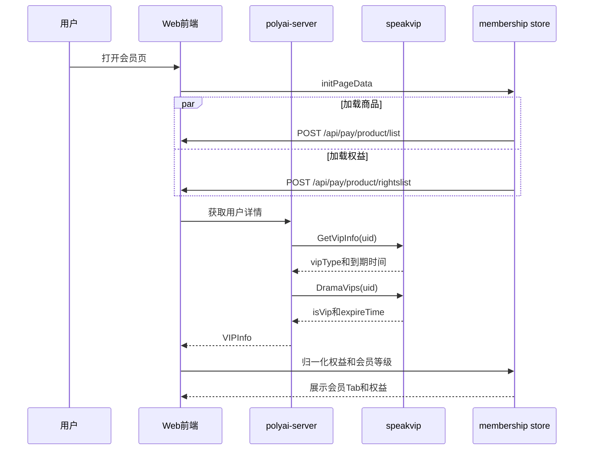

# MEMBER-001 会员状态与权益展示

## 1. 功能概述

- 业务说明：获取当前用户的会员等级、各等级到期时间、漫剧会员状态，并在会员页展示权益。
- 页面入口：`pages/membership/index.vue`；全局用户信息由 `stores/auth.ts` 使用。
- 核心字段：`uid`、`cuid`、`vipType`、`standardVip`、`premiumVip`、`ultimateVip`、`theaterVip`、`expireTime`。
- 功能状态：源码链路已确认；speakvip 内部实现为外部依赖边界。

## 2. 核心源码流程

1. 会员页 `initPageData()` 并行调用 `useMemshipStore().getRightsList()` 和 `getProductList()`；权益请求只携带 `cuid`。
2. 用户详情链路在 `polyai-server/service/sv_user/detail.go:GetUserDetail` 中先获取当前用户，再调用 speakvip `GetVipInfo([uid])`。
3. BFF 将返回的 `vipType` 通过 `ToDisplayVipType(... OsWeb ...)` 转成 Web 展示等级，同时保留各会员到期字段；再调用 `DramaVips([uid])` 写入 `VIPInfo.TheaterVip`。
4. 前端会员 Store 对权益响应执行 `normalizeMembershipRights`，生成 `normalizedRights`、`rightsData` 和弹窗权益 `dialogRights`；页面根据是否存在 Ultimate 权益决定 Tab。

## 3. 时序图

## 4. 前端链路

| 层级 | 文件/函数 | 关键处理 |
|---|---|---|
| 页面 | `pages/membership/index.vue:initPageData` | 并行拉取商品和权益；支付成功后刷新用户、商品、权益 |
| Store | `stores/membership.ts:getRightsList` | 请求 `cuid`，调用 `normalizeMembershipRights` |
| Store | `stores/membership.ts:rightTab` | 有 Ultimate 权益时展示 Ultimate/Premium/Basic；周卡实验过滤 Basic |
| 会员等级 | `stores/membership.ts:MEMBERSHIP_LEVEL` | 0 普通、3 高阶、4 畅听创作、5 Ultimate、99 未知 |
| 商品用户态 | `SmApiPayProductListResponse.user` | `ban`、`standardVip`、`premiumVip`、`ultimateVip`、`isTipAutoRenewFail` 被会员页消费 |

## 5. speakvip 接口用途

| 接口 | 用途 | 关键返回字段 |
|---|---|---|
| `/speakvip/inner/user/vips` | 查询 Web 用户会员状态 | `list[uid].vipType`、`standardVip`、`premiumVip`、`ultimateVip` |
| `/speakvip/inner/user/drama/vips` | 查询漫剧会员 | `uid`、`isVip`、`expireTime` |

## 6. DB/Redis/MQ

- DB：Web 侧未发现该功能直接读写会员表；会员状态由 speakvip 返回。
- Redis：本功能主链路未发现直接读写。
- MQ：未发现会员状态展示依赖的 Web 侧 Topic。

## 7. API 契约

| Method | Path | YApi |
|---|---|---|
| POST | `/api/pay/product/rightslist` | [会员权益列表](https://yapi.yukework.com/project/10756/interface/api/891532) |
| POST | `/api/pay/product/list` | [会员商品列表](https://yapi.yukework.com/project/10756/interface/api/891536) |

## 8. 源码证据

| 结论 | 仓库 | 文件/符号 |
|---|---|---|
| 前端加载商品和权益 | polyai-frontend | `pages/membership/index.vue:initPageData` |
| 权益归一化 | polyai-frontend | `stores/membership.ts:getRightsList` |
| VIP 信息组装 | polyai-server | `service/sv_user/detail.go:GetUserDetail` |
| speakvip 字段契约 | polyai-server | `api/api_speakvip/data.go:VipInfoItem,DramaVipItem` |
