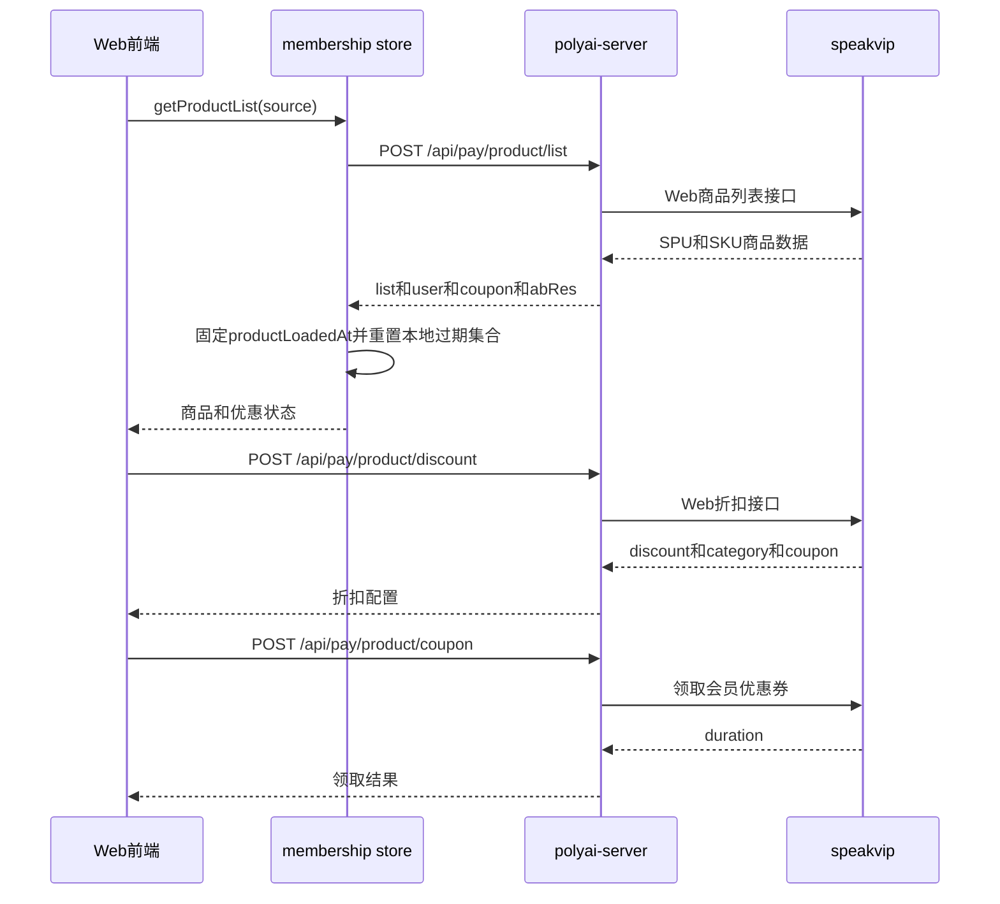

# MEMBER-002 会员商品与优惠配置

## 1. 功能概述

- 业务说明：加载会员 SPU/SKU、价格、币种、订阅状态、实验分组、折扣和优惠券，驱动 PC/H5 会员页及会员弹窗。
- 页面入口：`pages/membership/index.vue`、`components/Chat/Plugins/Membership/`。
- 核心字段：`spuId`、`skuID`、`offerId`、`price`、`originalPrice`、`currencyType`、`durationType`、`subStatus`、`couponExpireSecond`、`abRes`、`category`。
- 功能状态：源码链路已确认。

## 2. 核心源码流程

1. `membership` Store 调用 `/api/pay/product/list`，参数为 `appType`（PC=1/H5=2）和来源 `source`；响应写入 `vipData`。
2. 页面根据 `abRes`、路由 `spuId`、新用户折扣类型和商品列表选择当前 `curSpuId`，再按 `offerType` 排序选择 SKU。
3. `couponExpireSecond` 与 Store 记录的 `productLoadedAt` 转换成绝对过期时间；优惠到期只在前端将展示切回原价，并不自动刷新商品接口。
4. `/api/pay/product/discount` 返回折扣类别、持续时间、会员标签和优惠券配置；前端 `discountStore` 用于导航/会员页优惠展示。
5. 用户领取会员券时调用 `/api/pay/product/coupon`，成功后重新执行 `initPageData()`。

## 3. 时序图

## 4. 前端处理规则

| 返回字段 | 前端处理 |
|---|---|
| `spuId` | 10000 Basic、40000 Premium、50000 Ultimate，并映射展示样式 |
| `skuID` | 作为购买和订阅状态查询的商品主键 |
| `subStatus` | 1 已订阅、2 订阅中、3 恢复订阅、4 重新订阅 |
| `offer[]` | 取 `offerId` 作为订阅请求优惠参数；实验组过期后不再传 `offerId` |
| `abRes` | 归一化为会员周卡实验分组，决定 SPU/Tab/优惠逻辑 |
| `coupon.category` | 0 原价、2 首单、3 续单；用于优惠券类型和文案 |
| `isMarketing` | 标记大促商品展示 |

## 5. speakvip 接口用途与契约

| Web 接口 | 功能 | 关键字段 |
|---|---|---|
| `/web/product/list` | 提供会员 SPU/SKU、当前用户订阅状态、优惠和 AB | `list[].spuId`、`skuList[].skuID`、`subStatus`、`offer`、`user`、`coupon`、`abRes` |
| `/web/product/rightslist` | 提供 Basic/Premium/模块化权益 | `standard`、`premium`、`moduleList` |
| `/api/pay/product/discount` | 提供会员/代币折扣和优惠券配置 | `discount`、`discountDuration`、`category`、`vipCoupon`、`couponAbRes` |
| `/api/pay/product/coupon` | 领取会员优惠券 | 返回 `duration` |

## 6. DB/Redis/MQ

- DB：未发现 Web 侧直接读写商品、优惠券表。
- Redis：未发现前端商品展示链路直接使用 Redis。
- MQ：未发现商品展示链路依赖的 Web 侧 Topic。

## 7. API 契约

| API | YApi |
|---|---|
| `/api/pay/product/list` | [891536](https://yapi.yukework.com/project/10756/interface/api/891536) |
| `/api/pay/product/rightslist` | [891532](https://yapi.yukework.com/project/10756/interface/api/891532) |
| `/api/pay/product/discount` | [895081](https://yapi.yukework.com/project/10756/interface/api/895081) |
| `/api/pay/product/coupon` | [913943](https://yapi.yukework.com/project/10756/interface/api/913943) |

## 8. 源码证据

| 结论 | 仓库 | 文件/符号 |
|---|---|---|
| 商品响应落地与优惠倒计时 | polyai-frontend | `stores/membership.ts:getProductList` |
| SPU/SKU 选择和购买入口 | polyai-frontend | `pages/membership/index.vue:initPageData`、`skuSubcribe` |
| 实验分组与优惠判断 | polyai-frontend | `utils/membershipWeeklyExperiment.ts` |
| 接口字段 | polyai-frontend | `networkapi/yapiApi/index.ts:SmApiPayProductListResponse` |
