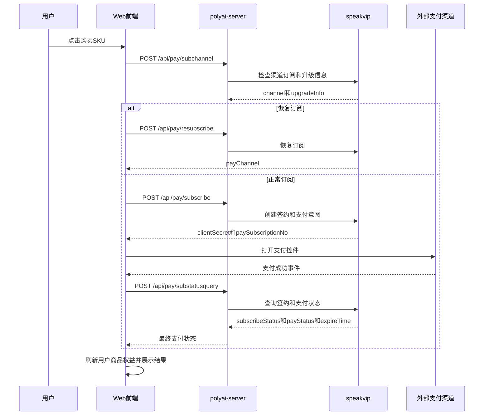

# MEMBER-003 会员订阅支付与订单管理

## 1. 功能概述

- 业务说明：从 SKU 购买意图生成订阅订单，完成支付控件展示、支付结果确认、取消/恢复订阅和订单列表。
- 页面入口：`pages/membership/index.vue`；聊天会员引导通过 `components/Chat/Plugins/Membership/events.ts` 唤起同一收银台。
- 核心字段：`skuID`、`spuID`、`cuid`、`paySubscriptionNo`、`channelOrderNo`、`channelCustomerId`、`clientSecret`、`subscribeStatus`、`payStatus`、`expireTime`、`orderID`。
- 功能状态：源码链路已确认；支付渠道最终扣款和订单落库属于 speakvip/外部支付边界。

## 2. 核心源码流程

1. `skuSubcribe(goods)` 先执行支付拦截检查，再拒绝 `ban` 用户或 `subStatus=2` 的重复订阅。
2. 调用 `/api/pay/subchannel` 检查其他渠道订阅、升级/降级和权益天数；降级或年转月限制直接弹窗终止。
3. `subStatus=3` 时调用 `/api/pay/resubscribe` 恢复订阅；Stripe 渠道跳转 Stripe 管理页，其他渠道提示原权益到期日。
4. 正常购买调用 `/api/pay/subscribe`，将返回的 `channelOrderNo`、`channelCustomerId`、`clientSecret`、`paySubscriptionNo` 等组装为 `payment.data`。
5. `InsertPayment/CashierPayment` 使用 Airwallex Drop-in；支付成功后 `pullMembershipSubscribe` 优先消费推送消息，未收到则轮询 `/api/pay/substatusquery`，最多 4 次、10 秒超时。
6. 只有 `subscribeStatus=1`、`payStatus=1` 且 `expireTime>0` 才算成功；成功后刷新用户信息、商品和权益，并展示成功弹窗。

## 3. 时序图

## 4. API 契约

| API | 功能 | YApi |
|---|---|---|
| `/api/pay/subchannel` | 签约前检查其他渠道订阅及升降级 | [903602](https://yapi.yukework.com/project/10756/interface/api/903602) |
| `/api/pay/subscribe` | 创建 Web 订阅签约/支付意图 | [901703](https://yapi.yukework.com/project/10756/interface/api/901703) |
| `/api/pay/substatusquery` | 查询签约和支付结果 | [901750](https://yapi.yukework.com/project/10756/interface/api/901750) |
| `/api/pay/resubscribe` | 恢复已取消的订阅 | [903565](https://yapi.yukework.com/project/10756/interface/api/903565) |
| `/api/pay/unsubscribe` | 取消订阅 | [901707](https://yapi.yukework.com/project/10756/interface/api/901707) |
| `/api/pay/userorder` | 订单列表 | [891539](https://yapi.yukework.com/project/10756/interface/api/891539) |
| `/api/pay/userrefund` | 单笔订单退款 | [891561](https://yapi.yukework.com/project/10756/interface/api/891561) |

## 5. 前端状态与失败处理

| 状态/字段 | 处理 |
|---|---|
| `subStatus=2` | 提示订阅处理中，不重复下单 |
| `upgradeInfo.upgrade=1` | 展示升级确认，确认后继续购买 |
| `upgradeInfo.upgrade=2` | 降级阻断 |
| `subscribeStatus=2` | 签约失败 |
| `payStatus=2` | 支付失败，按错误码提示余额不足、卡错误或处理中 |
| `expireTime>0` | 与两种状态成功同时满足才刷新会员态 |
| `uniqueKey` | 推送结果本地最多保留 3 个去重键，避免重复处理 |

## 6. speakvip/支付接口用途

`proxy_vip.yaml` 明确将 Web `/api/pay/*` 代理到 speakvip 的 `/web/*` 或对应支付接口；本卡片不展开 speakvip 内部订单表和支付渠道实现。外部支付控件由前端直接初始化，Web 后端只提供支付意图、订阅号和状态查询。

## 7. DB/Redis/MQ

- DB：订单和支付落库未在当前 Web 仓库中直接出现，属于 speakvip 边界。
- Redis：会员购买流程未发现独立业务 Redis；支付结果使用前端本地 `payment_unique_keys` 做推送去重。
- MQ/推送：前端 `ActionType.SubStatus` 可接收支付结果推送；未在当前源码中确认其生产 Topic、消费者和死信机制，因此只记录为前端推送边界。

## 8. 源码证据

| 结论 | 仓库 | 文件/符号 |
|---|---|---|
| 购买、升降级、恢复 | polyai-frontend | `pages/membership/index.vue:skuSubcribe` |
| 支付控件 | polyai-frontend | `components/CashierPayment.vue:initAW` |
| 支付结果推送/轮询 | polyai-frontend | `utils/payment.ts:pullMembershipSubscribe` |
| Web 到 speakvip 的代理映射 | polyai-server | `conf/mount/proxy_vip.yaml` |
