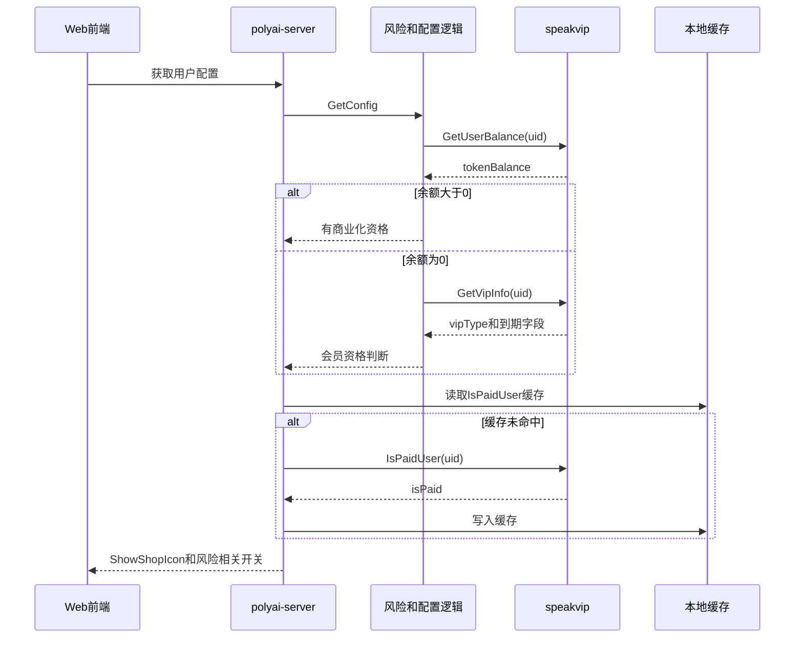

# MEMBER-004 会员资格与商业化拦截

## 1. 功能概述

- 业务说明：把会员类型、会员到期时间、积分余额、漫剧会员和设备风险组合成 Web 侧的商业化资格判断。
- 使用场景：用户配置、年龄验证实验过滤、设备风险豁免、搜推限制、漫剧会员资格和付费解锁。
- 核心字段：`uid`、`cuid`、`vipType`、`standardVip`、`premiumVip`、`ultimateVip`、`tokenBalance`、`isPaid`、`isVip`、`expireTime`、`WebDeviceLevel`。
- 功能状态：源码链路已确认；漫剧/积分消费的最终扣款由 speakvip 提供。

## 2. 核心源码流程

### 2.1 付费资格和年龄验证过滤

`sv_user/get_config.go:GetConfig` 读取当前用户和国家，判断年龄验证开关；当配置 `Filter=1` 时调用 `IsNotVipOrBanlance`。该方法先调用 speakvip `GetUserBalance(uid)`，余额大于 0 直接视为有商业化资格；余额为 0 时再调用 `GetVipInfo`，只要 `standardVip/premiumVip/ultimateVip>0`，或 Web 映射后的会员类型为 Ultimate，就不进入“无会员或无余额”分支。

### 2.2 设备风险豁免

`middleware/current_user.go:GetUserDeviceLevel` 在设备风险为中/高时调用 `GetIsPaidUser`；该方法先读本地缓存 `gcCache:IsPaidUser:{uid}`，未命中调用 speakvip `IsPaidUser`。付费用户返回普通风险，否则保留中/高风险。`GetConfig` 再据此关闭 LivePhoto、ScenePhoto、支付实验或 IM 入口。

### 2.3 漫剧会员资格

`service/sv_theater/common.go:isDramaVip` 调用 `DramaVips([uid])`，读取 `isVip`；`eligible.go`、`psign.go`、`unlock.go` 复用该判断。非会员访问受限资源时，解锁链路继续调用 speakvip 漫剧消费/TCC 接口，返回消费结果和幂等信息。

## 3. 时序图

## 4. speakvip 接口用途

| 接口 | 用途 | 关键字段 |
|---|---|---|
| `/speakvip/inner/iswebpaiduser` | 设备风险处理中判断付费用户 | `data.isPaid` |
| `/speakvip/creditinner/tokenbalance` | 年龄验证过滤和资格判断中的积分余额 | `data.tokenBalance` |
| `/speakvip/inner/user/vips` | 会员到期和会员等级判断 | `standardVip`、`premiumVip`、`ultimateVip`、`vipType` |
| `/speakvip/inner/user/drama/vips` | 漫剧会员资格 | `uid`、`isVip`、`expireTime` |
| `/speakvip/creditinner/drama/consume` | 漫剧付费解锁消费 | `res`、`isRepeat`、`transactionId` |
| `/speakvip/creditinner/tccconfirm` | 漫剧消费 TCC 确认/取消 | `eventType`、`transactionId` |

## 5. DB/Redis/MQ

- DB：当前功能的会员/积分数据不由 Web 侧直接读取。
- Redis：仅确认 `gcCache:IsPaidUser:{uid}`；付费用户为默认缓存时长，非付费用户缓存 60 秒。
- MQ：未确认 speakvip 消费事件在当前可访问源码中的 Topic/Consumer，不扩写为已确认。

## 6. 与前端返回的关系

`GetConfig` 返回 `ShowShopIcon`、`ExpPayFeature`、`PaymentWindow`、`SupportLivePhoto`、`ScenePhoto`、`ShowIMIcon` 等开关；前端按这些开关显示商城、支付入口、图片能力和互动入口。会员状态本身在用户详情返回 `VIPInfo`，前端不重新推导到期逻辑，只消费 BFF 已转换的 Web 展示字段。

## 7. 源码证据

| 结论 | 仓库 | 文件/符号 |
|---|---|---|
| 余额优先、会员兜底的资格判断 | polyai-server | `service/sv_user/get_config.go:IsNotVipOrBanlance` |
| 付费用户缓存和风险豁免 | polyai-server | `middleware/current_user.go:GetIsPaidUser/GetUserDeviceLevel` |
| 配置开关注入前端 | polyai-server | `service/sv_user/get_config.go:GetConfig` |
| 漫剧会员判断 | polyai-server | `service/sv_theater/common.go:isDramaVip` |
| speakvip 请求字段 | polyai-server | `api/api_speakvip/client.go`、`data.go` |
