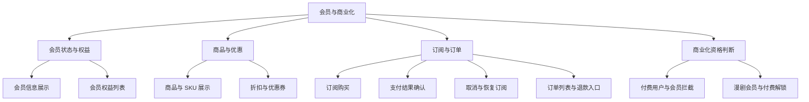
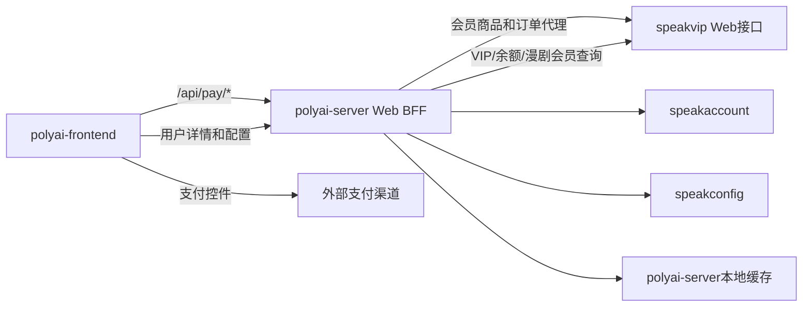

# 06 会员与商业化

## 1. 业务范围

本域覆盖 Web 会员身份、会员商品和权益展示、订阅支付及订单管理，以及会员状态对其他业务的商业化判断。speakvip 作为会员/积分能力提供方，本目录只记录 Web 实际调用的接口、接口返回如何被前端或 polyai-server 使用，不展开 speakvip 内部实现。

## 2. 功能地图

## 3. 功能点

| 功能 ID | 能力目录 | 状态 | 说明 |
|---|---|---|---|
| MEMBER-001 | [会员状态与权益展示](./01-会员状态与权益展示/README.md) | 源码链路已确认 | 用户详情中的 VIP 状态和会员页权益 |
| MEMBER-002 | [会员商品与优惠配置](./02-会员商品与优惠配置/README.md) | 源码链路已确认 | 商品、SPU/SKU、AB、折扣、优惠券 |
| MEMBER-003 | [会员订阅支付与订单管理](./03-会员订阅支付与订单管理/README.md) | 源码链路已确认 | 订阅、支付确认、恢复、订单和退款入口 |
| MEMBER-004 | [会员资格与商业化拦截](./04-会员资格与商业化拦截/README.md) | 源码链路已确认 | 付费用户、积分余额、风险豁免、漫剧权益 |

## 4. 服务依赖图

## 5. 资源边界

- speakvip：会员有效期、会员类型、漫剧会员、积分余额及 Web 支付接口的提供方。
- polyai-server：Web API、鉴权、国家/风险/年龄等组合判断，并通过 `conf/mount/proxy_vip.yaml` 代理支付接口。
- 前端：会员页状态管理、商品选中、支付控件、支付结果轮询/推送、成功/失败反馈。
- 当前功能卡片未发现会员业务 DB 表、Redis Key 或 MQ 由 Web 侧直接写入；`IsPaidUser` 有 polyai-server 本地缓存，详见 MEMBER-004。

## 6. 分析边界

本轮不追踪 speakvip 内部数据库、订单表、支付渠道落库和消费端实现；这些接口在当前 Web 可确认的边界是“polyai-server 代理/调用 speakvip，前端消费返回”。

