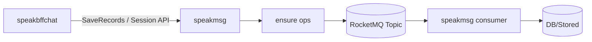

# 对话 MQ 事件目录

## 已定位的异步机制

| 机制 | 服务 | 触发位置 | 作用 | 当前结论 |
|---|---|---|---|---|
| Conversation ensure ops | speakmsg | `helpers/conv_async_ops.go`、`internal/conversationsession/` | 会话数据的异步写入/补偿 | `hire_speakmsg_conv_async` 已确认 |
| MsgExt ensure ops | speakmsg | `helpers/conv_async_ops.go` | 消息扩展字段异步存储 | `hire_speakmsg_msg_ext_async` 已确认 |
| Memory ensure ops | speakmsg | `helpers/conv_async_ops.go` | SessionMemory/SessionChatMemory 异步写入 | `hire_speakmsg_memory_async` 已确认 |

## 事件目录模板

| Topic/Event | Version | Producer | Consumer | 触发时机 | Key | 幂等 | 重试/死信 | 被哪些功能使用 | 证据 |
|---|---|---|---|---|---|---|---|---|---|
| `hire_speakmsg_conv_async` | - | speakmsg | `SpeakMsgConvAsyncConsumer` → storedasync | SaveRecords/Session 写入后 | uid | 按 UID 分片、批量 Ops 顺序处理 | 失败/过载回退 `hire_speakmsg_overload` | CHAT-001/002/004 | L1 |
| `hire_speakmsg_msg_ext_async` | - | speakmsg | `SpeakMsgMsgExtAsyncConsumer` → MsgExtOpsService | 选择消息、灵感、内心独白、派生消息写入 | uid | 按 UID 分片、Ops 操作类型驱动 | 失败/过载回退 `hire_speakmsg_overload` | CHAT-002/003/006 | L1 |
| `hire_speakmsg_memory_async` | - | speakmsg | `SpeakMsgMemoryAsyncConsumer` → memory stored service | SessionMemory 等记忆数据写入 | uid | 按 UID 分片、批量 Ops 顺序处理 | 失败/过载回退 `hire_speakmsg_overload` | CHAT-002/007 | L1 |
| `speakmsg_del` | - | speakmsg | 删除消息消费者 | 隐藏/删除消息联动清理 | messageId + Redis 锁 | consumer 幂等锁已确认 | tag `DelUserSceneMsg` | CHAT-007/008 | L1 |

## MQ 拓扑

> Topic 名称、生产入口、消费者和回退 Topic 均已从 `speakmsg/defines/rmq.go`、`helpers/conv_async_ops.go`、`router/mq.go` 确认。
