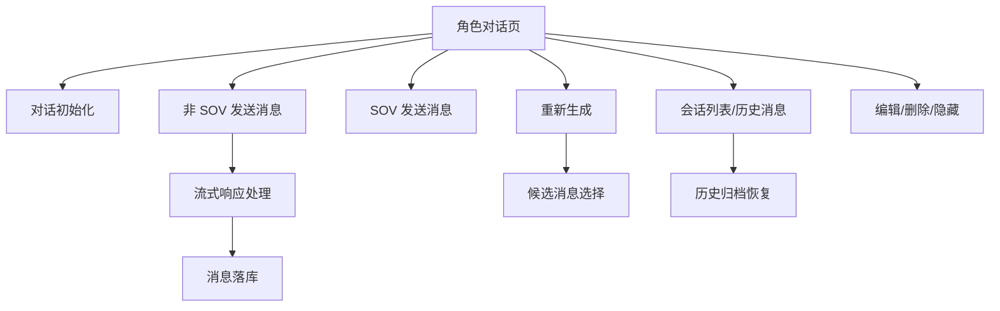

# Web 功能链路总表

> 分析范围：`polyai-frontend`、`polyai-server`、`speakbffchat`、`muse`、`speakmsg`。
> 当前状态：对话核心同步链路、主要 MQ Topic、数据库逻辑对象和关键分支均已完成源码确认。

| 功能 ID | 功能点 | Web 入口/API | YApi | 关键下游 | 数据/事件 | 状态 |
|---|---|---|---|---|---|---|
| CHAT-001 | 对话初始化 | `POST /api/conversation/init` | 854980 | speakbffchat → speakmsg | 会话、开场消息、Redis | 源码已确认 |
| CHAT-002 | 非 SOV 模式发送消息/流式回复 | `POST /api/conversation/msgbystream` | 855221 | speakbffchat → speakmsg + muse | 普通轮次、消息落库、流式帧 | 源码已确认 |
| CHAT-003 | AI 消息重新生成 | `POST /api/conversation/regeneratemsgbystream` | 895820 | speakbffchat → muse + speakmsg | 候选消息、消息选择关系 | 源码已确认 |
| CHAT-004 | 对话列表与历史记录 | `/api/conversation/list`、`/record`、`/history/*` | 872027、854988、904982、904990、905009 | speakbffchat → speakmsg + speakscene | 会话表、消息表、历史归档 | 源码已确认 |
| CHAT-005 | 对话灵感 | `/api/conversation/inspiration` | 895825、1805690 | speakbffchat → muse + speakmsg + Redis | 灵感扩展消息、额度/锁 | 已建立初版 |
| CHAT-006 | 对话上下文与记忆 | 随发送消息进入 | 855128 | speakbffchat → speakmsg PromptMsg → muse → memory MQ | SessionMemory、Prompt 上下文 | 已建立初版 |
| CHAT-007 | 删除/隐藏对话 | `/api/conversation/hiddennew` | 1316261 | speakbffchat → speakmsg → `speakmsg_del` | 会话状态、消息/历史/扩展清理 | 源码已确认 |
| CHAT-008 | 消息编辑/删除后重试 | `/api/conversation/editmsg`、`/delaftermsg` | 883179、1316266、883176 | speakbffchat → speakmsg + Muse | 消息树、候选 `isUse`、记忆重算 | 源码已确认 |
| CHAT-009 | 游客对话 | `POST /api/conversation/msgbystreamasguest` | 872688 | polyai-server → speakbffchat → muse | 前端 `msgList`、游客 Redis、轮次 MQ | 源码已确认 |
| CHAT-010 | SOV 模式发送消息/流式回复 | `POST /api/conversation/sovmsgbystream` | 1948366 | polyai-server → speakbffchat → speakmsg + muse + speakvip | SOV Prompt、宝石 TCC、SOV 消息扩展 | 源码已确认 |

## 功能总览图

## 证据说明

- L1：源码静态分析；本轮主要结论为 L1。
- L2：配置、YApi、路由和服务契约确认。

## 01 用户与身份

| 功能 ID | 功能点 | 入口/API | YApi | 关键下游 | 状态 |
|---|---|---|---|---|---|
| USER-001 | 登录与注册体系 | 注册、登录、恢复、鉴权、登出、注销 | 835296、902340、1611479 | 认证服务、Passport/Krampus、speakaccount | 部分下游边界已确认 |
| USER-002 | 游客与身份体系 | CUID、fake user、虚拟 UID | 873128 | Redis、location、Krampus | 源码已确认 |
| USER-003 | 新用户体系 | 首次登录资料创建和初始化 | 835296 | speakaccount/Krampus、location、speakvip | 源码已确认 |
| USER-004 | 风险等级体系 | 风险获取、映射、注入、业务消费 | 891713、1317889、1322212 | speakrisk、Redis、对话/推荐/直播 | 源码已确认 |
| USER-005 | 年龄验证体系 | 年龄开关、Yoti Session、结果回写 | 1287250、1287255、1315982、1274756 | Redis、Yoti、speakaccount、speakrisk | 源码已确认 |

详情入口：[用户与登录体系](../features/01-用户与身份/README.md)，依赖深度：[用户依赖服务目录](../features/01-用户与身份/用户依赖服务目录.md)。

## 02 发现与搜推

| 功能 ID | 功能点 | 入口/API | YApi | 关键下游 | 数据/事件 | 状态 |
|---|---|---|---|---|---|---|
| SEARCH-001 | 搜索与联想词 | `/api/scene/sug`、`/api/scene/search` | 902381、871713 | speakbffhome → 检索服务、Krampus | Redis 搜索限制 | 源码链路已确认，检索内部为外部边界 |
| SEARCH-002 | 首页与分类角色推荐 | `/api/scene/getRecListBuzzV2`、`/api/scene/getRecListByScene` | 1733381、900306 | speakbffhome → 推荐服务、Krampus | Redis 推荐浏览限制 | 源码链路已确认，推荐内部为外部边界 |
| SEARCH-003 | 相似角色推荐 | `/api/scene/similarSceneList` | 905208 | speakbffhome → 推荐服务、Krampus | 无当前请求专用 DB/MQ | 源码链路已确认，推荐内部为外部边界 |
| SEARCH-004 | 标签与专题导航 | `/api/scene/getTagByParam`、`/getTagById`、`/getSpecialSceneList` | 900285、900899、914393 | polyai-server → Krampus Stored | 专题 Redis 缓存、角色分组 | 源码链路已确认 |
| SEARCH-005 | 角色详情与资料页 | `/api/scene/detailguest`、`/profile`、`/profileguest` | 873348、882719、882875 | polyai-server → speakscene/Krampus + speakcommunity + speakvip | 浏览限制、广告黑名单、关注和 VIP 聚合 | 源码链路已确认 |
| SEARCH-006 | 投放落地页推荐 | `/api/scene/landingPageList` | 1790146 | polyai-server → 角色服务 | 投放配置和角色列表 | 源码链路已确认 |

详情入口：[搜推链路](../features/02-发现与搜推/README.md)。

## 06 会员与商业化

| 功能 ID | 功能点 | 入口/API | YApi | 关键下游 | 数据/事件 | 状态 |
|---|---|---|---|---|---|---|
| MEMBER-001 | 会员状态与权益展示 | `/api/pay/product/list`、`/api/pay/product/rightslist`、用户详情 | 891536、891532 | polyai-server → speakvip | VIP 到期字段、会员权益 | 源码链路已确认 |
| MEMBER-002 | 会员商品与优惠配置 | `/api/pay/product/list`、`/discount`、`/coupon` | 891536、895081、913943 | polyai-server → speakvip | SPU/SKU、offer、折扣、优惠券 | 源码链路已确认 |
| MEMBER-003 | 会员订阅支付与订单管理 | `/subscribe`、`/substatusquery`、`/userorder` | 901703、901750、891539 | polyai-server → speakvip → 外部支付 | 订阅状态、支付状态、订单 | 源码链路已确认 |
| MEMBER-004 | 会员资格与商业化拦截 | 用户配置、漫剧资格、风险判断 | — | polyai-server → speakvip、Redis | `isPaid`、余额、VIP、漫剧会员 | 源码链路已确认 |

详情入口：[会员与商业化](../features/06-会员与商业化/README.md)。
