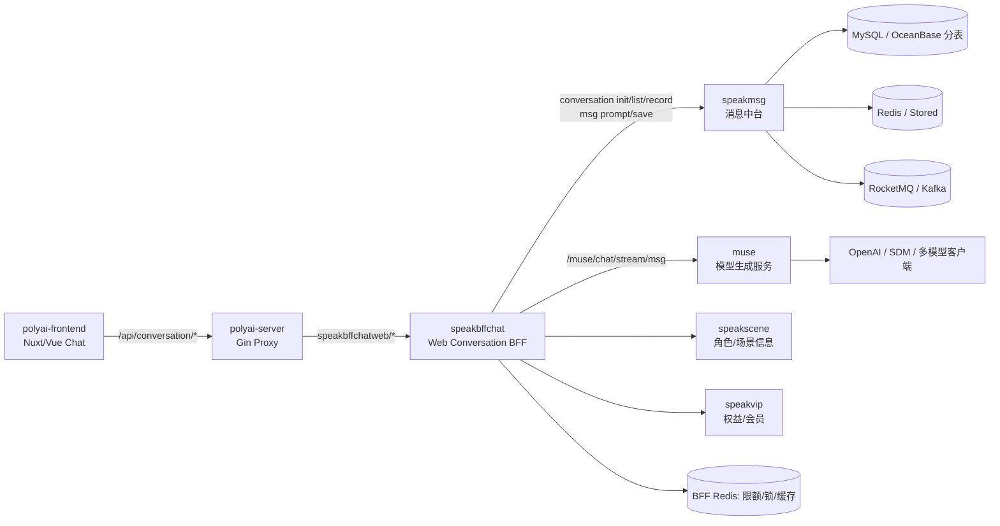

# 对话服务依赖图

## 主链路

## 关键边界

1. `polyai-server` 对普通 Web 流式聊天主要承担代理和路由适配；代理配置位于 `conf/mount/proxy_bffchat.yaml`。
2. `speakbffchat` 是对话编排层，负责鉴权上下文、场景、权益、审核、限额、Muse 请求构造、流式帧处理和消息保存。
3. `muse` 负责 Prompt/上下文构建、模型路由和流式生成，不是 Web API 的直接入口。
4. `speakmsg` 负责会话、消息、历史归档、候选消息及存储一致性。
5. 当前图中 DB、Redis、MQ 的具体实例和部分配置仍需按源码和配置继续核验。
