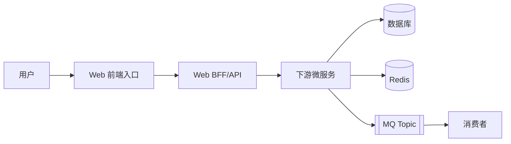
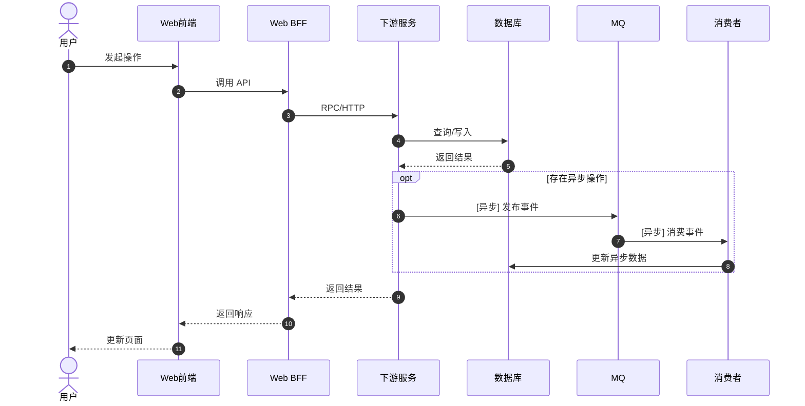
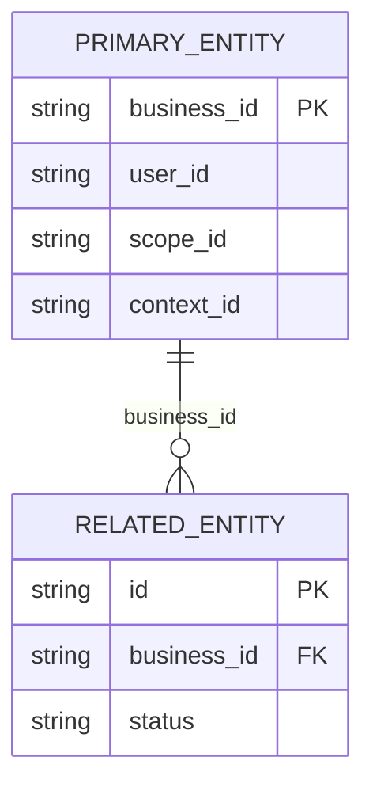
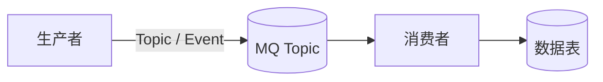

# Web 全栈功能链路文档模板

> 用于创建 `features/{功能大类}/{功能ID}-{中文功能名}/README.md`。功能专属的数据库、缓存和 MQ 汇总文档放在同一个功能大类目录下。

## 1. 元数据

```yaml
功能ID: DOMAIN-001
功能大类: {业务大类}
功能名称: {功能名称}
状态: 已登记
优先级: P0
入口页面:
入口路由:
关联服务:
代码版本:
```

证据等级使用：`L1` 源码、`L2` 配置/接口契约、`KG` 知识图谱定位。

## 2. 功能概述

- 用户动作：
- 功能目标：
- 前置条件：
- 成功结果：
- 失败结果：
- 权限、灰度和开关：

## 3. 链路总览图



## 4. 端到端时序图



时序图必须标明：同步调用、异步事件、主流程成功边界、前端展示成功边界，以及失败/超时/取消分支。

## 5. 前端入口和代码证据

| 页面/路由 | 组件/方法 | Store/Composable | API 方法 | 作用 | 证据 |
|---|---|---|---|---|---|
|  |  |  |  |  | L1 |

## 6. Web BFF 和下游服务

| 层级 | 服务/方法 | 文件和符号 | 调用方式 | 输入/输出 | 证据 |
|---|---|---|---|---|---|
| Web 前端 |  |  | HTTP/SSE/WebSocket |  | L1 |
| BFF |  |  | RPC/HTTP |  | L1 |
| 下游服务 |  |  | DAO/Repository |  | L1 |

## 7. 数据库和缓存

### 7.1 功能专属数据文档

如果本功能属于一个已有功能大类，优先链接该大类的数据文档：

- 业务表与分库分表：`../../database/业务表与分库分表.md`

当前业务大类的数据文档：

- [业务表与分库分表](../../database/业务表与分库分表.md)

### 7.2 当前功能读写明细

| 资源/表/Key | 所属服务 | 读/写 | 条件或 Key 模式 | 关键字段 | 事务/TTL | 证据 |
|---|---|---|---|---|---|---|
|  |  |  |  |  |  | L1 |

### 7.3 关键字段关系图



必须根据具体业务源码替换示例字段，优先补充业务主键、跨表关联键、状态字段、时间边界字段和幂等字段。

## 8. MQ 事件

### 8.1 事件目录

| Topic | Event/Tag | 生产者 | 消费者 | 触发时机 | 关联键 | 幂等/顺序 | 重试/死信 | 证据 |
|---|---|---|---|---|---|---|---|---|
|  |  |  |  |  |  |  |  | L1/L2 |

### 8.2 事件流图



### 8.3 事件字段

| 字段 | 类型 | 必填 | 说明 | 证据 |
|---|---|---|---|---|
|  |  |  |  | L1/L2 |

## 9. 实时通信和异常边界

- 通信方式：HTTP / SSE / WebSocket / 长轮询
- 建连和鉴权：
- 流式消息格式：
- 断线处理：
- 请求取消：
- 前端超时处理：
- 主流程失败边界：
- 异步最终一致性边界：
- 幂等和重复请求处理：

## 10. 接口契约

| API/方法 | Method | YApi/Proto | 请求字段 | 响应字段 | 错误码 | 超时/重试/幂等 | 证据 |
|---|---|---|---|---|---|---|---|
|  |  |  |  |  |  |  | L1/L2 |

YApi 链接统一使用：

```text
https://yapi.yukework.com/project/{projectId}/interface/api/{apiId}
```

## 11. 源码证据和反向索引

### 11.1 源码证据

| 层级 | 仓库 | 文件 | 方法/符号 | 行号 | 结论 | 证据等级 |
|---|---|---|---|---|---|---|
| 前端/BFF/服务/DAO/MQ |  |  |  |  |  | L1/L2/KG |

### 11.2 被哪些功能使用

- 功能 ID：
- 共享服务：
- 共享表：
- 共享 Redis Key：
- 共享 Topic：

## 12. 完成检查

- [ ] 已定位前端真实入口和 API 调用点
- [ ] 已定位 BFF Handler/Service 和下游服务方法
- [ ] 已追踪到核心 DAO/Repository、表字段或缓存 Key
- [ ] 已追踪 MQ 消费者及消费后的数据变化
- [ ] 已补充关键字段关系图
- [ ] 已补充核心功能时序图
- [ ] 已记录同步成功边界与异步边界
- [ ] 关键结论均有源码、配置、接口契约或知识图谱证据
- [ ] 已更新功能总表和资源反向索引
